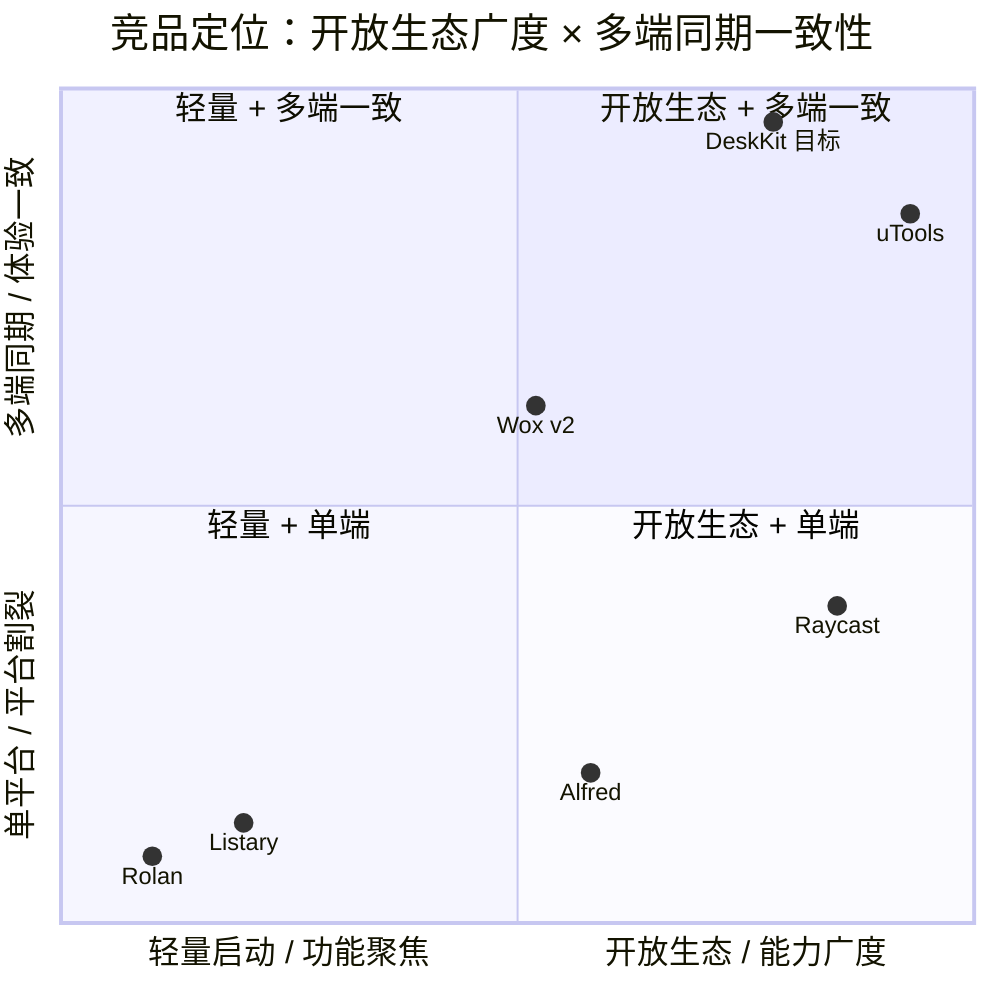
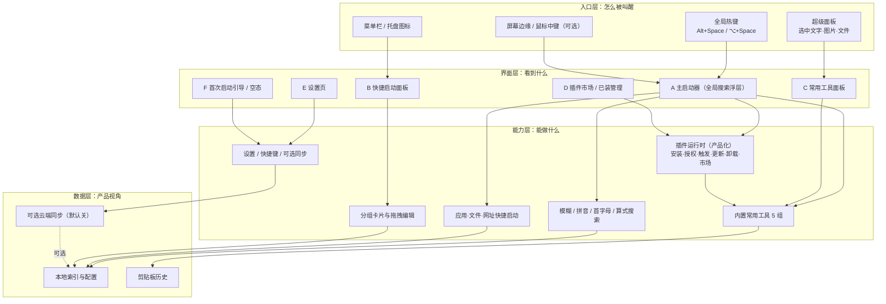
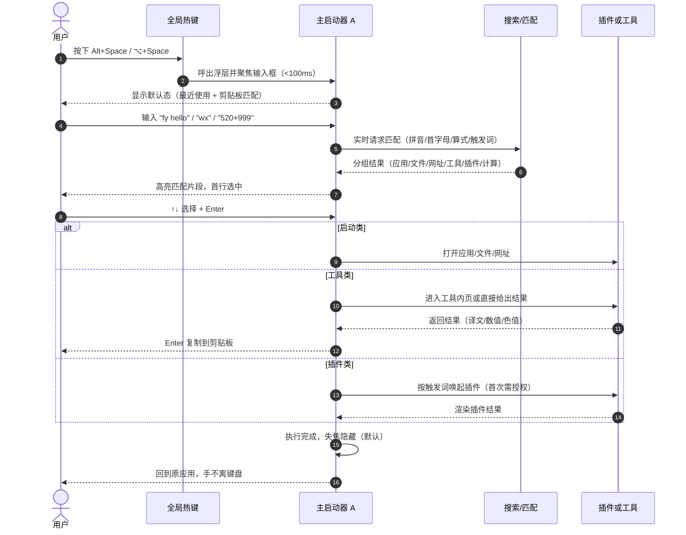
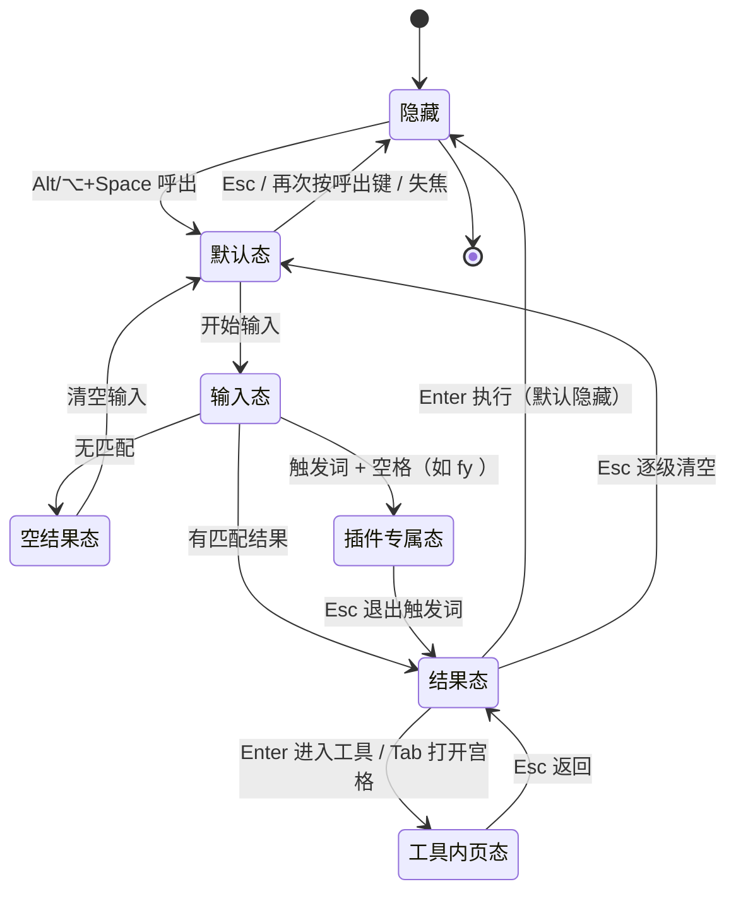
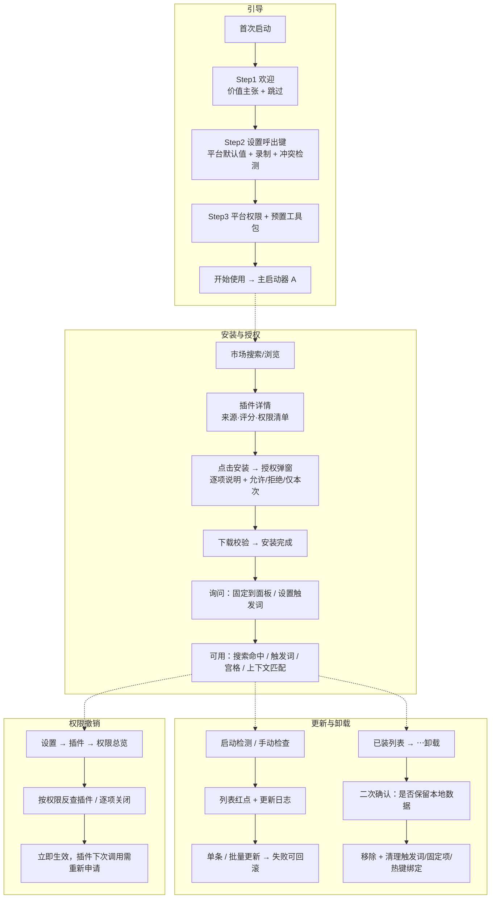

# DeskKit 产品需求文档（完整 PRD）

> **不要把全文当现行需求。** 功能范围以 [`docs/06-Incremental-PRD.md`](06-Incremental-PRD.md) 为准，技术栈以 [`docs/10-Current-Architecture.md`](10-Current-Architecture.md) 为准。
>
> 不要做：插件运行时、插件市场（界面 D）、设置中的插件 Tab、触发词 `ocr`、空态「未安装插件 / 无更新 / 市场断网」。80MB 不是拒发条件。
>
> 仍然有效：第 5.7 节尺寸、第 5.8 节配色、第 6.6 节 13 项平台差异。键盘以第 6.2 节为底，按 06 删掉插件相关项。界面 A/B/C/E/F 的分区按 06 的改写执行。

> 文档版本：v1.0 ｜ 撰写：许清楚（产品经理）｜ 团队：software-deskkit
> 交付对象：架构师（插件运行时 / 双端同期方案）、工程师（可交互 HTML 原型）
> 说明：本文只定义**产品侧需求、UI 与交互**，不定义底层技术实现，不含任何 HTML/CSS/代码。
> 文中 ASCII 图为**结构示意图**（中文按全角双宽渲染），精确尺寸以第 5.7 节规范表为准。

---

## 0. 结论先行（TL;DR）

| # | 结论 |
|---|---|
| 1 | **定位**：一个「全局呼出的办公桌面」，把应用/文件/网址启动、5 组内置常用工具、第三方插件收进同一个搜索框；不对标 uTools 拼插件数量，而是拼「**通用办公开箱即用 + Win/macOS 同期一致**」。 |
| 2 | **价值主张**：一次呼出，办完一件事。 |
| 3 | **差异化机会点**：Rolan 极轻但只有 Windows 且无插件生态；uTools 生态最强（3000+ 插件）但重心在极客/三端通用、办公开箱体验与「同期一致性」不是承诺；Raycast/Alfred 生态强但 macOS 为主。空白 = **面向办公人群、默认即好用的内置工具 + 开放插件运行时 + 双端同期版本/功能/体验三对齐**。 |
| 4 | **三大约束落地**：通用办公 → 6 个具体高频场景写进用户故事与 P0；开放插件运行时 → 第 4.3 节定义插件的产品化表现（形态/边界/安装授权更新卸载/市场/触发），技术实现交给架构师；双端同期 → 第 6.6 节给出产品定义与「必须保留的平台差异白名单」。 |
| 5 | **本次交付重点**：6 个界面（A 主启动器 / B 快捷启动面板 / C 常用工具面板 / D 插件市场与已装管理 / E 设置 / F 引导与空态）的分区、尺寸、状态、配色 token；以及全局呼出、键盘流、触发词、拖拽、插件生命周期的表格 + Mermaid 图。工程师可直接照 5.7 / 5.8 节的数值做原型。 |
| 6 | **给工程师的一句话**：先做 A（4 态）+ C（宫格态）+ 全局呼出键盘流，这三块决定原型像不像；B/D/E/F 作为二级页面可跳转。 |
| 7 | **给架构师的输入**：第 4.3 节（插件运行时的产品化要求）、第 6.6 节（双端差异白名单）、第 7 节（非功能要求），底座实现由架构师定义。 |

---

## 1. 产品定位与项目信息

### 1.1 项目信息

| 项 | 内容 |
|---|---|
| Language | 简体中文（全中文交付） |
| Programming Language | 原型阶段默认 Vite + React + MUI + Tailwind CSS（**仅用于可交互 HTML 原型**；桌面端技术栈由架构师决定，本文不定义） |
| Project Name | `deskkit`（snake_case） |
| 产品代号 / 名称建议 | 主推 **DeskKit**（中文名「随手桌」）；备选 `闪启 SparkDesk`、`一唤 OneCall`。理由：Desk = 桌面场景，Kit = 工具箱 + 可扩展，中英双端易读，与团队/目录名一致 |
| 原始需求复述 | 开发一款桌面工具，融合快捷启动与常用工具，兼容 Windows / macOS，参考 Rolan、uTools，需要产品主要功能、UI 与交互设计，并交付产品原型 UI 和用户交互说明。三大约束：通用办公 / 开放插件运行时 / 双端同期 |

### 1.2 一句话价值主张

> **一次呼出，办完一件事** —— 按一个键，把找应用、找文件、查剪贴板、翻译、算数、截图取色、以及任何第三方工具，收进同一个搜索框；Windows 与 macOS 同一天发布、同一个体验。

### 1.3 产品定义

**Product Goals（3 个正交目标）**

| 目标 | 描述 | 可度量判据 |
|---|---|---|
| G1 更快完成一件事 | 把「找应用/文件 → 处理文本/数值/颜色 → 拿到结果」压缩进一次呼出，减少点击与窗口切换 | 高频办公操作平均 ≤ 3 次按键完成；呼出到可见 < 100ms |
| G2 能力可生长 | 内置工具保底，开放插件运行时让第三方工具用同一套触发 / 权限 / 市场机制「装上即用、用完即走」 | 第三方插件从安装到首次成功执行 ≤ 3 步；插件可独立禁用/卸载/撤权 |
| G3 双端零迁移成本 | Win / mac 同期发布、功能对齐、快捷键与设置语义一致 | 同一版本号同期发布；功能清单对齐率 100%；差异仅限第 6.6 节白名单 |

**边界（明确不做什么，MVP 阶段）**：不做云文档协作、不做 IM/邮件客户端、不做 AI 大模型自研、不做 Linux 端（V2 再评估）、不做系统级窗口管理器（V2 评估）。

### 1.4 三大产品约束的产品定义

| 约束 | 产品定义（本 PRD 的口径） | 落地位置 |
|---|---|---|
| **通用办公** | 面向日常办公人群（非极客优先），核心价值是「少点击、少切换、快速完成一件事」；默认开箱即带常用工具，不要求先装插件才能用 | 1.5 用户故事、4.2 需求池 P0、5.4 界面 C |
| **开放插件运行时** | 第三方可开发并发布插件；PRD 只定义**产品化表现**：插件形态、能力边界、安装/卸载/更新/授权、插件市场、触发方式；底层架构由架构师负责 | 4.3、5.5 界面 D、6.5 生命周期流程 |
| **双端同期** | ① **版本同期**：Win/mac 同一版本号、同一发布日、同一更新日志；② **功能对齐**：P0/P1 功能清单两端 100% 对齐，不允许「某端先行/阉割」；③ **数据体验一致**：快捷键语义、界面分区、文案、设置项、结果呈现、分组/剪贴板数据结构一致（可选云同步时跨端可迁移）。**仅允许**第 6.6 节白名单内的平台原生差异 | 6.6、5.6 界面 E「关于」、7 非功能 |

---

### 1.5 目标用户画像

| 画像 | 特征 | 核心痛点 | 对本产品的期待 |
|---|---|---|---|
| **P1 主力：通用办公族**（运营/行政/产品/财务/HR，25–40 岁） | 每天开 8–15 个应用，频繁在浏览器、文档、表格、IM 间切换；不写脚本，不折腾配置 | 桌面图标一堆找不到、复制的内容被覆盖、翻译/换算要开网页、算个数要找计算器 | 装好就能用，一个键出结果，不学就会 |
| **P2 次主力：双端办公者**（公司 Windows + 家里 Mac / 换机用户） | 两套系统来回切，最怕「这个键在 Mac 上不一样」「那功能 Mac 版没有」 | 快捷键、功能、设置位置两端不一致，重新适应成本高 | 两端功能与体验一致，设置/快捷项能跟着走 |
| **P3 进阶：效率爱好者 / 轻开发者** | 用过 uTools / Raycast / Alfred，愿意装插件、绑定触发词 | 内置工具不够用，想要自定义能力，但嫌配置繁琐 | 开放插件、触发词、可固定到面板、权限看得见 |
| **P4 生态侧：第三方插件开发者**（V1 起） | 想把自己的小工具分发给办公人群 | 缺少统一分发入口与清晰的权限模型 | 明确的插件形态、触发方式、市场与授权流程 |

> 用户偏移动端开发工程师（1–3 年）→ 原型与文档要求「结论先行 + 可照着做」，故本文以表格、尺寸规范、状态清单为主，避免长叙述。

### 1.6 用户故事（标准格式）

| ID | 用户故事 |
|---|---|
| US-1 | As a 通用办公族，I want 按下 `Alt/⌥+Space` 后直接敲应用名/拼音首字母就能打开软件或找到文件，so that 我不用在桌面图标和文件夹里翻找，手不离键盘。 |
| US-2 | As a 经常复制粘贴的人，I want 呼出后直接看到最近的剪贴板历史并一键粘贴，so that 被覆盖的内容不用重新复制一遍。 |
| US-3 | As a 需要临时翻译/算数/换算的人，I want 把文本或算式直接敲进搜索框就得到结果并可复制，so that 不用另开浏览器或计算器，不打断手头工作。 |
| US-4 | As a 需要取色/截图识字的设计与文职用户，I want 通过触发词或超级面板把当前屏幕内容交给对应工具，so that 一次呼出就能拿到色值或文字，减少切换。 |
| US-5 | As a 双端办公者，I want 在公司 Windows 和家里 Mac 上用同一套快捷键、同样的分组与工具、同样的设置位置，so that 换设备零学习成本。 |
| US-6 | As a 效率爱好者，I want 从插件市场装一个工具、给它设触发词并固定到面板，且能随时看到它申请了哪些权限并撤销，so that 能力可扩展又不牺牲掌控感。 |

---

## 2. 竞品分析（已核实）

> 核实方式：WebSearch 3 组关键词（Rolan 功能与平台 / uTools 生态与三端 / Raycast·Alfred·Listary·Wox 平台对比），交叉比对官网与第三方资料。核实日期 2026-11-06。
> 关键事实：**Rolan 仅 Windows**（官网标注「支持系统 Windows」，纯原生、无 WebView/Electron，约 0.5–2.4MB）；**uTools 为 Win/macOS/Linux 三端**，默认 `Alt+Space`（Mac `Option+Space`），官网称 3000+ 插件、500 万+ 用户，三大入口为万能搜索框 / 超级面板 / 悬浮球；**Raycast 为 macOS 原生 + Windows 10+ 公测（邀请制）**、无 Linux 计划；**Alfred 仅 macOS**，高级能力需 Powerpack；**Listary 专精 Windows 资源管理器内搜索**；**Wox 开源、v2 覆盖三端**。

### 2.1 功能维度对比表

| 维度 | **Rolan** | **uTools** | **Raycast** | **Alfred** | **Listary** | **Wox v2** | **DeskKit（目标）** |
|---|---|---|---|---|---|---|---|
| 平台 | **仅 Windows** | Win / macOS / Linux | macOS 原生；Win 公测 | 仅 macOS | 仅 Windows | Win / macOS / Linux | **Win + macOS 同期** |
| 定位 | 轻量快捷启动 + 分组 | 插件化效率平台「一切皆插件」 | 键盘优先的可扩展启动器 + AI | macOS 工作流自动化 | 资源管理器内文件搜索 | 开源 Alfred 式启动器 | 通用办公 + 开放插件 + 双端同期 |
| 全局呼出 | 默认 `Alt+Space`，另支持中键 / 屏幕边缘 / 托盘 | `Alt+Space`（Mac `⌥+Space`） | 可配置热键、`⌘K` 操作面板 | 可配置热键 | Explorer/对话框内直接搜 | 可配置热键 | `Alt+Space` / `⌥+Space`，可改键 + 冲突检测 |
| 模糊 / 拼音搜索 | 弱（`:g`/`:b` 网页搜索） | **强**：中文/拼音/首字母（`wx`→微信） | 强（英文为主） | 中 | 中（文件名优先） | 中 | **强**：中文/拼音/首字母/算式 |
| 应用·文件·网址启动 | ✔ 分组平铺 / 拖拽 / 网址快捷方式 | ✔ | ✔ | ✔ | ✔✔（对话框内） | ✔ | ✔ P0 |
| 分组 / 拖拽编辑 | **✔✔ 核心优势**（分组、拖拽、排序、图标大小） | 弱（固定项为主） | 弱 | 弱 | 弱 | 弱 | **✔✔ 吸收 Rolan** P0 |
| 内置常用工具 | 少（待办/备忘/系统操作/快捷搜索） | **依赖插件**（剪贴板/OCR/翻译/计算器需装） | **丰富开箱**（剪贴板历史、Snippets、窗口管理、计算器、Notes） | 基础计算；剪贴板等需 Powerpack | 少 | 计算器/换算/截图等 | **开箱 5 组工具**（不装插件即可用）P0 |
| 剪贴板历史 | ✘ | ✔（插件，`Ctrl+Shift+V`） | ✔ 内置 | 需 Powerpack | ✘ | ✔ 召回 | ✔ 内置 P0 |
| 超级面板 / 选区上下文 | ✘ | **✔✔ 特色**（长按右键/中键，选中文字图片自动匹配插件） | ✔ Universal Actions | ✔ Universal Actions | ✘ | ✘ | ✔ 上下文匹配（V1 完整，MVP 基础） |
| 触发词 / 命令 | `:g` `:b` | ✔ 插件关键词 + 粘贴即匹配 | ✔ alias / 命令 | ✔ keywords | ✔ 关键词网页搜索 | ✔ 命令前缀 | ✔ 触发词 `fy ` 等 P0 |
| 插件生态规模 | ✘ 无开放生态 | **3000+ 插件**，官方+社区 | 数千扩展（开源 Store） | Workflows / Gallery | 自定义命令 | 插件 + Store | V1 起开放市场，重质量与权限透明 |
| 插件开发门槛 | — | JS / Python / Shell；含 AI 生成插件 | 官方 API + Script Commands | Workflows 可视化 | 自定义动作 | 插件 | 由架构师定义（PRD 只要求「可开发、可上架、可授权」） |
| AI 能力 | ✘ | ✔ AI 插件创作 / AI 助手 | **✔✔ AI Native**（Quick AI / AI Chat） | ✘ | ✘ | ✘ | V2 评估 |
| 云同步 / 账号 | 备忘录云备份 | 登录账号，插件配置云备份（会员） | 本地为主，凭据存 Keychain | 本地 | — | 云同步 | 可选、默认关闭、本地优先 |
| 定价 | 免费版 / 专业版（3 设备·1 年） | 免费（插件上限 10）/ 会员 ¥199 年（不限+云同步） | 个人免费 / Pro 订阅 | 免费 / Powerpack 买断 | 免费+付费 | 免费开源 | **待用户决策**（见第 9 节 Q1） |
| 轻量与性能 | **✔✔ 纯原生、单文件绿色、极小** | 轻量框架 + 即用即走 | 较重（Electron 系） | 轻 | 轻 | 轻 | 目标空闲 ≤ 80MB、< 100ms 呼出 |
| 双端「同期一致」承诺 | ✘ 不适用 | 三端有，但未强调同期对齐 | ✘ Mac 为主 | ✘ | ✘ | 三端有 | **✔ 核心承诺** |

### 2.2 竞品象限图



> 打分口径：X = 能力是否开放可扩展 / 内置丰富度；Y = 多端覆盖与「同期一致性」承诺。分数为产品定位相对值，均匀分布 0–1，非市场份额。

### 2.3 差异化机会点（结论）

| # | 机会点 | 依据 | 我们的做法 |
|---|---|---|---|
| O1 | **办公开箱即用，不靠「先装插件」** | uTools 的剪贴板/翻译/计算都需先装插件（免费版还有 10 个上限）；Rolan 内置工具少 | 5 组常用工具**内置 P0**，装完即用；插件是「加法」不是「前提」 |
| O2 | **吸收 Rolan 的分组 / 拖拽，补上 uTools 的短板** | Rolan 核心优势是分组平铺 + 拖拽编辑；uTools/Raycast 偏搜索与命令，可视化收纳弱 | 快捷启动面板 P0 完整做分组卡片 + 图标网格 + 拖拽编辑/右键菜单 |
| O3 | **把「双端同期一致」做成可验收的产品承诺** | 竞品多为单平台或「有端但不承诺同期」；Raycast Windows 仍公测邀请制、Alfred 仅 Mac | 版本同期 / 功能对齐 / 数据体验一致三定义 + 差异白名单，写进非功能与「关于」页 |
| O4 | **插件权限透明 + 本地优先，降低办公人群顾虑** | 办公人群对剪贴板/文件/网络权限敏感；竞品权限说明多藏在文档 | 安装与首次调用均展示权限清单、可拒绝/撤销，设置内有权限总览；默认仅本机存储 |
| O5 | **交互收敛到一个入口，同时保留上下文匹配** | uTools 三入口（搜索框/超级面板/悬浮球）学习成本不低；Rolan 多呼出方式偏散 | MVP 以「主启动器」为唯一主入口，超级面板作为上下文补充（V1 完整），减少认知负担 |
| O6 | **中文 / 拼音 / 首字母 + 算式同框** | 中文办公用户高频；uTools 已验证，Raycast/Alfred 中文弱 | P0 模糊 + 拼音 + 首字母 + 算式直算，结果按「应用/文件/网址/工具/插件」分组 |

---

## 3. 功能架构总览（产品视角）

> 下图为**功能分解**，不是技术架构；分层只为说明「入口 → 界面 → 能力 → 数据」的产品关系。



---

## 4. 需求池

### 4.1 优先级定义

| 级别 | 含义 | 验收口径 |
|---|---|---|
| **P0** | Must have，MVP 必须交付，双端同期 | 逐条给出可测验收要点，缺一不发布 |
| **P1** | Should have，V1 交付 | 有明确交互与界面，允许 V1 上线 |
| **P2** | Nice to have，V2 或按需 | 仅定义方向 |

### 4.2 需求池表格（编号 / 功能名 / 说明 / 优先级 / 验收要点）

| 编号 | 功能名 | 说明 | 优先级 | 验收要点 |
|---|---|---|---|---|
| DK-P0-01 | 全局呼出 / 隐藏 | 任意应用内一键呼出浮层并聚焦输入框，再次按下或 `Esc` 隐藏；不抢焦点、不弹窗 | **P0** | Win `Alt+Space` / Mac `⌥+Space` 生效；按下到输入框可输入 < 100ms（P95）；呼出时不产生字符副作用（Mac 不插入 NBSP）；注册失败给冲突提示与一键改键 |
| DK-P0-02 | 模糊搜索 + 拼音匹配 | 单一输入框实时匹配：中文、全拼、首字母、英文、算式；匹配片段高亮；结果按类型分组 | **P0** | 输入 `wx`/`weixin`/`微信` 均能命中微信；`kzmb` 命中控制面板类系统项；输入到结果刷新 < 100ms；结果分组标题固定为 应用/文件/网址/常用工具/插件/计算 |
| DK-P0-03 | 应用 / 文件 / 网址快捷启动 | 索引本机应用、常用文件/文件夹、网址快捷方式；回车执行，副操作可打开所在目录 / 复制路径 | **P0** | 命中项回车即打开；网址用默认浏览器打开；结果展示 图标 + 名称 + 副标题(路径/来源)；双端索引来源不同但结果结构一致 |
| DK-P0-04 | 剪贴板历史（内置工具） | 自动记录文本/图片/文件复制记录，支持搜索、收藏、一键粘贴、保留时长与一键清空 | **P0** | 默认开启且可暂停；呼出后默认态可见最近 5 条；`Ctrl/⌘+Shift+V` 直达；支持保留 7/30/永久 与清空；可设置不记录指定应用 |
| DK-P0-05 | 计算器 / 单位换算（内置） | 搜索框直接输入算式即出结果；支持长度/重量/温度/货币(离线汇率)/字节等单位换算 | **P0** | 输入 `520+999-1314` 顶部结果行显示 `205`，`Enter` 复制；`100cny to usd`、`3km to mi` 可解析；结果不写入搜索历史以外的任何地方 |
| DK-P0-06 | 翻译（内置） | 中英互译为主，支持触发词 `fy ` 进入专属模式；可切换引擎（在线时）/ 离线基础词库 | **P0** | 输入 `fy hello` 即出译文；`Enter` 复制译文；离线时明确提示「当前为离线基础翻译」且主流程不报错 |
| DK-P0-07 | 截图取色（内置） | 屏幕取色 + 区域截图；输出 HEX/RGB/HSL，一键复制；截图可送入 OCR / 剪贴板 | **P0** | 触发后进入取色态，鼠标移动实时显示色值；`Enter` 复制 HEX；Mac 未授予屏幕录制权限时给明确引导而非静默失败 |
| DK-P0-08 | 时间戳 / 颜色转换（内置） | 时间戳 ↔ 日期双向、时区显示；HEX / RGB / HSL 互转并给色块预览 | **P0** | `1730000000` 自动识别为时间戳并给出本地时间；输入 `#3B6CF6` 给出 RGB/HSL 与色块；两端时区取系统设置，展示格式一致 |
| DK-P0-09 | 常用工具面板（超级面板） | 工具宫格 3×3，数字键 1–9 直达；工具内页态可展开为独立工作区 | **P0** | 宫格项可由用户增删/排序；数字键直达；工具内页有返回、复制结果、固定到面板；与 A 主启动器结果互通 |
| DK-P0-10 | 插件运行时与插件管理（产品侧） | 插件可安装/启用/禁用/卸载/更新/授权；支持触发词唤起、固定到面板、权限查看与撤销 | **P0** | 完整跑通「市场安装 → 授权 → 触发词唤起 → 执行 → 禁用/卸载」闭环；每个插件独立开关；权限可逐项撤销并立即生效；详见 4.3 |
| DK-P0-11 | 插件市场（本地/Beta） | 浏览、搜索、分类、详情、安装；展示来源标识（官方/社区/本地）、版本、权限清单、评分 | **P0** | MVP 至少可浏览并安装 1 个示例插件；安装前必展示权限清单；无网络时市场明确降级提示，已装插件仍可用 |
| DK-P0-12 | 触发词唤起插件 | 输入 `触发词 + 空格` 进入插件专属模式；触发词可自定义、可冲突检测 | **P0** | `fy ` 翻译、`js ` 计算、`color ` 颜色、`ts ` 时间戳、`clip ` 剪贴板、`ocr ` OCR（示例）；冲突时提示并允许改词；退出专属模式用 `Esc` 逐级回退 |
| DK-P0-13 | 剪贴板 / 选区上下文匹配 | 呼出时若剪贴板有新内容或当前有选区，自动在结果顶部推荐可处理该内容的插件/工具 | **P0** | 复制文本后呼出，顶部出现「剪贴板匹配：翻译 / 剪贴板 / 二维码」；复制图片出现 OCR / 取色；选中文本 + 超级面板弹出匹配工具 |
| DK-P0-14 | 分组与拖拽编辑 | 快捷启动面板按分组平铺图标；新建/重命名/删除分组；面板内拖拽排序、跨分组拖动、从系统拖入添加 | **P0** | 从桌面拖 `.app`/`.exe`/文件夹/网址入面板即自动识别图标与名称；拖拽有占位虚线与目标高亮；删除分组时项目移入「未分组」不丢失；右键菜单 8 项齐全 |
| DK-P0-15 | 双端一致的快捷键与设置 | 同一套设置项、语义与默认值（键名按平台映射）；设置自动保存；可选配置同步 | **P0** | Win/mac 设置页分区与条目一一对应；`Alt`↔`⌥` 文案自动映射；改键后两端配置结构一致；「关于」页展示同一版本号与功能对齐状态 |
| DK-P0-16 | 首次启动引导与空态 | 3 步引导（欢迎 → 设呼出键 → 平台权限与预置工具）；所有列表页有空态文案与主行动 | **P0** | 首次启动必现引导且可跳过；权限页仅展示本平台所需项；6 类空态（面板无项/剪贴板空/无结果/无插件/无更新/断网）均有文案 + 主按钮 |
| DK-P0-17 | 失焦隐藏 / 多屏行为 | 浮层失焦自动隐藏；多屏下跟随鼠标所在屏 / 记住上次屏 / 固定主屏 | **P0** | 失焦 150ms 内隐藏且不影响正在执行的操作；浮层靠近屏幕边缘自动内收 16px，不跨屏裁切；三种多屏策略可切换 |
| DK-P1-01 | 在线插件市场与评价 | 云端市场、分类/榜单/评分/更新日志、搜索与详情 | P1 | 可浏览并一键安装；展示下载量与评分；断网可回退到本地已装列表 |
| DK-P1-02 | 插件更新与批量管理 | 启动检测更新、单条/批量更新、更新日志、失败回滚 | P1 | 有更新时左侧导航显示红点角标；更新失败可回到旧版本且提示 |
| DK-P1-03 | 超级面板完整上下文 | 长按右键 / 中键 / 选中即弹出匹配工具，支持文字、图片、文件三类 | P1 | 三类选区各自匹配正确工具集合；可在设置中关闭 |
| DK-P1-04 | 操作菜单（`Ctrl/⌘+K`） | 对选中结果提供打开、打开所在目录、复制路径、固定到面板、绑定快捷键、卸载等 | P1 | 菜单项随结果类型动态变化；全键盘可操作 |
| DK-P1-05 | 云同步与账号（可选） | 登录后同步设置/分组/触发词/插件清单（剪贴板默认不同步） | P1 | 默认关闭；开启前明确说明同步范围；可一键关闭并清除云端数据 |
| DK-P1-06 | 深色主题 / 强调色 / 密度 | 浅色(默认)/深色/跟随系统；强调色可选；结果密度紧凑/标准 | P1 | 切换即时生效；两套主题对比度达标；不影响尺寸规范 |
| DK-P1-07 | 快捷键别名与全局热键桥 | 为任意应用/网址/插件绑定独立全局热键 | P1 | 绑定不与其他热键冲突；冲突时给出占用者提示 |
| DK-P1-08 | 开发者文档与示例插件 | 插件形态说明、权限清单规范、示例项目、本地调试入口 | P1 | 开发者按文档可完成「创建 → 本地加载 → 上架申请」 |
| DK-P2-01 | AI 能力 / 自然语言生成工具 | 用中文描述需求生成小工具或让 AI 处理选中内容 | P2 | 方向性：需独立评估隐私与定价 |
| DK-P2-02 | 片段 Snippets / 文本展开 | 关键字展开常用文案 | P2 | — |
| DK-P2-03 | 窗口管理 / 多屏布局 | 快捷调整窗口位置与尺寸 | P2 | — |
| DK-P2-04 | 团队配置分发 / 企业版 | 统一分组与插件清单下发 | P2 | 依赖商业模式决策 |
| DK-P2-05 | Linux 端评估 | 是否扩展第三端 | P2 | 依赖 Q5 |
| DK-P2-06 | 插件数据统计与开发者后台 | 安装量、崩溃、评分看板 | P2 | — |

### 4.3 开放插件运行时 —— 产品化表现定义（不是技术设计）

> 以下只描述「用户与开发者能感知到什么」，底层沙箱、进程模型、通信机制由架构师定义。

| 维度 | 产品定义 |
|---|---|
| **插件形态** | ① **搜索结果型**（输入关键词命中后回车执行，如「二维码生成」）；② **触发词专属型**（`fy ` 进入插件独占输入区，如翻译）；③ **工具宫格型**（占用 C 面板一个格子，有独立内页）；④ **上下文型**（声明可处理「文本/图片/文件」，被剪贴板/选区自动匹配）。一个插件可同时声明多种形态 |
| **能力边界（用户可感知）** | 插件可：显示结果、复制到剪贴板、打开网址/文件、读写自己声明范围内的数据。插件**不可**：静默开机自启、后台常驻采集、在未授权时读取剪贴板/文件/网络、修改其他插件或主程序设置、绕过权限弹窗。每次越界调用必须走授权 |
| **权限清单（安装与首次调用可见）** | 固定 6 类，逐项带用途说明与可撤销开关：`剪贴板读取`、`文件与目录访问`、`网络访问`、`系统通知`、`截图/屏幕内容`、`全局快捷键`。权限在安装弹窗与「设置 → 插件 → 权限总览」两处可见 |
| **安装** | 市场详情 → 查看权限 → 点击安装 → 权限授权弹窗 → 下载校验 → 完成 → 询问「是否固定到面板 / 设置触发词」。来源标识：官方认证 / 社区 / 本地开发 |
| **授权** | 首次调用受限能力时弹窗说明「哪个插件、要什么、用来做什么」，选项：允许 / 拒绝 / 仅本次。拒绝不影响插件其他功能。权限随时可撤销并立即生效 |
| **更新** | 启动检测或手动检查；列表标红点 + 更新日志；单条/批量；失败可回滚到上一版本并提示 |
| **卸载** | 已装列表 → 卸载 → 二次确认（是否保留本地数据）→ 移除并清理触发词/固定项/快捷键绑定；不清空用户其他数据 |
| **启用/禁用** | 每个插件独立开关，禁用后不出现在搜索结果与上下文匹配中，但保留配置 |
| **插件市场** | 分类（办公/开发/图像/AI/系统）、搜索、榜单、详情页（图标、简介、截图、版本、来源、评分、安装量、**权限清单**、更新日志）、安装按钮；无网络时降级为「已装插件」本地视图 |
| **触发方式** | ① 搜索命中；② 触发词 + 空格；③ 工具宫格点击 / 数字键；④ 剪贴板/选区上下文自动匹配；⑤（P1）全局热键桥 |
| **失败与边界的产品表现** | 插件崩溃/超时不影响主浮层：显示「该插件暂时不可用」+ 重试/禁用/卸载入口；单个插件不拖慢搜索（结果区独立加载态） |

---

## 5. UI 设计稿（本次重点·工程师照此实现）

### 5.0 全局视觉风格

| 项 | 规范 |
|---|---|
| 主题 | **浅色为默认**（深色 P1）；干净、低饱和、无渐变滥用 |
| 形态 | 浮层 / 卡片；圆角、轻投影、1px 描边；**紧凑密度**（信息密度接近 Raycast/uTools，不做大留白） |
| 层级 | 桌面 → 浮层（A/C，无标题栏、始终置顶）→ 主窗口（B/D/E/F，有标题栏）→ 弹层（授权/右键菜单/冲突提示）→ 气泡提示 |
| 字体层级 | 输入 18/500；窗口标题 16/600；结果主标题 14/500，副标题 12/400；分组标题 12/600 大写间距；角标/快捷键 11/500；宫格标签 12/400；数值结果用等宽字体 14/600 |
| 字体族 | 中文优先 系统默认（苹方 / 微软雅黑）；数值与代码用系统等宽 |
| 强调色 | 蓝色系（见 5.8），仅用于：选中行底色、匹配高亮、主按钮、焦点环、激活态图标 |
| 动效 | 浮层出现 120ms 淡入 + 轻微上移；结果刷新无闪烁；拖拽占位 100ms；不做花哨动画 |
| 一致性 | 两端同一套尺寸、圆角、间距、色值；仅平台原生窗口材质与菜单栏/托盘位置允许差异（见 6.6） |

### 5.1 界面 A：主启动器（全局搜索浮层）—— 4 态

**结构化描述**

| 项 | 规范 |
|---|---|
| 窗口尺寸 | 宽 `720px`；高：默认态 ~`360px`，结果态自适应 `64px 输入行 + 结果区(最多 8 行×48px) + 32px 底栏`，上限 `480px`；空结果态 ~`260px` |
| 位置 | 水平居中；垂直距屏幕顶部约 `22%`（1080p 下 top ≈ 240px）；无标题栏、无边框、始终置顶、圆角 14px + 投影 |
| 分区 | ① 输入行（64px）② 结果区（可滚动）③ 底栏（32px，快捷键提示 + 品牌）④ 右上角工具区（操作菜单 / 设置 / 关闭） |
| 关键元素 | 搜索图标、输入框（含触发词胶囊）、清除按钮、结果分组标题、结果行（图标 32 + 主/副标题 + 右侧序号/操作提示）、选中行强调底、底栏提示 |
| 状态 | A1 默认态 / A2 输入态 / A3 结果态 / A4 空结果态（见下） |

**A3 结果态（主形态）ASCII 布局**

```
┌─ 输入行 64px ────────────────────────────────────────────────┐
│  🔍  [ fy ] hello world                      ⌘K   ⚙    ✕   │  ← 触发词以胶囊呈现
└──────────────────────────────────────────────────────────────┘
┌─ 结果区（自适应，最多 8 行 × 48px） ─────────────────────────┐
│  常用工具 · 触发词 fy                              插件     │  ← 分组标题 28px
│ ▌[译] 聚合翻译      hello world → 你好，世界        ⏎   1  │  ← 选中行：强调底 + 左侧 3px 强调条
│  [板] 剪贴板历史    最近复制：https://…            ⏎   2  │
│  [= ] 计算器        = 205                         ⏎   3  │
│  应用                                                    │
│  [W ] Word          Microsoft Office         C:\…       │
│  文件                                                    │
│  [📄] 周报_v2.docx   文档 · 昨天 16:20                     │
│  网址                                                    │
│  [🌐] 打开 example.com   默认浏览器                      │
└──────────────────────────────────────────────────────────────┘
┌─ 底栏 32px ──────────────────────────────────────────────────┐
│ ↑↓ 选择   ⏎ 执行   Tab 补全   ⌘K 操作   Esc 关闭    DeskKit │
└──────────────────────────────────────────────────────────────┘
```

**四态清单**

| 状态 | 触发 | 内容与元素 | 高度 |
|---|---|---|---|
| **A1 默认态**（刚呼出、无输入） | 按呼出键 / 清空输入 | 输入行占位「搜索应用、文件、工具，或直接输入算式…」；下方「最近使用」6 条（图标+名称+类型角标）；再下「推荐工具」一行 3 个 Chip；若剪贴板有新内容，顶部插入一条**剪贴板匹配卡**（「刚复制了文本 → 翻译 / 剪贴板 / 二维码」）；底栏提示 | ~360px |
| **A2 输入态** | 开始输入、结果尚未聚焦 | 输入行内匹配片段用强调色高亮；输入框右侧出现清除 `✕`；触发词输入后（如 `fy `）变成**胶囊**并与正文分隔；结果实时刷新（输入即出结果，无「搜索中」长等待）；首行结果默认选中但不执行 | 64px + 实时结果 |
| **A3 结果态** | 有匹配结果 | 如上图；按类型分组（应用 / 文件 / 网址 / 常用工具 / 插件 / 计算）；每组最多展示 3–5 条；选中行强调底 + 左侧强调条；右侧显示 `⏎` 与数字序号 1–9；匹配字符高亮；`↑↓` 换选中 | 上限 480px |
| **A4 空结果态** | 无匹配 | 居中空插画（简笔放大镜）+ 「没有找到与 “xxx” 相关的内容」+ 3 个主行动按钮：`在插件市场搜索` / `用浏览器搜索` / `清空重来`；底栏保留 `Esc` 提示；不显示任何结果分组 | ~260px |

**状态切换**：`A1 --输入--> A2 --有匹配--> A3 --清空/删除--> A1`；`A2/A3 --无匹配--> A4`；任一态 `Esc` 逐级回退（触发词胶囊 → 清空输入 → 隐藏）。

---

### 5.2 界面 B：快捷启动面板（分组卡片 / 图标网格 / 编辑拖拽态）

| 项 | 规范 |
|---|---|
| 窗口尺寸 | `960 × 640`（可缩放 880–1120 宽 / 600–720 高），有标题栏，圆角 14px |
| 分区 | ① 顶栏 48px（标题 + 添加 / 编辑 / 更多 + 搜索 + 设置入口）② 左侧分组导航 200px ③ 右侧分组卡片区（可滚动）④ 底栏 36px（拖入提示 / 统计 / 完成按钮） |
| 关键元素 | 分组卡片（标题 + 项数 + `⋯` 菜单 + 折叠）、图标网格单元 80×80（图标 40 + 单行标签，超长省略）、色标（分组左侧 3px 竖条） |

**普通态 ASCII**

```
┌────────────────────────────────────────────────────────────────────┐
│ ●●●  DeskKit 快捷启动        [+ 添加] [✎ 编辑] [⋯]   🔍    ⌘,   │ 顶栏48
├──────────────┬─────────────────────────────────────────────────────┤
│ 分组   200px │  ┌─ 办公 · 8 项 ────────────────────  ⋯   ⊟ ┐   │
│ ▸ 全部  23   │  │  ┌──┐ ┌──┐ ┌──┐ ┌──┐ ┌──┐              │   │
│ ★ 收藏   6   │  │  │W │ │X │ │P │ │C │ │🌐│  ← 图标40   │   │
│ ▪ 办公   8   │  │  └──┘ └──┘ └──┘ └──┘ └──┘  单元80×80  │   │
│ ▪ 开发   5   │  │  Word  Excel  PPT  Chrome  内网              │   │
│ ▪ 设计   4   │  │  ┌──┐ ┌──┐ ┌──┐                           │   │
│ ▪ 系统   6   │  │  │F │ │N │ │▸ │  标签单行截断             │   │
│ ──────────  │  │  └──┘ └──┘ └──┘                           │   │
│ ＋ 新建分组  │  └────────────────────────────────────────────┘   │
│              │  ┌─ 常用网址 · 4 项 ────────────── ⋯   ⊟ ┐   │
│              │  │  …（同上网格，卡片间距 16）             │   │
│              │  └────────────────────────────────────────────┘   │
├──────────────┴─────────────────────────────────────────────────────┤
│ 把应用 / 文件 / 网址拖到这里即可添加        共 23 项 · 已自动保存  │ 底栏36
└────────────────────────────────────────────────────────────────────┘
```

**三态差异**

| 状态 | 视觉变化 |
|---|---|
| **普通态** | 卡片静态，悬停单元出现浅底 + 右下角「打开」角标；单击即启动；分组标题可折叠 |
| **编辑态**（点 `✎ 编辑`） | 图标轻微抖动；每单元左上角出现 `⊖` 删除角标；卡片出现虚线描边；底栏右侧出现高亮「✓ 完成」按钮；顶栏 `+ 添加` 变为「添加应用 / 添加文件 / 添加网址 / 添加系统操作」下拉；分组标题可就地重命名 |
| **拖拽中态** | 被拖单元半透明 + 浮起投影；目标位置显示 **虚线占位框**（80×80）；跨分组拖动时目标分组卡片整块高亮强调色淡底；拖到左侧导航 = 移入该分组；拖出窗口 = 触发「移除」确认；从系统拖入时全面板出现「松手添加到当前分组」遮罩提示 |

**右键菜单（8 项）**：打开 / 打开所在目录 / 重命名 / 更换图标 / 绑定全局快捷键 / 移到分组 ▶（子菜单）/ 从面板移除 / 属性（显示来源路径与添加时间）。

---

### 5.3 界面 C：常用工具面板（超级面板）—— 宫格态 + 工具内页态

| 项 | 规范 |
|---|---|
| 宫格态尺寸 | `420 × 360` 浮层，圆角 14px；标题栏 40px；3×3 宫格，单元 `112 × 96`；底栏 28px |
| 工具内页态尺寸 | 展开为 `720 × 520` 浮层（原位平滑放大），顶栏 48px + 工作区 + 底部操作条 44px |
| 触发 | 呼出后按 `Tab` 进入 / 点击 A 浮层「工具」入口 / 超级面板（选中内容时）/ `Ctrl/⌘+T`（建议） |

**宫格态 ASCII**

```
┌──────────────────────────────────────────┐
│  常用工具                   剪贴板：1 条新 │ 标题40
├──────────────────────────────────────────┤
│  ┌────────┐  ┌────────┐  ┌────────┐    │
│  │  📋   │  │  🎨   │  │  🌐   │    │  3×3
│  │ 剪贴板 │  │截图取色│  │ 翻译   │    │  单元112×96
│  │   1    │  │   2   │  │   3   │    │  图标32 + 标签12
│  └────────┘  └────────┘  └────────┘    │
│  ┌────────┐  ┌────────┐  ┌────────┐    │
│  │  🧮   │  │  🕐   │  │  🔁   │    │
│  │ 计算器 │  │ 时间戳 │  │单位换算│    │
│  │   4    │  │   5   │  │   6   │    │
│  └────────┘  └────────┘  └────────┘    │
│  ┌────────┐  ┌────────┐  ┌────────┐    │
│  │  🎯   │  │  #️⃣   │  │   ＋   │    │
│  │颜色转换│  │ 二维码 │  │ 添加   │    │
│  │   7    │  │   8   │  │   9   │    │
│  └────────┘  └────────┘  └────────┘    │
├──────────────────────────────────────────┤
│  数字键 1–9 直达    ·    Esc 返回         │ 底栏28
└──────────────────────────────────────────┘
```

**工具内页态（通用骨架，以「翻译」为例）**

```
┌──────────────────────────────────────────────────────────────┐
│ ← 返回   🌐 翻译          [有道 ▾]  [自动检测 ▾]   ⚙  📌   │ 顶栏48
├───────────────────────────┬──────────────────────────────────┤
│  输入区                   │  结果区                          │
│  ┌─────────────────────┐  │  ┌──────────────────────────────┐ │
│  │ hello world         │  │  │ 你好，世界                    │ │
│  │                     │  │  │                              │ │
│  │             12/500  │  │  │ 引擎：有道 · 在线              │ │
│  └─────────────────────┘  │  └──────────────────────────────┘ │
│  [清空] [粘贴] [朗读]      │  [复制译文] [复制原文] [朗读]     │
├───────────────────────────┴──────────────────────────────────┤
│ ⏎ 复制结果   ⌘K 操作   📌 固定到面板   Esc 返回      离线提示 │ 底部44
└──────────────────────────────────────────────────────────────┘
```

**各工具内页差异表**

| 工具 | 工作区形态 | 主操作 | 特有状态 |
|---|---|---|---|
| 剪贴板 | 左侧列表（文本/图片/文件 Tab + 搜索），右侧预览 | 双击/回车粘贴；收藏；删除 | 空态「还没有复制记录」；暂停记录条 |
| 截图取色 | 全屏取色蒙层 + 放大镜（含像素网格）+ 色值卡 | `Enter` 复制 HEX；`Tab` 切换 HEX/RGB/HSL | 取色中 / 已复制 / 权限未授予引导 |
| 翻译 | 左输入 / 右结果双栏 | 复制译文、切换引擎、朗读 | 在线 / 离线基础翻译 / 无结果 |
| 计算器·单位换算 | 顶部大号结果（等宽）+ 下方历史行 | `Enter` 复制结果 | 表达式错误提示、单位类别切换 |
| 时间戳·颜色转换 | 三栏对照（时间戳↔日期↔时区 / HEX↔RGB↔HSL + 色块） | 复制任一栏 | 格式非法提示、色块实时预览 |
| 二维码（P1 位，MVP 占位） | 输入文本 → 预览二维码 | 保存图片 / 复制 | — |

---

### 5.4 界面 D：插件市场 / 已装插件管理

| 项 | 规范 |
|---|---|
| 窗口尺寸 | `1000 × 680`，标题栏 + 左侧导航 200px + 右侧内容区 + 底栏 32px |
| 分区 | 左导航（发现插件 / 已装(12) / 更新(2)🔴 / 已固定 / 权限说明 / 开发者中心）；右内容（分类 Chips + 卡片网格 3 列）；底部状态栏 |
| 关键元素 | 插件卡片（图标 48、名称、官方✓/社区标识、评分、简介、安装量、权限小标签、安装/更新按钮）；授权弹窗；权限清单 |

**市场态 ASCII**

```
┌──────────────────────────────────────────────────────────────────────┐
│  DeskKit  插件市场                    🔍 搜索插件            [头像]   │
├───────────────┬──────────────────────────────────────────────────────┤
│ ◉ 发现插件    │  全部 | 办公 | 开发 | 图像 | AI | 系统      ← Chips  │
│ ○ 已装 (12)   │  ┌──────────────┐ ┌──────────────┐ ┌──────────────┐ │
│ ○ 更新 (2) 🔴 │  │ 🌐  聚合翻译 │ │ 👁   OCR 识字 │ │ 🕐  日期助手 │ │
│ ○ 已固定 (4)  │  │ 官方✓ 4.9 ★ │ │ 官方✓ 4.8 ★ │ │ 社区  4.6 ★ │ │
│               │  │ 划词 / 触发词│ │ 截图识字      │ │ 时间戳转换   │ │
│ ───────────   │  │ 12.3 万安装  │ │ 8.1 万安装   │ │ 2.4 万安装  │ │
│ 权限说明  ？   │  │ 剪贴板·网络  │ │ 屏幕·剪贴板  │ │ 无敏感权限  │ │
│ 开发者中心 →   │  │ [  安装  ]   │ │ [  更新  ]   │ │ [  安装  ]  │ │
│               │  └──────────────┘ └──────────────┘ └──────────────┘ │
├───────────────┴──────────────────────────────────────────────────────┤
│ 已装 12  ·  可更新 2  ·  已同步 2 分钟前        （离线时显示降级提示）│
└──────────────────────────────────────────────────────────────────────┘
```

**已装管理视图**：列表行 = 图标 / 名称 + 版本 / 触发词胶囊 / 权限摘要 / 启用开关 / 更新按钮 / `⋯`（详情、权限、卸载）。

**关键弹层**

| 弹层 | 内容 | 按钮 |
|---|---|---|
| 插件详情 | 截图轮播、功能说明、版本与更新日志、来源、评分、**权限清单（逐项带用途）** | 安装 / 取消 |
| 授权弹窗 | 「『聚合翻译』需要：剪贴板读取（读取你复制的文本用于翻译）、网络访问（调用翻译服务）」+ 逐项开关 | 允许并继续 / 拒绝 / 仅本次 |
| 更新 | 更新日志 + 版本对比 | 更新 / 稍后 / 批量更新 |
| 卸载确认 | 「同时保留该插件的本地数据？」勾选 | 卸载 / 取消 |
| 冲突提示 | 触发词或快捷键被占用，列出占用者 | 改一个 / 仍要使用 / 取消 |

---

### 5.5 界面 E：设置页（常规 / 快捷键 / 插件 / 关于与双端信息）

| 项 | 规范 |
|---|---|
| 窗口尺寸 | `1000 × 680`；左侧 Tab 导航 200px；右侧内容区卡片式分组，卡片间距 16，卡片内行高 44 |
| 分区 | 4 个 Tab；设置自动保存（无「确定」按钮，底部仅提示「所有设置自动保存」） |

```
┌──────────────────────────────────────────────────────────────────────┐
│  设置                                                    ─  □  ✕    │
├───────────────┬──────────────────────────────────────────────────────┤
│  ⚙  常规      │  常规                                                │
│  ⌨  快捷键    │  ┌─ 启动与呼出 ────────────────────────────────────┐ │
│  🧩 插件      │  │ 开机自启                              [ 开 ]   │ │
│  ⓘ  关于      │  │ 呼出方式     全局快捷键 ▾（另：菜单栏/边缘）  │ │
│               │  │ 失焦自动隐藏                          [ 开 ]   │ │
│               │  │ 多屏行为     跟随鼠标所在屏 ▾                 │ │
│               │  └────────────────────────────────────────────────┘ │
│               │  ┌─ 外观 ────────────────────────────────────────┐ │
│               │  │ 主题         ◉ 浅色  ○ 深色  ○ 跟随系统        │ │
│               │  │ 强调色       ● ● ● ● ●     浮层透明度 ──●──    │ │
│               │  │ 结果密度     ◉ 紧凑  ○ 标准                    │ │
│               │  └────────────────────────────────────────────────┘ │
│               │  ┌─ 数据与隐私 ──────────────────────────────────┐ │
│               │  │ 本地优先：仅本机存储   [管理数据/导出/清空]   │ │
│               │  │ 可选云同步（需登录）                  [ 关 ]   │ │
│               │  │ 剪贴板保留时长  7天 ▾    [暂停记录] [清空]    │ │
│               │  └────────────────────────────────────────────────┘ │
├───────────────┴──────────────────────────────────────────────────────┤
│  所有设置自动保存  ·  快捷键与设置结构在 Windows / macOS 两端一致     │
└──────────────────────────────────────────────────────────────────────┘
```

**各 Tab 内容清单**

| Tab | 分组与条目 |
|---|---|
| **常规** | 启动与呼出（开机自启 / 呼出方式 / 失焦隐藏 / 多屏行为）、外观（主题 / 强调色 / 透明度 / 密度）、数据与隐私（本地优先 / 管理数据 / 导出 / 清空 / 云同步开关 / 剪贴板保留时长）、语言 |
| **快捷键** | 主呼出键（展示当前平台默认值 + 「录制新快捷键」按钮 + 冲突检测状态）、常用工具面板、剪贴板历史、操作菜单、截图取色、逐条可禁用/恢复默认；底部列出「被系统或其他应用占用」的提示区 |
| **插件** | 已装插件清单入口、权限总览（按权限类型反查哪些插件在用）、安装来源与信任设置、自动更新开关、插件数据目录、本地开发插件加载开关 |
| **关于与双端信息** | 版本号（Win/mac 同一号）、构建日期、更新日志、**双端功能对齐状态 ✅**、当前平台与所需系统权限状态（逐项「已授予 / 未授予 → 去授权」）、数据目录（抽象显示）、开源许可、检查更新、反馈 |

---

### 5.6 界面 F：首次启动引导 / 空态

**引导：`760 × 520` 居中窗口，3 步，底部进度点 + 上一步/下一步/跳过**

| 步骤 | 内容 | 主操作 |
|---|---|---|
| Step 1 欢迎 | 产品图 + 一句话价值主张 + 3 个卖点图标（一个键 / 开箱工具 / 双端一致） | 「开始设置」/「跳过」 |
| Step 2 设呼出键 | 展示本平台默认值（Win `Alt+Space` / Mac `⌥+Space`）+ 大号键帽 +「按下你想要的组合键」录制区 + 实时冲突检测（绿色可用 / 红色「已被 XX 占用，建议改为 ⌥+R」） | 「下一步」/「用默认值」 |
| Step 3 平台权限与预置 | 按平台只列本平台所需权限：macOS = 辅助功能 / 输入监控 / 屏幕录制（截图取色）/ 完全磁盘访问（文件搜索）；Windows = 开机自启 / 文件索引。每项带「为什么需要」+ 状态 +「去授权」。下方选择预置工具包（默认全选 5 组） | 「开始使用」 |

**空态清单（6 类，均 = 图标 + 一句文案 + 一个主行动按钮）**

| 空态 | 文案 | 主行动 |
|---|---|---|
| 快捷启动面板无项 | 「面板还是空的，拖一个应用进来吧」 | `+ 添加应用` / 支持拖入 |
| 剪贴板无记录 | 「还没有复制记录，复制任意内容后这里会出现」 | `去试试` |
| 搜索无结果 | 见 A4 | 见 A4 |
| 未安装插件 | 「还没有安装插件，去市场看看」 | `打开插件市场` |
| 无可用更新 | 「所有插件都是最新版本」 | `检查更新` |
| 市场断网 | 「当前离线，已装插件仍可正常使用」 | `查看已装插件` / `重试` |

---

### 5.7 统一尺寸与间距规范（工程师直接用）

| Token / 项 | 值 | 用途 |
|---|---|---|
| 主启动器浮层宽 | `720px` | A |
| 主启动器输入行高 | `64px` | A |
| 主启动器结果行高 | `48px`（紧凑密度 `40px`） | A |
| 主启动器底栏高 | `32px` | A |
| 主启动器高度上限 | `480px`（结果区最多 8 行） | A |
| 浮层距屏幕顶部 | `22%`（1080p ≈ 240px） | A / C |
| 常用工具宫格浮层 | `420 × 360`；工具内页 `720 × 520` | C |
| 工具宫格单元 | `112 × 96`，3 列；图标 `32px` | C |
| 窗口（面板/市场/设置） | `960 × 640` / `1000 × 680` / `1000 × 680`；引导 `760 × 520` | B / D / E / F |
| 左侧导航宽 | `200px` | B / D / E |
| 顶栏 / 底栏高 | `48px` / `36px`（设置/市场底栏 `32px`） | B / D / E |
| 分组卡片内边距 | `16px`；卡片间距 `16px` | B |
| 快捷项网格单元 | `80 × 80`；应用图标 `40px`（结果行图标 `32px`；插件卡片图标 `48px`） | B / D |
| 图标圆角 | `8px` | 全局 |
| 圆角 | 浮层 `14px`；卡片 `10px`；控件/输入 `8px`；Chip/胶囊 `999px` | 全局 |
| 间距基数 | 4px 栅格：`4 / 8 / 12 / 16 / 24 / 32` | 全局 |
| 浮层内边距 | `16px`；结果行左右内边距 `12px` | A / C |
| 描边 | `1px`（默认色 / 强色两级） | 全局 |
| 投影（浮层） | 两层外阴影：① Y 偏移 `12` / 模糊 `40` / `rgba(28,36,48,0.14)`；② Y 偏移 `2` / 模糊 `8` / `rgba(28,36,48,0.06)` | A / C / 弹层 |
| 选中强调条 | 左侧 `3px` 竖条 + 整行强调淡底 | A |
| 字体层级 | 输入 `18/500`；窗口标题 `16/600`；结果主 `14/500`；副标题 `12/400`；分组标题 `12/600`；角标/快捷键 `11/500`；宫格标签 `12/400`；数值结果 等宽 `14/600` | 全局 |
| 动效时长 | 浮层出现 `120ms`；拖拽占位 `100ms`；结果刷新无动画 | 全局 |
| 边缘安全距离 | 浮层靠近屏幕边缘自动内收 `16px` | A / C |

---

### 5.8 配色 Token（浅色主题·十六进制）

| Token（语义名） | 十六进制 | 用途 |
|---|---|---|
| `bg.float` 浮层底 | `#FFFFFF` | A / C / 弹层 |
| `bg.canvas` 窗口底 | `#F7F8FA` | B / D / E / F |
| `bg.subtle` 卡片底 | `#F2F4F7` | 分组卡片、次级区块 |
| `bg.hover` 悬停 | `#EEF1F6` | 结果行 / 网格单元悬停 |
| `bg.selected` 选中 | `#E8EFFD` | 选中行、激活态 |
| `bg.input` 输入底 | `#FFFFFF` | 输入框、工具内页输入区 |
| `border.default` | `#E5E8ED` | 卡片 / 分割线 |
| `border.strong` | `#D6DBE3` | 输入框描边、强分隔 |
| `text.primary` | `#1C2430` | 标题、结果主文本 |
| `text.secondary` | `#5C6675` | 副标题、说明 |
| `text.tertiary` | `#98A1B0` | 占位符、禁用、快捷键提示 |
| `accent` 强调色 | `#3B6CF6` | 选中条、匹配高亮、主按钮、焦点环、激活图标 |
| `accent.hover` | `#2F5BE0` | 主按钮悬停 |
| `accent.soft` | `#E8EFFD` | 选中行底、Chip 底、目标分组高亮 |
| `on.accent` 反白 | `#FFFFFF` | 主按钮文字、强调底上文字 |
| `success` | `#18A058` | 权限已授予、可用状态、成功提示 |
| `warning` | `#F0A020` | 冲突提示、离线提示、待更新 |
| `danger` | `#E5484D` | 删除/卸载、权限拒绝、错误 |
| `shadow.ink` | `#1C2430`（投影基色，配合 5.7 透明度） | 浮层投影 |
| `chip.group` 分组色标（5 色） | `#3B6CF6` / `#18A058` / `#F0A020` / `#9B6CF6` / `#E5484D` | B 分组左侧竖条 |

> 深色主题（P1）沿用同一语义 Token 换值，不改变布局与尺寸规范。

---

## 6. 用户交互说明（本次重点）

### 6.1 全局呼出 / 隐藏

| 项 | Windows | macOS | 说明 |
|---|---|---|---|
| 默认呼出键 | `Alt + Space` | `Option(⌥) + Space` | 与 Rolan / uTools / PowerToys Run 事实标准一致，用户迁移成本最低 |
| 再次按下 | Toggle 隐藏 | Toggle 隐藏 | 同一键呼出/收起，符合肌肉记忆 |
| 为何不用 `Cmd/Win + Space` | `Win+Space` = 输入法切换 | `⌘+Space` = Spotlight | 系统级占用，不可抢注 |
| 为何选 `Alt/⌥ + Space` | 单手可及、与主流启动器一致、跨应用不产生字符 | 同左 | 是「第三方启动器默认键」的收敛选择 |
| 已知冲突与处理 | `Alt+Space` 传统上会呼出窗口系统菜单（Rolan/uTools/PowerToys Run 均通过抢注解决） | `⌥+Space` 在部分输入框会插入不换行空格（NBSP），需事件拦截；需辅助功能权限才能全局注册 | ① 注册失败 → 浮层提示「快捷键被占用」并列出占用者；② 提供一键改键（备选 `Alt/⌥ + R`、`Ctrl/⌘ + Alt/⌥ + Space`）；③ 录制式改键实时检测冲突；④ 冲突提示不阻塞首次使用，可「仍要使用」；⑤ 验收要求「在任意应用输入框内不产生字符副作用」 |
| 其他呼出入口（可选） | 托盘图标单击 / 鼠标中键 / 屏幕边缘悬停 | 菜单栏图标单击 / 中键 / 屏幕边缘 | 与 Rolan 多呼出方式一致，但主入口仍收敛为一个键 |

### 6.2 搜索 → 结果 → 执行：完整键盘流

| 按键 / 动作 | 行为 | 备注 |
|---|---|---|
| `Alt/⌥ + Space` | 呼出并聚焦输入框；若当前有选区，带入选区上下文 | Toggle |
| 输入任意字符 | 实时模糊匹配（中文 / 全拼 / 首字母 / 英文 / 算式），结果 < 100ms 刷新；首行自动选中不执行 | 匹配字符高亮 |
| `↑` / `↓` | 上下移动选中，到顶/到底停住；跨分组连续移动 | 也支持 `Ctrl/⌘ + N/P` |
| `Enter` | 执行选中项；无选中时执行第一条；执行后按设置隐藏浮层（默认隐藏） | 计算/翻译类 = 复制结果 |
| `Shift + Enter` | 执行「副操作」（打开文件所在目录 / 复制路径 / 以管理员运行，随结果类型变化） | 与 `⌘K` 菜单一致 |
| `Tab` | ① 有触发词联想时补全触发词；② 把选中项标题补进输入框；③ 在 A 与 C 工具面板间切换 | 依上下文优先级 |
| 数字键 `1`–`9` | 直接执行对应序号的结果 / 宫格工具 | 可在设置关闭 |
| `Ctrl/⌘ + K` | 打开选中结果的「操作菜单」：打开、打开所在目录、复制路径、固定到面板、绑定快捷键、卸载… | 借鉴 Raycast Action Panel（P1 完整，MVP 基础） |
| `Ctrl/⌘ + ,` | 打开设置页 | 双端一致 |
| `Ctrl/⌘ + T` | 打开常用工具面板（建议） | 可改键 |
| `Ctrl/⌘ + Shift + V` | 直达剪贴板历史 | 与 uTools 一致 |
| `Esc` | **逐级回退**：工具内页 → 结果 → 触发词胶囊 → 清空输入 → 隐藏浮层 | 每级一次，不直接跳到底 |
| 鼠标悬停 | 高亮但不抢焦点、不改变选中项 | 键盘优先 |
| 鼠标单击 | 执行该项 | — |
| 鼠标右键 | 打开同 `⌘K` 的操作菜单 | — |
| 鼠标拖拽结果项 | 拖到快捷启动面板 = 添加为快捷项；拖到桌面 = 创建快捷方式 | 见 6.4 |

**时序图：搜索 → 结果 → 执行**



**状态图：主启动器**



### 6.3 触发词唤起插件

**显式触发词（MVP 示例，用户可自定义）**

| 触发词 | 进入的插件/工具 | 输入区行为 |
|---|---|---|
| `fy ` | 翻译 | 空格后全部内容作为待译文本，结果区固定为译文卡片 |
| `js ` | 计算器 / 单位换算 | 表达式或 `100cny to usd` 直算 |
| `color ` | 颜色转换 | `#3B6CF6` → RGB/HSL + 色块 |
| `ts ` | 时间戳 | 时间戳 ↔ 日期双向 |
| `clip ` | 剪贴板历史 | 直接列出历史并进入搜索 |
| `ocr ` | OCR（P1 插件） | 进入截图识字流程 |

> 触发词在输入框渲染为**胶囊**（见 A2/A3），与正文视觉分离；冲突时提示占用者并允许改词；`Esc` 先退胶囊再退输入再隐藏（逐级）。

**隐式上下文匹配（P0）**

| 呼出前上下文 | 浮层默认态顶部 | 自动推荐 |
|---|---|---|
| 刚复制了文本 | 「剪贴板匹配：文本 · 3 分钟前」 | 翻译 / 剪贴板 / 二维码 / 搜索 |
| 刚复制了图片 | 「剪贴板匹配：图片 · 1205×903」 | OCR / 截图取色 / 图片压缩 |
| 刚复制了文件 | 「剪贴板匹配：4 个文件」 | 批量重命名 / 打开所在目录 |
| 当前有选中文本 + 超级面板 | 环形/宫格匹配面板 | 翻译 / 搜索 / 复制 / 相关插件 |
| 无新内容 | 不显示匹配卡，只显示最近使用 | — |

### 6.4 拖拽、右键、分组、失焦、多屏

| 交互 | 行为定义 |
|---|---|
| 从系统拖入 | 从桌面/资源管理器/Finder 拖 `.exe`/`.app`/文件夹/网址到 B 面板 → 全面板出现「松手添加到当前分组」遮罩 → 松手自动识别图标与名称 → 落入目标分组；拖到 A 浮层时转为「添加到快捷启动面板」提示 |
| 面板内拖拽排序 | 被拖项半透明浮起 + 80×80 虚线占位框；松手即重排并自动保存 |
| 跨分组拖动 | 目标分组卡片整块 `accent.soft` 高亮；拖到左侧导航某分组 = 移入该分组 |
| 拖出窗口 | 触发「从面板移除」二次确认（不删除源文件） |
| 右键菜单 | 打开 / 打开所在目录 / 重命名 / 更换图标 / 绑定全局快捷键 / 移到分组 ▶ / 从面板移除 / 属性 |
| 分组管理 | 新建（左侧 `＋`）、重命名（编辑态就地改）、色标（5 色）、折叠、排序、删除（**项目移入「未分组」，不随分组删除**） |
| 失焦隐藏 | 浮层失焦 `150ms` 内隐藏；执行操作后默认隐藏；存在模态弹层（授权/引导/冲突）时不隐藏；取色/截图等需保留结果的工具可临时「置顶」阻止隐藏 |
| 多屏 | 设置三选一：跟随鼠标所在屏（默认）/ 记住上次呼出屏 / 固定主屏；浮层不跨屏裁切，靠边自动内收 16px；双端行为一致 |
| 关闭行为 | Win 关闭 = 最小化到托盘；Mac 红绿灯关闭 = 隐藏到菜单栏；两端均「常驻不退出」，真正退出需二次确认 |

### 6.5 首次启动引导 / 插件生命周期流程



**授权弹窗规则**：谁申请（插件名）、要什么（权限项）、用来做什么（用途说明）三要素必填；拒绝不影响插件其他功能；「仅本次」在本次会话结束后失效；所有授权记录可在权限总览查看与撤销。

### 6.6 双端交互差异清单（白名单：仅允许以下差异）

| # | 维度 | Windows | macOS | 产品侧统一策略 |
|---|---|---|---|---|
| 1 | 修饰键名称 | `Alt` / `Ctrl` | `Option ⌥` / `Command ⌘` | 所有 UI 文案与快捷键展示**按平台自动映射**，功能语义一致（如 `Ctrl+K` ↔ `⌘K`） |
| 2 | 默认呼出键 | `Alt + Space` | `⌥ + Space` | 同名不同键、同逻辑；可统一自定义为相同组合；冲突检测两端都有 |
| 3 | 系统快捷键冲突 | `Alt+Space` 与窗口系统菜单；`Win+Space` 输入法 | `⌥+Space` 与 NBSP 输入；`⌘+Space` Spotlight | 抢注 + 冲突提示 + 一键改键 + 「不产生字符副作用」验收 |
| 4 | 常驻入口 | 任务栏通知区域（托盘） | 顶部菜单栏图标 | 菜单结构一致：呼出 / 快捷启动面板 / 工具面板 / 设置 / 退出 |
| 5 | 系统权限 | 开机自启、文件索引 | **辅助功能**（全局热键/事件监听）、**输入监控**、**屏幕录制**（截图取色）、**完全磁盘访问**（文件搜索） | 引导页按平台**只列本平台所需项**，逐项说明用途 + 状态 + 去授权；未授予不静默失败 |
| 6 | 开机自启 | 启动项开关 | 登录项开关 | 同一个「开机自启」开关，语义一致 |
| 7 | 文件与数据路径 | `C:\Users\<用户>\AppData\Roaming\DeskKit` | `~/Library/Application Support/DeskKit` | UI 抽象为「数据目录」按钮（打开/导出/清空），不向普通用户暴露原始路径 |
| 8 | 应用/文件索引来源 | 开始菜单、桌面、注册应用；（可选）Everything 类索引 | `/Applications`、LaunchServices、Spotlight 元数据 | 搜索结果结构一致：图标 + 名称 + 副标题(位置/类型) + 操作 |
| 9 | 全局热键注册 | 系统热键注册 | 需辅助功能权限后监听 | 权限未授予时引导页强提示；注册失败给改键 |
| 10 | 截图 / 取色 | 系统截图接口 | 需「屏幕录制」权限 | 未授权给明确引导页，不显示黑屏/空结果 |
| 11 | 窗口材质 | 亚克力 / 云母（可选） | 毛玻璃 vibrancy | 圆角、投影、密度、配色**完全一致**，仅材质随平台 |
| 12 | 窗口关闭行为 | 关闭 → 最小化到托盘 | 红绿灯关闭 → 隐藏到菜单栏 | 均「常驻不退出」，退出需二次确认 |
| 13 | 更新分发 | 安装包 / 自动更新 | 安装包 / 自动更新 | **同一版本号、同一发布日、同一更新日志** |

> **对齐判据**：除上表 13 项白名单外，任何功能、界面、文案、快捷键语义的双端差异均视为缺陷（QA 验收依据）。

---

## 7. 非功能需求（产品侧可验收）

| 编号 | 项 | 要求 |
|---|---|---|
| NFR-01 | 呼出响应 | 从按下热键到浮层可见且输入框可输入 **< 100ms（P95）**；冷启动后首次 < 300ms |
| NFR-02 | 输入到结果 | 模糊/拼音匹配与结果刷新 **< 100ms**；万级索引下体感无卡顿；结果区独立加载态，插件慢不拖垮主浮层 |
| NFR-03 | 常驻资源 | 空闲常驻内存目标 **≤ 80MB**；不抢焦点、不弹广告、无无关后台活动；即用即走 |
| NFR-04 | 离线可用 | 启动、搜索、分组、5 组内置工具、已装插件**完全离线可用**；仅插件市场、云同步、在线翻译依赖网络；断网有明确降级提示且不影响主流程 |
| NFR-05 | 本地优先与隐私 | 默认所有数据仅存本机；剪贴板历史/搜索记录可设保留时长、暂停记录、一键清空、排除指定应用；不上传明文；云同步为**可选、默认关闭**，开启前明确同步范围 |
| NFR-06 | 插件沙箱与权限（产品侧要求） | 插件必须声明权限清单；安装与首次调用可见、可拒绝、可撤销且立即生效；插件不得静默自启或后台采集；每个插件可独立启用/禁用/卸载；权限总览可反查「谁在用什么」；来源标识（官方/社区/本地）；崩溃隔离，主浮层不崩 |
| NFR-07 | 双端一致性 | 同版本号同期发布；P0/P1 功能清单两端对齐率 100%；差异仅限第 6.6 节白名单；「关于」页展示对齐状态 |
| NFR-08 | 交互一致性 | 全键盘可完成所有主流程；焦点环清晰；字号可缩放；文字对比度达标；动效 ≤ 120ms |
| NFR-09 | 稳定性 | 单个插件超时/崩溃有「暂时不可用 + 重试/禁用/卸载」出口；设置与分组每次变更自动保存，异常退出不丢数据 |
| NFR-10 | 升级兼容 | 版本升级保留分组、快捷项、触发词、设置与剪贴板（按保留策略）；不因升级要求重新走引导 |

---

## 8. 版本规划

| 版本 | 目标 | 交付内容 | 双端 |
|---|---|---|---|
| **MVP v0.9** | 验证「一个键办完一件事」 | **全部 P0**：全局呼出/隐藏、模糊+拼音+算式搜索、应用/文件/网址启动、分组与拖拽编辑、5 组内置工具（剪贴板历史、计算器与单位换算、翻译、截图取色、时间戳与颜色转换）、常用工具面板（宫格 + 内页）、插件运行时最小闭环（安装/授权/触发词/启用禁用/卸载 + 本地 Beta 市场 + 1 个示例插件）、剪贴板/选区上下文匹配、设置页 4 Tab、首次引导与 6 类空态、失焦与多屏 | **Win + macOS 同期发布，功能 100% 对齐** |
| **V1 v1.0** | 开放生态成型 | 在线插件市场（分类/榜单/评分/更新日志）、插件更新与批量管理、超级面板完整上下文（文字/图片/文件）、`Ctrl/⌘+K` 操作菜单、可选云同步与账号、深色主题/强调色/密度、快捷键别名与热键桥、开发者文档与示例插件 | 同期 |
| **V2** | 生态与智能化 | AI 能力 / 自然语言生成工具、Snippets 文本展开、窗口管理、团队配置分发（企业版）、插件数据与开发者后台、Linux 端评估 | 视 Q5 / Q1 决策 |

---

## 9. 待确认问题（需用户决策）

| # | 问题 | 影响范围 | 建议默认值 |
|---|---|---|---|
| Q1 | 商业模式：完全免费 / 免费+会员（云同步与插件数上限，参考 uTools ¥199/年）/ 一次性买断（参考 Rolan、Alfred Powerpack）？ | 市场页、设置页、账号体系、V1 范围 | MVP 完全免费且不设插件数上限；V1 再评估会员 |
| Q2 | 是否提供云同步与账号？若提供，剪贴板历史等敏感数据是否允许上云、是否端到端加密？ | 设置-数据、NFR-05、V1 | 默认关闭；即使开启也默认**不同步剪贴板内容** |
| Q3 | 第三方插件允许申请哪些权限？是否设「官方审核 + 社区」双层与权限分级（如禁止系统命令类）？ | 4.3 能力边界、市场审核流程、架构师沙箱设计 | 开放 6 类权限，敏感组合（网络+剪贴板）需官方审核 |
| Q4 | 出厂默认呼出键是否坚持 `Alt/⌥+Space`（Win 与窗口系统菜单、Mac 与 NBSP 存在潜在冲突），还是改用无冲突的 `Alt/⌥+R`？ | 引导 Step2、设置-快捷键、NFR | 坚持 `Alt/⌥+Space`（对标主流），但强制做冲突检测与一键改键 |
| Q5 | 是否需要 Linux 端？用户明确 Win/mac 双端，但 uTools / Wox v2 已三端、Raycast 明确无 Linux 计划 | 版本规划、架构选型 | MVP/V1 只做 Win+mac；V2 再评估 |
| Q6 | 内置工具组合是否合适？我选的 5 组（剪贴板 / 计算换算 / 翻译 / 截图取色 / 时间戳颜色）是否覆盖你的日常？是否需要把 **OCR / 二维码 / 批量重命名** 前置到 MVP？ | P0 范围、界面 C 宫格 3×3 排布 | 维持 5 组；OCR/二维码放 P1 |
| Q7 | 是否需要面向团队/企业分发（统一分组与插件清单）？是否要多语言（英文界面/英文搜索优化）？ | V2、国际化 | 个人版优先，V2 评估 |
| Q8 | 视觉风格是否确认「浅色 + 蓝色 `#3B6CF6` 强调色」为默认？是否有品牌色要求、深色主题是否要同期？ | 5.8 配色 token、原型观感 | 确认浅色 + 蓝色；深色 V1 |

---

## 10. 交付物索引（给下游）

| 对象 | 本文对应章节 | 用途 |
|---|---|---|
| **架构师** | 4.3 插件运行时产品化定义、6.6 双端差异白名单、7 非功能、3 功能架构 | 设计插件运行时与双端同期架构；注意本文未定义任何技术实现 |
| **工程师（原型）** | 5.1–5.6 六套界面 ASCII 与状态清单、5.7 尺寸规范、5.8 配色 token、6.1–6.4 交互表与图 | 实现高保真可交互 HTML 原型；建议优先 A（4 态）+ C（宫格）+ 全局键盘流 |
| **QA** | 4.2 每条「验收要点」、6.6 对齐判据、7 非功能、5.6 空态清单 | 编写验收用例；双端差异仅认 6.6 白名单 |

---

*（本 PRD 中所有竞品事实均经 WebSearch 核实于 2026-11-06；市场规模/份额类未在文中做任何推断性数字声明。）*
