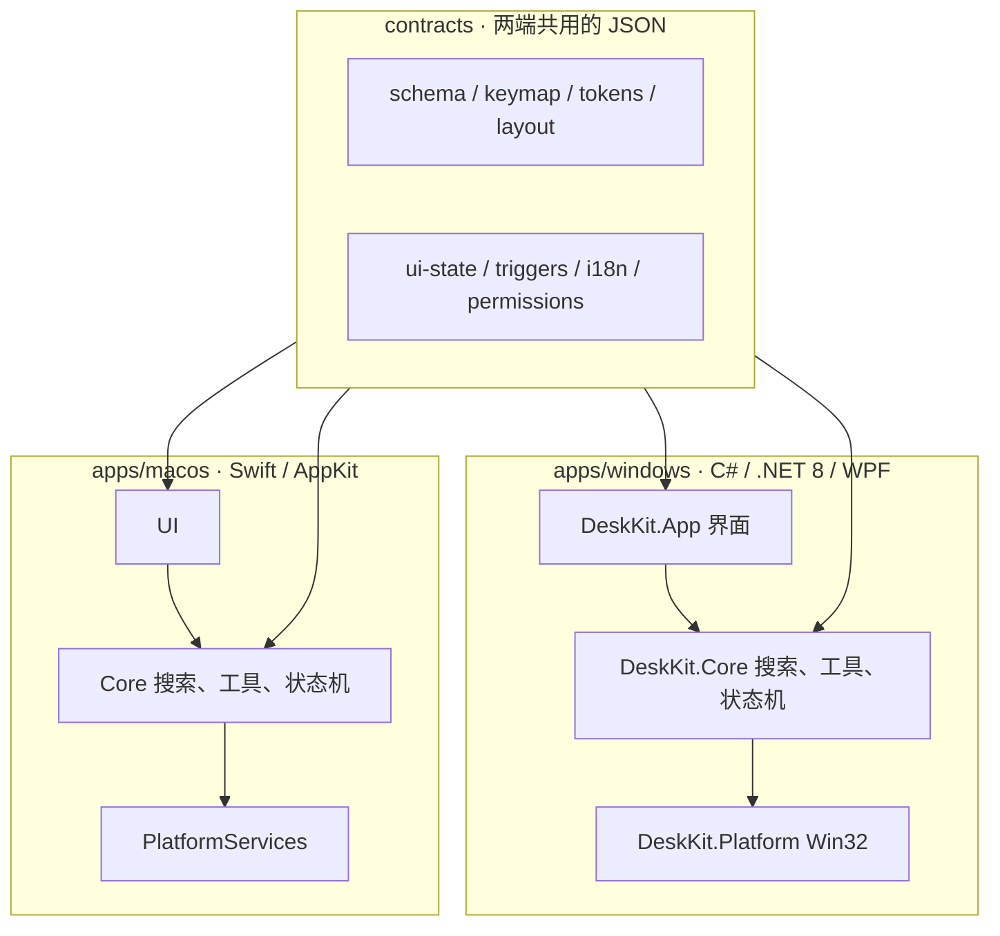
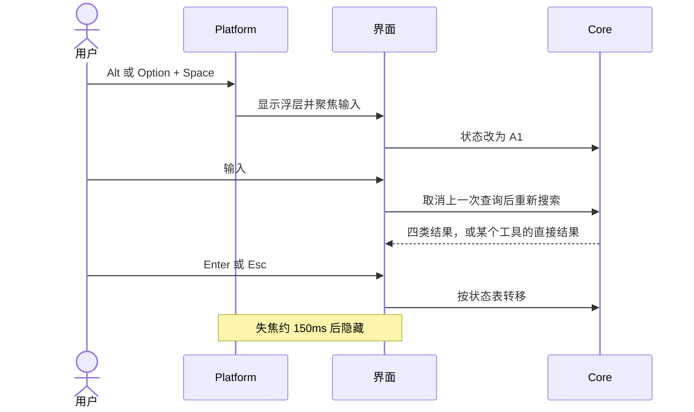

# DeskKit 现行技术架构

> 版本：v1.0 ｜ 日期：2026-11-16
> **本文是实现阶段的唯一架构依据。** 与本文冲突时，技术栈以本文为准，功能范围以 `docs/06-Incremental-PRD.md` 为准（06 里「≤80MB 不可放宽」已作废），视觉与键盘以 `docs/01-PRD.md` 第 5、6 章为准（被 06 改写的条目以 06 为准）。
> 品牌仍用工程代号 **DeskKit**。正式名未定，不要改品牌位。
> 本文不改 `prototype/index.html` 和 `tests/`。那套原型已经验收，但是旧方向（含插件市场），只供看布局，不能当功能清单。

---

## 0. 结论

Windows 用 **C# / .NET 8 + WPF**。macOS 用 **Swift + AppKit**。两端各写各的界面和业务代码，靠同一份 `contracts/` 和同一套测试夹具对齐。不设共享 Rust 核心，不上 WebView，不做插件运行时。

| 项 | 现行决定 |
|---|---|
| Windows | C#，.NET 8，WPF。系统调用用 CsWin32。W0 首发 |
| macOS | Swift + AppKit。主界面不用 SwiftUI，不用 WKWebView。最晚 W8 |
| 共享物 | `contracts/` 里的 JSON：数据结构、键盘、色值、尺寸、状态机、文案、权限说明 |
| 对齐方式 | 同一份夹具输入，两端各自实现，输出归一化后逐字段比对 |
| 插件 | 不做。没有市场、授权、沙箱、SDK |
| 发布 | W0 只发 Windows，版本可带 `-win`。macOS 最晚 8 周补齐核心功能。v1.0 起恢复单一版本号 |
| 内存 | 80MB 不再决定 Windows 选什么技术，也不阻断发布。关于页记录实测值 |

### 0.1 先读哪份

| 顺序 | 文档 | 用途 |
|---|---|---|
| 1 | **本文** | 技术栈、目录、模块边界、任务顺序 |
| 2 | `docs/06-Incremental-PRD.md` | 哪些功能留下、哪些删掉、双端节奏 |
| 3 | `docs/01-PRD.md` 第 5、6、7 章 | 尺寸、配色、键盘、13 项平台差异白名单 |
| 4 | `handoff/PROTOTYPE-SPEC.md` 第 2、3、5、7 章 | 状态机、键盘、视觉 token、内置工具算法 |
| 5 | `prototype/index.html` | 打开看布局和动效 |

作废方案的全文在 `docs/archive/`。原来的路径只留了短说明，打开后不要继续往下实现：

| 归档 | 内容 |
|---|---|
| `docs/archive/02-Architecture.md`、`TECH-SPEC.md`、`CURSOR.md`、`cursor-rules.mdc` | Tauri v2 + React + 插件运行时 |
| `docs/archive/05-Architecture-Review.md` | 「维持 Tauri」 |
| `docs/archive/07-New-Architecture.md` | Rust + Win32，并写明不能用 WPF。该结论已被覆盖 |
| `docs/archive/08-QA-Migration-Assessment.md` | 旧原型 140 条断言怎么迁移。摘要留在 `docs/08` |
| `docs/archive/class-diagram.mermaid`、`sequence-diagram.mermaid` | 插件运行时的类图和时序图 |

开发规则在 `.cursor/rules/deskkit.mdc`，不要再启用归档里的 Tauri 规则。

---

## 1. 决策记录

| 时间 | 决定 | 状态 |
|---|---|---|
| 2026-11-06 | 初版：Tauri v2，开放插件，双端同一天发布 | 作废 |
| 2026-11-16 | 产品收窄：取消第三方插件；Windows 先行；数据 schema、快捷键语义、视觉规范、设置项结构仍然随时对齐 | **有效**，见 06 |
| 2026-11-16 | 曾选「共享 Rust Core + Windows Win32 自绘 + macOS AppKit」，并用 80MB 否决 WPF | **Windows 半段作废**。macOS 的 Swift + AppKit 保留 |
| 2026-11-16 | 用户要求 Windows 使用主流方案 | **有效**。Windows = C# / .NET 8 + WPF |
| 2026-11-16 | macOS 按该品类主流实现 | **有效**。Swift + AppKit |

80MB 曾经是选型门槛，用来否决 Electron、Flutter、Tauri 和 WPF。用户改选 Windows 主流方案之后，这条门槛不再用来挑选 Windows 技术栈。WPF 进程要常驻 CLR，内存会高于原生自绘。发布时记录实测 RSS，不把某个内存数字写成拒发条件。

两端各写一套业务代码，是这次选型的代价。Flow Launcher、PowerToys Run 就是整套 C#；Raycast、Alfred 的 macOS 壳就是 Swift + AppKit。搜索、拼音、五组工具如果以后出现行为偏差，再考虑抽出共享库。W0 / W8 不引入 Rust，也不为了复用去换回 WebView。

---

## 2. 系统做什么

价值主张：一个键呼出，把找应用、找文件、查剪贴板、翻译、算数、取色办完。装好就能用。

### 2.1 要做

全局呼出和隐藏；中文、全拼、首字母、英文、算式搜索；打开应用、文件、网址；分组拖拽（快捷启动面板）；5 组内置工具；工具宫格和工具内页；剪贴板上下文推荐内置工具；3 个 Tab 的设置；首次引导；失焦隐藏和多屏。

触发词只保留五个，进入的是内置工具，不是插件：

| 触发词 | 工具 |
|---|---|
| `fy` | 翻译 |
| `js` | 计算器 / 单位换算 |
| `color` | 颜色转换 |
| `ts` | 时间戳 |
| `clip` | 剪贴板历史 |

结果只分四类：应用、文件、网址、内置工具。计算并进内置工具，不单独成组。

### 2.2 不做

第三方插件的安装、授权、市场、更新、卸载和 SDK。界面 D 整页不做。设置里没有「插件」Tab。触发词 `ocr` 不做。空态只留三类：快捷启动面板没有项目、剪贴板没有记录、搜索没有结果。

云同步默认关闭，MVP 不实现。Linux 不做。AI 不做。深色主题、选区超级面板、二维码的真实生成放到 V1。

### 2.3 界面

| 界面 | 尺寸 | 说明 |
|---|---|---|
| A 主启动器 | 宽 720；输入行 64；结果行 48；底栏 32；最高 480；距顶约 22% | 默认 / 输入 / 结果 / 空结果，另加工具专属态和工具内页 |
| B 快捷启动面板 | 960×640，左导航 200 | 普通、编辑、拖拽。删除分组时项目进「未分组」 |
| C 工具宫格 | 420×360；格子 112×96；内页 720×520 | 9 格。最后一格是排序和显示隐藏，不是添加插件 |
| E 设置 | 1000×680 | 常规、快捷键、关于。系统权限在关于页，主程序更新在常规 |
| F 引导 | 760×520 | 欢迎、录制呼出键、本平台系统权限和预置 5 组工具 |

强调色 `#3B6CF6`。分组第 4 色是 `#9B6CF6`。色值和尺寸只从 `contracts/tokens.json`、`contracts/layout.json` 读取，业务代码里不写散落的色值。

`Esc` 逐级回退：工具内页 → 结果 → 触发词胶囊 → 清空输入 → 隐藏。禁止一次按键直接从内页跳到隐藏。

默认呼出键：Windows `Alt+Space`，macOS `⌥+Space`。在输入框里不能插入字符，也不能把系统菜单呼出来。注册失败时提示占用，并允许改键，备选 `Alt/⌥+R`。

---

## 3. 分层



Windows 的 `DeskKit.Core` 不引用 WPF，也不调用 Win32。`DeskKit.Platform` 是 Windows 进程里唯一允许出现 Win32 的项目。界面只通过 Core 改状态，通过 Platform 做热键、托盘、索引和截图。

macOS 同样分成 UI、纯逻辑、系统能力三块。纯逻辑不调用 AppKit。

两端的 Core **不共享二进制**。它们必须遵守同一份契约，并用同一批夹具测试。

### 3.1 目录

代码放在当前仓库，与规格并列。不要另起一个丢掉文档的仓库，也不要创建 `src-tauri/`。

```
deskkit/
├── docs/10-Current-Architecture.md
├── contracts/                          T01 新建
│   ├── schema/{index-item,groups,clipboard,settings}.json
│   ├── keymap.json
│   ├── tokens.json
│   ├── layout.json
│   ├── ui-state.json
│   ├── triggers.json
│   ├── i18n.json
│   ├── permissions.json
│   ├── platform-diffs.json
│   └── fixtures/*.json
├── apps/windows/                       T01 起
│   ├── DeskKit.sln
│   ├── src/DeskKit.App/
│   ├── src/DeskKit.Core/
│   ├── src/DeskKit.Platform/
│   └── tests/DeskKit.Core.Tests/
├── apps/macos/                         可与 Windows 并行开发，W8 发布
│   ├── DeskKit.xcodeproj
│   └── Sources/{Core,Platform,UI}/
├── tests-v2/                           夹具比对、截图、内存记录
├── release/{version.json,CHANGELOG.md,feature-manifest.json}
├── prototype/  tests/                            冻结的旧原型，不要改
├── docs/01  docs/03  docs/04  docs/06            产品文档，按文首说明使用
└── docs/archive/                                 作废架构，不要实现
```

---

## 4. 共享契约

`contracts/` 是两端唯一允许手写色值、尺寸、快捷键文案、设置项键名和状态名的地方。业务代码读生成结果或在启动时加载 JSON。CI 对整个目录做 SHA-256，写进两端产物。哈希不一致就拒绝启动。

所有持久化 JSON 带 `schemaVersion`。升级走单向迁移。设置和分组用临时文件写完再替换，避免退出时写坏。时间用 ISO 8601 UTC 存储。

| 文件 | 内容 |
|---|---|
| `schema/index-item.json` | `id, kind, title, path, iconRef, keywords, score`。`kind` 只有 `app / file / url / tool` |
| `schema/groups.json` | 分组、快捷项、色标、排序 |
| `schema/clipboard.json` | 文本 / 图片 / 文件记录，收藏，保留策略 |
| `schema/settings.json` | 3 个 Tab 的条目和默认值 |
| `keymap.json` | 键盘行为，以及 `Alt↔⌥`、`Ctrl↔⌘` 的展示名。界面禁止硬编码这两个词 |
| `tokens.json` | `docs/01-PRD.md` 5.8 的色值，含分组第 4 色 `#9B6CF6` |
| `layout.json` | 5.7 的尺寸、圆角、间距、字号 |
| `ui-state.json` | 第 7 节的状态和合法迁移 |
| `triggers.json` | 五个触发词到工具 id |
| `i18n.json` | 界面文案，含空态和权限引导 |
| `permissions.json` | 各平台要申请的系统权限、原因、跳转 |
| `platform-diffs.json` | `docs/01-PRD.md` 6.6 的 13 项白名单，加上 06 的阶段性差异。每条阶段性差异有负责人和到期节点 |
| `fixtures/` | 搜索、算式、触发词、Esc 序列、设置默认值的输入和期望输出 |

删除分组时，项目移动到「未分组」，契约里要有这个规则，两端夹具都要覆盖。

---

## 5. Windows

### 5.1 工程

| 项目 | 目标框架 | 职责 |
|---|---|---|
| `DeskKit.Core` | `net8.0` | 搜索、拼音、排序、状态机、五组工具、设置迁移、契约校验、日志接口 |
| `DeskKit.Platform` | `net8.0-windows` | 热键、托盘、剪贴板监听、应用和文件索引、取色、开机自启、DPI、数据目录 |
| `DeskKit.App` | `net8.0-windows` | WPF 窗口和 ViewModel。引用 Core 和 Platform |
| `DeskKit.Core.Tests` | `net8.0` | xUnit。不启动窗口 |

启用 nullable。界面用 CommunityToolkit.Mvvm。Win32 用 CsWin32 生成，不手写大段 P/Invoke。日志用 `Microsoft.Extensions.Logging`。

`DeskKit.App` 不直接枚举开始菜单、不直接注册热键。窗口句柄上必须做的样式钩子放在 Platform 的窗口宿主里。

### 5.2 进程和窗口

一个常驻进程。索引构建在后台线程，完成后把不可变快照交给搜索。不另驻 worker。

启动器是无边框、置顶的 WPF 窗口，`WindowStyle=None`，圆角和投影按 `layout.json` 画。使用 `WS_EX_TOOLWINDOW`，使它不单独占任务栏，常驻入口在托盘。

呼出时窗口必须变成前台并聚焦输入框，否则无法打字。不要给这个窗口加 `WS_EX_NOACTIVATE`。隐藏之后再显示时重新激活。

失焦后 150ms 内隐藏。引导、改键、确认对话框打开时不隐藏。取色进行中不隐藏。

关闭主窗口等于缩进托盘。真正退出要二次确认。

DPI 使用 Per-Monitor V2。多屏默认跟随鼠标所在屏幕，浮层离屏幕边缘至少内收 16px。另两种策略（记住上次、固定主屏）放在设置里。

### 5.3 系统能力

| 能力 | 做法 |
|---|---|
| 呼出热键 | 隐藏的消息窗口上 `RegisterHotKey(MOD_ALT, VK_SPACE)`。成功则该组合不再打开窗口系统菜单。失败时给出占用说明和改键 |
| 托盘 | `Shell_NotifyIcon`。菜单：呼出、快捷启动面板、工具面板、设置、退出 |
| 剪贴板 | `AddClipboardFormatListener`。历史数据放 Core，Platform 只负责监听和写入系统剪贴板 |
| 取色 | `BitBlt` / `Graphics.CopyFromScreen` 取像素，HEX、RGB、HSL 换算放 Core。不用独立捕获进程 |
| 拖入添加 | OLE `IDropTarget`，接收 exe、快捷方式、文件夹、网址 |
| 开机自启 | `HKCU\Software\Microsoft\Windows\CurrentVersion\Run`。不写 HKLM，不请求管理员 |
| 数据目录 | `%APPDATA%\DeskKit`。界面只提供「打开数据目录」，不把原始路径当正文展示 |

应用索引的 MVP 来源：开始菜单和桌面的 `.lnk`（`IShellLink`）、卸载注册表、App Paths。Windows Search 可以接，但不是首发阻塞项。Everything 和直接读 MFT 不进 MVP。

### 5.4 发布

`dotnet publish` 自包含发布 `win-x64` 和 `win-arm64`，目标机不必预装 .NET。默认不用单文件压缩，避免启动时解压拖过冷启动。

最低系统 Windows 10 1809（build 17763）。主推 Windows 10 22H2 和 Windows 11。

分发先做便携目录和 winget。签名用 Authenticode，放在发布闸门里，不阻塞第一版能跑起来。

明确不引用：WebView2、WinUI 3、Electron、Rust、C++ 主程序。

---

## 6. macOS

语言 Swift 5.9 及以上，UI 用 AppKit。Raycast 在键盘优先的长列表上放弃了 SwiftUI，本产品同样不用 SwiftUI 做主界面，也不把界面放进 WKWebView。

`NSApplication` 使用 accessory 策略，没有 Dock 图标。常驻在菜单栏 `NSStatusItem`。浮层用无边框 `NSPanel`，呼出时成为 key window 并聚焦输入。失焦约 150ms 后隐藏。红绿灯关闭等于藏到菜单栏，退出要确认。

| 能力 | 做法 | 未授权时 |
|---|---|---|
| 全局热键 | `CGEventTap`，默认 `⌥+Space`，避开 `⌘+Space` | 不注册热键，引导打开辅助功能。不能装成已经注册成功 |
| 输入监控 | 只在热键路径需要时申请 | 单独的引导，不静默失败 |
| 截图取色 | ScreenCaptureKit 或 `CGWindowListCreateImage` | 不返回空图、不黑屏，工具页给出「去授权」 |
| 文件索引 | `/Applications`、LaunchServices、Spotlight 元数据 | 完全磁盘访问未开时，只索引能读到的范围，并写明有遗漏 |
| 开机自启 | `SMAppService`（macOS 13+） | 与 Windows 同一个「开机自启」开关语义 |
| 数据目录 | `~/Library/Application Support/DeskKit` | 界面同样不展示原始路径 |

最低系统 macOS 13。分发用已签名、已公证的 DMG。默认不进 Mac App Store，沙箱和全局热键、辅助功能、完全磁盘访问冲突。

macOS 的 Core 用 Swift 实现第 4 节的契约，不链接 Rust 静态库。

---

## 7. 状态和一次呼出

状态定义在 `contracts/ui-state.json`，两端都按这张表转移。原型里的 `TRIGGER` 改名为 `TOOL`（工具专属态）。

| 当前状态 | 可以进入 |
|---|---|
| `HIDDEN` | `A1`、`TOOLPAGE` |
| `A1` | `A2`、`A3`、`TOOL`、`HIDDEN`、`TOOLPAGE` |
| `A2` | `A3`、`A4`、`A1`、`TOOL`、`HIDDEN`、`TOOLPAGE` |
| `A3` | `A2`、`A4`、`A1`、`TOOL`、`TOOLPAGE`、`HIDDEN` |
| `A4` | `A2`、`A3`、`A1`、`HIDDEN` |
| `TOOL` | `A2`、`A3`、`A4`、`TOOLPAGE`、`HIDDEN`、`A1` |
| `TOOLPAGE` | `A3`、`TOOL`、`HIDDEN`、`A1`、`A2` |

`HIDDEN → TOOLPAGE` 合法，例如从工具宫格直接打开内页。进入更深的状态时把返回点压栈。`Esc` 只弹出栈顶；栈空才隐藏。

必须有夹具的两条路径：

- `TOOL → A4 → A1 → HIDDEN`
- `TOOLPAGE → A1 → HIDDEN`



每次输入先取消上一次搜索，再发新的。迟到的结果按请求 id 丢掉。本地结果先显示。某个内置工具失败时，只影响该工具，主列表仍可输入。搜索耗时、热键注册失败、权限探测结果要打日志。剪贴板正文和色值默认不打。

内置工具算法沿用 `handoff/PROTOTYPE-SPEC.md` 第 7 章：四则运算用递归下降，支持括号和小数，除零不崩溃；`520+999-1314` 得 `205`。颜色在 HEX、RGB、HSL 之间互转。10 位和 13 位时间戳都能识别。翻译有离线词库，断网时提示「当前为离线基础翻译」，主流程不报错。在线翻译是唯一按需发起的网络请求，空闲时不留连接。

---

## 8. 双端对齐和发布

下面四类在任何时候都要一致。差了算缺陷：

1. 数据 schema
2. 快捷键语义（展示名可以是 Alt 或 ⌥，行为必须相同）
3. 视觉规范（尺寸、圆角、间距、色值、字号）
4. 设置项的结构和默认值语义

`docs/01-PRD.md` 6.6 的 13 项允许不同：修饰键名称、默认热键的物理按键、系统冲突的具体表现、托盘或菜单栏、系统权限清单、自启的系统接口、数据目录的真实路径、索引来源、热键注册方式、截图所需权限、窗口材质、关闭按钮的系统行为、安装包格式。材质在首发可以不做亚克力和毛玻璃。

06 允许的阶段性差异只限两类：macOS 权限和索引的深度适配，最晚 W8；选区超级面板、操作菜单、深色主题、快捷键别名、二维码、可选云同步，最晚 W16。每条写在 `platform-diffs.json`，带负责人和到期节点。关于页的对齐状态由这份清单生成，不手写。

| 节点 | Windows | macOS | 版本号 |
|---|---|---|---|
| W0 | 发布全部留下的 P0 | 可以尚未发布 | `0.9.x-win` |
| 最晚 W8 | 继续迭代 | 核心功能和四类结构对齐 | `0.9.x-mac` 可以并存 |
| 最晚 W16 | V1 增强 | 同一天补齐 V1 | 单一 `1.0.0`，同一份更新日志 |

W0 的 CI 只要求 Windows 作业成功。W8 起两端都成功才发布。

---

## 9. 错误和日志

不再使用插件时代的 12 个 `E_*` 码。Core 返回统一结构：`ok`、`code`、`message`、`data`。

| code | 含义 |
|---|---|
| `OK` | 成功 |
| `INVALID_ARG` | 参数不合法，例如算式或颜色格式错误 |
| `SCHEMA_VIOLATION` | 持久化数据不符合契约 |
| `PERMISSION_REQUIRED` | 系统权限未授予。界面必须给出引导，不能当成空结果 |
| `OFFLINE` | 在线翻译不可用，已改用离线词库 |
| `TOOL_FAILED` | 某个内置工具失败。主浮层保持可用 |
| `HOTKEY_CONFLICT` | 热键注册失败 |

宿主日志用 `DK-<域>-<三位号>`，与上表分开。不要发明第三套字符串。

---

## 10. 非功能

| 编号 | 要求 |
|---|---|
| 呼出 | 热键到输入框可打字，P95 < 100ms。冷启动后第一次 < 300ms |
| 搜索 | 输入到本地结果 P95 < 100ms，索引查询 P95 < 30ms |
| 离线 | 启动、搜索、分组、五组工具在无网时可用。只有在线翻译需要网络 |
| 隐私 | 默认只存在本机。剪贴板可暂停、清空、设置保留时长、排除应用 |
| 权限 | 未授权时有说明和跳转。macOS 尤其不能静默返回空数据 |
| 升级 | 分组、快捷项、触发词、设置、剪贴板按保留策略留下，不重新走引导 |
| 动效 | 浮层出现不超过 120ms |

内存不设发布阻断线。W0 仍要在关于页和 `tests-v2/perf/` 写下空闲 5 分钟、本进程私有工作集的实测值，并注明系统版本和构建号。

---

## 11. 实现顺序

| 任务 | 做什么 | 完成时能看到什么 |
|---|---|---|
| **T01** | `contracts/` 全部 JSON 和夹具；Windows 解决方案；空的 WPF 浮层；`Alt+Space` 能呼出并聚焦；托盘能退出 | `dotnet test` 通过契约夹具；热键能开关窗口 |
| **T02** | Core：拼音搜索、算式、五个触发词、状态机、五组工具、设置原子写入和迁移 | 夹具全绿；断网时翻译给出离线提示；`520+999-1314` 得 205 |
| **T03** | Windows 界面 A/B/C/E/F，索引，剪贴板，取色，引导，三态拖拽 | 留下的 P0 在 Windows 上能用键盘走通 |
| **T04** | macOS 三层实现，接同一份契约和夹具；四项权限未授权时有引导 | 核心功能与 Windows 的夹具输出一致 |
| **T05** | 双端夹具比对、截图、V1 项、单一版本号 | W8 之后两端作业都成功才发布 |

T02 和 T03 可以并行：界面先用固定夹具数据。T04 可以在契约稳定后开工，发布不早于 Windows 首发。

T01 之前不要写搜索界面的业务逻辑。每个提交的代码都要能编译，不留 TODO 和空函数体。

---

## 12. 本机环境

2026-11-16 检查这台 macOS：已安装 Xcode 26.4.1 和 Swift 6.3.1，没有 .NET SDK。

WPF 工程打开了 `EnableWindowsTargeting`，所以在这台 Mac 上可以编译，但不能运行。界面验收要在 Windows 上做：按 `Alt+Space` 看浮层是否出现。macOS 应用要等 T04，用本机的 Xcode 构建。

## 13. 仍未定、但不阻塞 T01

| 项 | 现行默认 |
|---|---|
| 正式产品名 | 继续用 DeskKit。命名方案在 `docs/04-Naming.md`，未采纳 |
| 极简自定义命令 | 不做。以后若要，只允许本机配置，不允许安装第三方包 |
| 云同步 | 关，且不实现 |
| Mac App Store | 不进 |
| Linux | 不做 |
| 深色主题、二维码真实编码、选区超级面板 | V1 |

改技术栈必须先改本文。不要把 `docs/archive/` 里的方案当成现行架构。
