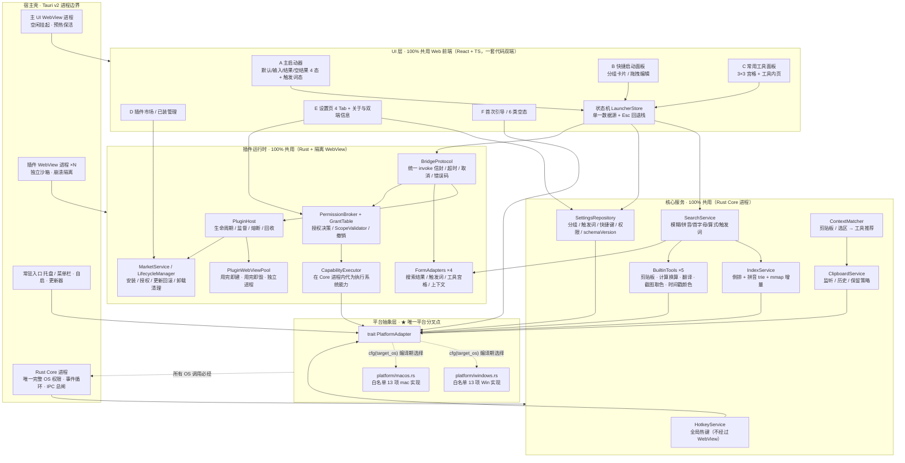
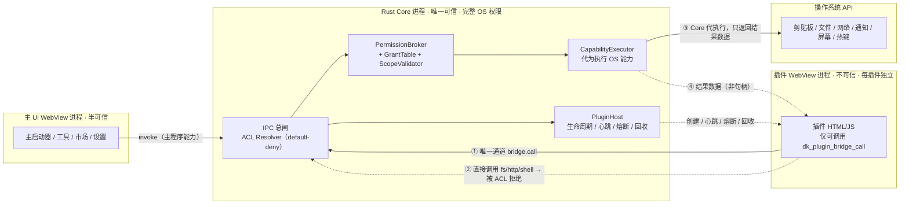
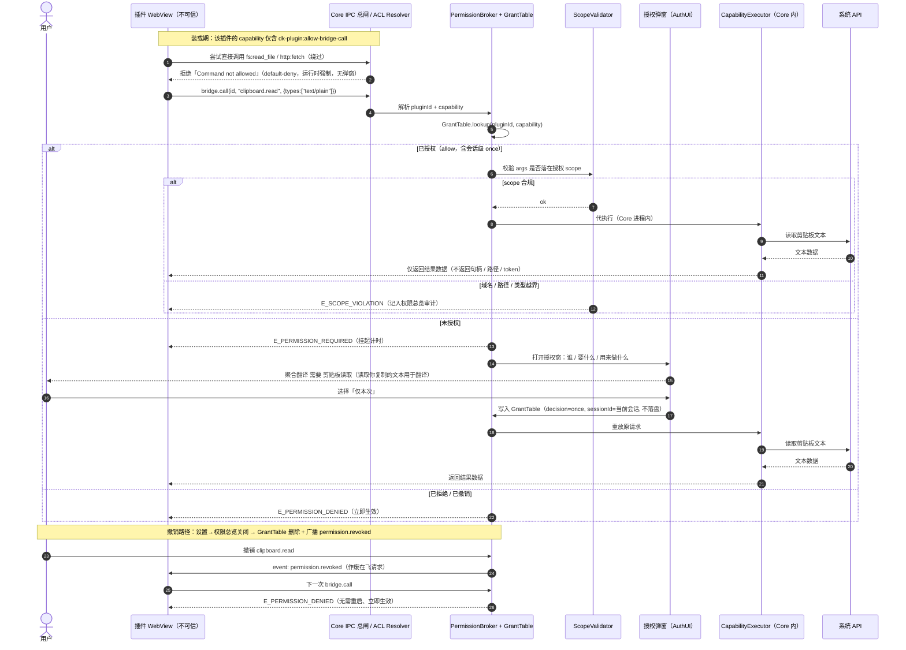
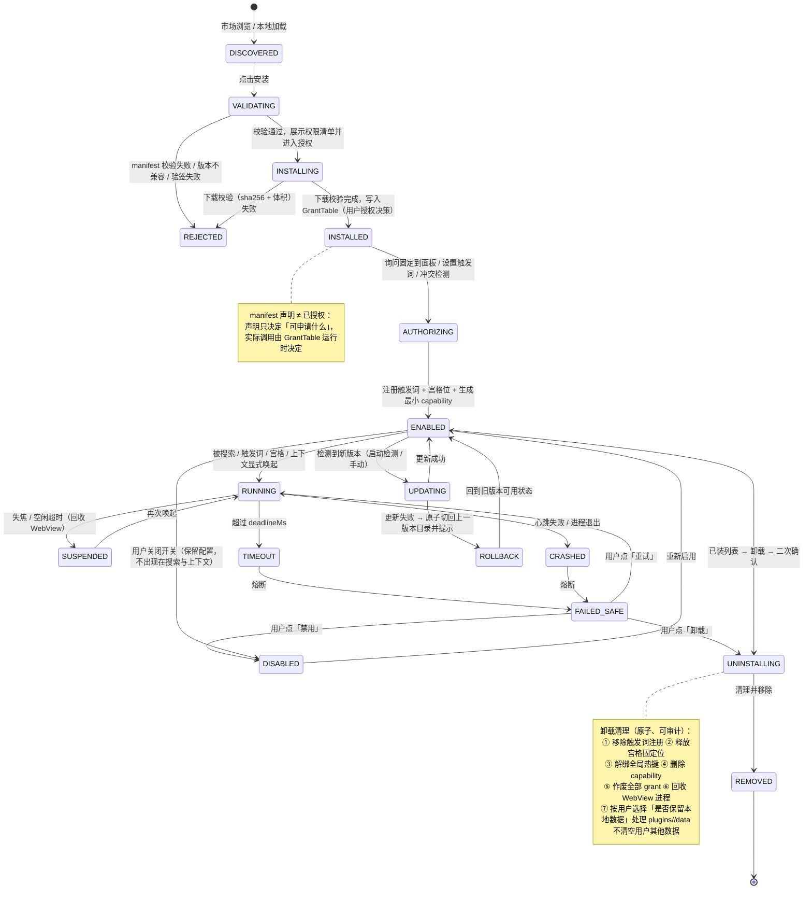
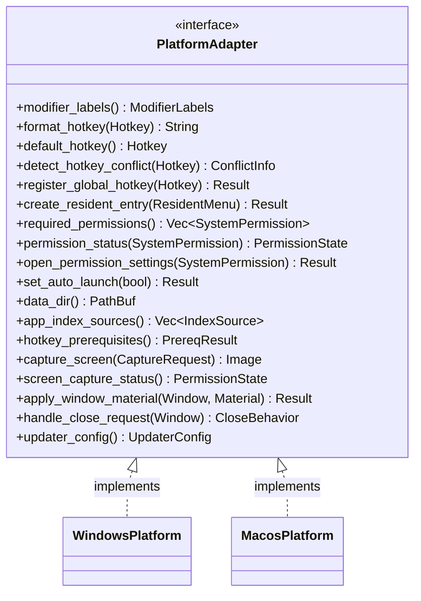
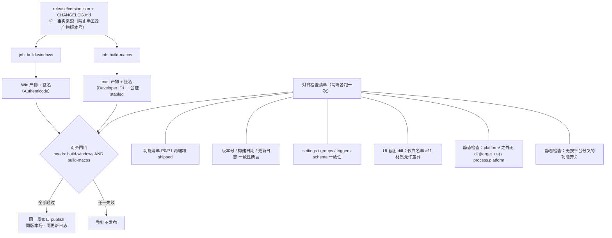
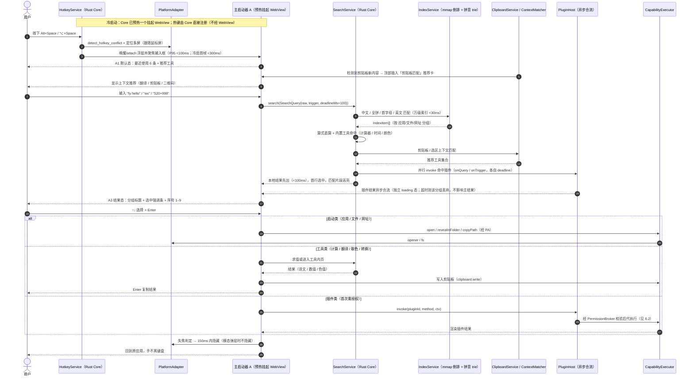
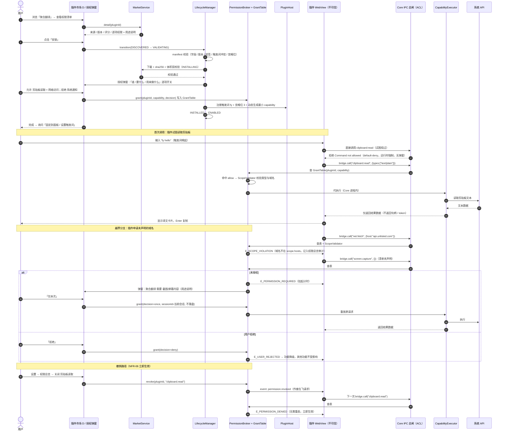
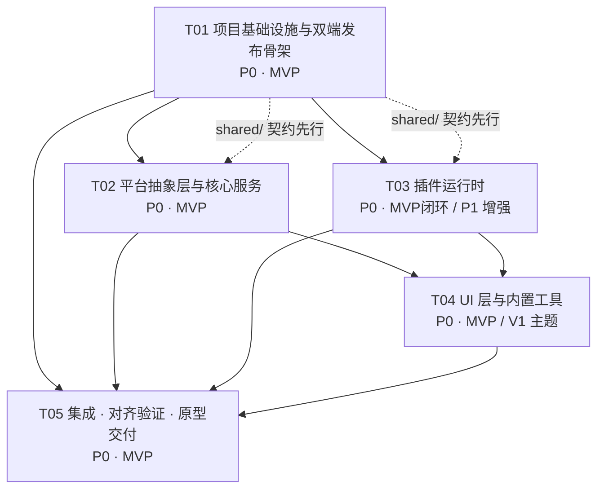

# DeskKit 系统架构设计与任务分解

> **状态：历史文档，不要按本文实现。** 现行架构见 [`docs/10-Current-Architecture.md`](../10-Current-Architecture.md)。Windows 为 C# / .NET 8 + WPF，macOS 为 Swift + AppKit。本文保留 Tauri v2 方案作审计。

> 文档版本：v1.0 ｜ 撰写：高见远（架构师）｜ 团队：software-deskkit
> 上游输入：`docs/01-PRD.md`（v1.0，844 行，重点 4.3 / 5.7 / 5.8 / 6.6 / 第 7 节）
> 下游对象：工程师（本次高保真可交互 HTML 原型）、QA（双端对齐验收依据）、后续真实桌面项目
> 技术数据核实：WebSearch 于 2026-11-06（Tauri v2 / Electron 内存、启动、权限模型、官方插件矩阵、签名与更新）
> 本文只定义**架构、契约与任务**，**不含任何实现代码**（JSON 为契约示例，Mermaid 为设计图，均非实现代码）

---

## 0. 结论先行（TL;DR）

| # | 结论 |
|---|---|
| 1 | **技术选型（单一结论）：Tauri v2**（Rust Core + 系统 WebView + Web 前端）。不选 Electron（空闲内存 250–320MB、包 120–187MB，**硬性不达 NFR-03 ≤80MB**），不选原生混合（第三方插件无法用 HTML/JS 低成本开发，**违背「开放插件运行时 + 对标 uTools 生态」**）。 |
| 2 | **插件运行时一句话**：插件 = 独立 WebView 进程 + 一份 manifest + 一条 `bridge.call` 通道；插件**只被授予一个** capability（`dk-plugin:allow-bridge-call`），其余全部 default-deny；任何受限能力都必须经 Rust Core 的 `PermissionBroker` 查授权表、验 scope，再由 `CapabilityExecutor` **代为执行并返回结果数据**。这是**运行时强制拦截**，授权弹窗只是决策入口，不是防线。 |
| 3 | **双端同期一句话**：`trait PlatformAdapter` 及其 `platform/{windows,macos}.rs` 是**全仓唯一平台分叉点**，PRD 6.6 的 13 项差异逐一映射到该 trait 的方法；前端、核心服务、插件运行时、manifest、消息协议、数据 schema **六套代码 100% 共用**；「同版本号 / 同发布日 / 同更新日志」由**单一 CI 双端构建闸门**强制，而非人工约定。 |
| 4 | **性能解法一句话**：把「常驻」与「峰值」拆开。**全局热键由 Rust Core 直接注册（不经 WebView）→ 呼出 <100ms**；空闲常驻仅 Rust Core + mmap 索引 + 剪贴板索引 + **挂起态** WebView（≈42MB，≤80MB 留 38MB 余量）；**插件 WebView 用完即建、用完即毁**，不常驻。这同时解开了「Web 插件生态」与「≤80MB 内存」的张力。 |
| 5 | **本次交付边界**：本次只交付**一个单页、零构建、可离线打开的高保真 HTML 原型**（`prototype/index.html`），由工程师实现；本文 §10.1 给出 8 条技术约束，**不含任何代码**。真实桌面项目按 §7 的 5 个任务推进，MVP / V1 分标。 |
| 6 | **交付物**：主文档 `docs/02-Architecture.md`；附加图资产 `docs/class-diagram.mermaid`、`docs/sequence-diagram.mermaid`（便于后续单独渲染 / 评审）。 |

### 0.1 非功能要求逐条设计对策（NFR-01 ~ NFR-10，可验收）

| 编号 | PRD 要求 | 架构对策 | 可验收判据（落点） |
|---|---|---|---|
| NFR-01 | 呼出 <100ms P95；冷启动首次 <300ms | 热键在 Rust Core 注册；**预热一个挂起态 WebView 进程**避免冷创建 WebView 的 200–500ms；索引 mmap 常驻 | 端到端打点 `hotkey→inputFocused`，P95 <100ms；冷启动首帧 <300ms |
| NFR-02 | 输入→结果 <100ms；插件慢不拖垮主浮层 | Rust 侧倒排 + 拼音 trie（万级索引 <30ms）；**本地结果与插件结果异步合流**，插件分组独立加载态、超时即丢弃 | 本地结果 P95 <30ms；整体 <100ms；单插件挂起时主结果仍按时出 |
| NFR-03 | 空闲常驻 ≤80MB | Rust Core 常驻 + WebView 空闲挂起 + 插件零常驻（§2.4 内存预算表） | 空闲 5 分钟后 RSS ≤80MB（Win/mac 各测） |
| NFR-04 | 内置工具与已装插件完全离线可用 | 工具、词库、汇率、索引、插件包全部本地；仅市场 / 云同步 / 在线翻译走网络；`E_OFFLINE` 降级 | 断网飞行模式下跑通 17 条 P0 主流程 |
| NFR-05 | 默认仅本机存储；剪贴板可暂停/清空/排除应用 | 统一 `data_dir()` 抽象；剪贴板保留策略 + 排除名单 + 一键清空；云同步默认关且预留接口不实现 | 全仓无默认外发；`grants` / `settings` / `clipboard` 均落本机 |
| NFR-06 | 权限可见/可拒绝/可撤销且立即生效；崩溃隔离 | ACL default-deny + PermissionBroker + ScopeValidator + 撤销事件即时作废在飞请求（§3.4）；独立 WebView 进程（§3.7） | 撤销后下一次 `bridge.call` 立即 `E_PERMISSION_DENIED`；杀掉插件进程主浮层不崩 |
| NFR-07 | 同版本号同期发布；P0/P1 对齐率 100% | 单一 `release/version.json` + `CHANGELOG.md` + `feature-manifest.json`；CI 双 job 全绿才 publish（§4.4） | 任一平台构建失败 → 整批不发；对齐清单两端均 `shipped` |
| NFR-08 | 全键盘可达；动效 ≤120ms | 键盘流状态机（§10.1 第 3 条）；语义 token 统一（§9） | QA 按 PRD 6.2 键盘表全键盘走通 |
| NFR-09 | 插件超时有出口；设置自动保存不丢 | 超时熔断 + `FAILED_SAFE` 态；settings/groups 每次变更原子落盘 | 超时 → 「暂时不可用 + 重试/禁用/卸载」；强杀进程后重启数据完整 |
| NFR-10 | 升级保留分组/触发词/设置/剪贴板 | 所有持久化 JSON 带 `schemaVersion` + migration 链；插件更新失败回滚（§3.6） | 跨版本升级后四类数据零丢失且不重走引导 |

---

## 1. 架构总览（分层视图）

> 分层的准绳：**上层只依赖下层接口，平台差异只允许出现在「平台抽象层」**。宿主壳与 UI 层之间的一切 OS 能力调用都必须穿过平台抽象层与核心服务，不得直连系统 API。



**读图要点**

| 关注点 | 说明 |
|---|---|
| 信任边界 | `Rust Core 进程` = 唯一可信、唯一拥有完整 OS 权限的组件；所有 WebView（含主 UI 与插件）**不可信**，只能通过 IPC 与 Core 通信，且参数一律在 Rust 侧校验 |
| 唯一分叉点 | `#[cfg(target_os)]` / `process.platform` **只允许出现在 `platform/` 目录**，CI 静态检查（§4.4） |
| 插件零直连 | 插件 WebView 与 UI 层之间**没有**直接通道，所有往来经 `BridgeProtocol → PermissionBroker` |
| 内置工具即一等公民 | 5 组内置工具与第三方插件共用同一套 `invoke` 协议与结果结构，仅 capability 与生命周期不同；V1 开放生态时无需改协议 |

---

## 2. 技术选型

### 2.1 三方案对比表（8 个维度）

> 判定：✅ 满足 / ⚠️ 需额外设计 / ❌ 硬性不达标。数据为 2026-11-06 WebSearch 多来源实测**区间**，取趋势，不作为 SLA。

| 维度 | Electron（Chromium + Node） | **Tauri v2（Rust Core + 系统 WebView）** | 原生混合（Rust 核心 + 原生窗口） |
|---|---|---|---|
| **呼出延迟**（NFR-01 <100ms P95 / 冷启 <300ms） | ❌ 需唤醒完整 Chromium 渲染进程；冷启动实测 1.8–3.2s，热态亦受 renderer 调度影响，P95 难保证 | ✅ **Rust Core 直接注册全局热键**（不依赖 WebView）；预热挂起 WebView 后首帧 142ms(p50)–520ms；实测冷启 1.04s 为完整应用，浮层路径远低于此 | ✅ 最优（原生窗口直接 show），但见下「插件门槛」 |
| **常驻内存**（NFR-03 ≤80MB） | ❌ **空闲 250–320MB**（Chromium + Node 常驻），硬性不达标且不可通过架构技巧压缩 | ⚠️ **裸跑 60–134MB**（含 WebView 渲染进程时偏高）；但 **Core 与 WebView 进程可分离、WebView 可挂起**，设计后 ≈42MB 常驻（§2.4） | ✅ 最低（10–30MB），但见下 |
| **第三方插件开发门槛**（对标 uTools：能否用 HTML/JS 低成本写插件） | ✅ 最友好（Node + Chromium，uTools 即此类），但代价是内存 | ✅ **插件即 HTML/JS + 一份 manifest**，跑在独立 WebView，前端生态全可用；开发者无需 Rust | ❌ **致命伤**：原生控件无 Web 运行时，插件必须写 Rust/原生模块或自带渲染层 → 生态门槛极高，**直接违背三大约束之一** |
| **双端一致性成本**（NFR-07 对齐率 100%） | ⚠️ 渲染引擎一致（自带 Chromium），但两端功能易各自分叉，缺少编译期约束 | ✅ 同一套 Rust/TS 代码 + `PlatformAdapter` 唯一分叉点 + CI 闸门；系统 WebView 渲染差异由严格 token 与截图基线收敛 | ❌ 两套原生 UI（WinUI/AppKit）各自实现，尺寸/文案/状态对齐成本最高 |
| **系统能力**（全局热键 / 截图取色 / 剪贴板监听 / 文件索引） | ✅ 成熟（`globalShortcut`/`desktopCapturer`/`clipboard`），但需常驻 Node 进程 | ✅ 官方插件矩阵齐备：`global-shortcut`、`clipboard-manager`、`fs`、`http`、`notification`、`autostart`、`opener`、`dialog`、`store`、`updater`；社区补 `tauri-plugin-macos-permissions`（TCC）、`tauri-plugin-screenshots`/`xcap`（截图）、`tauri-plugin-context-menu`、`tauri-nspanel`（mac 菜单栏） | ✅ 最底层最直接，但每个能力两端各写一遍 |
| **权限模型 / 崩溃隔离**（NFR-06） | ⚠️ 需自行实现 `contextBridge` + sandbox；插件与主进程隔离靠多 BrowserWindow，内存代价大 | ✅ **原生 `capabilities → permissions → scopes`，default-deny**，可按 window label 隔离；Core 集中路由所有 IPC 可拦截；多进程模型天然崩溃隔离；v2 并经外部安全审计 | ✅ 进程隔离可控，但插件权限体系需从零自建 |
| **签名公证与自动更新** | ✅ `electron-updater` / `electron-builder` 成熟（Squirrel、delta、staged rollout） | ✅ `plugin-updater` + 签名更新清单（minisign）；mac Developer ID + 公证 + stapled ticket + hardened runtime；Win Authenticode/SmartScreen；**全量二进制更新，但包小** | ⚠️ 需自建更新链路 |
| **包体积** | ❌ Windows 实测 187MB / 常见 120MB（Chromium + Node 随包） | ✅ 实测 56MB、均值 12.4MB，最低可 ~8MB（复用系统 WebView） | ✅ 极小（<10MB） |
| **综合** | 生态最友好但 **NFR-03 硬性不达标** | **唯一同时满足「Web 插件生态 + ≤80MB 可设计达成 + 双端同期可强制 + 权限运行时可拦截」** | 性能最优但 **插件生态与双端一致性双输** |

### 2.2 核实数据摘要（避免引用过时信息）

| 指标 | Electron 30 / 28 | Tauri 2.x | 来源性质 |
|---|---|---|---|
| 空闲内存 | **150–320MB**（2026-11 复核区间；更保守口径 150–168MB，11-06 记录的 250–320MB 属偏高口径；方向不变，仍 >80MB） | 20 / 35 / 42 / 60 / 89（1k app 均值）/ 134MB | 多篇迁移实测 + 基准汇总，波动取决于 WebView 是否活跃、是否计独立进程；广传基准缺方法论披露，仅作方向参考 |
| 冷启动 | 1.8–3.2s（另一来源 p50 412ms 疑为热态） | 142ms(p50) / 520ms / 1.04s | 同上；Tauri 完整 app 冷启 1.04s，浮层路径远小于此 |
| 包体积（Win） | **85–187MB**（187MB 实测 / 常见 85–150MB / 均值 78.2MB；11-06 记录的 120–187MB 属偏高口径） | 3.2MB / 8MB / 56MB（均值 12.4MB）；**固定 WebView2 Runtime 分发时安装包可额外 +~180MB** | 生产构建实测；包体积优势依赖打包方式 |
| IPC p99 | 14.7ms | 2.1ms（Raw Payload / 自定义序列化） | 1k 调用基准 |
| 权限模型 | `contextIsolation` + `contextBridge`（自管） | **Capabilities / Permissions / Scopes，default-deny，可按 window 分派，deny 优先** | Tauri 官方博客与文档；v2 经 Radically Open Security 外部审计 |
| 进程模型 | main + 多 renderer（每个均含 Chromium） | **一个 Rust Core（唯一完整 OS 权限）+ 多个轻量 WebView 进程 + sidecar** | Tauri 官方「进程模型」文档 |

> **诚实标注**：即使 Tauri，一个**活跃** WebView 的空闲内存也可能逼近甚至超过 80MB（不同测量口径 60–134MB）。因此 ≤80MB **不是选型即达标，而是靠 §2.4 的进程分层设计达成**。这正是本设计必须正面处理的地方。

> **2026-11-13 复核补注（仅数字口径，不改 §2.3 结论）**：Electron 空闲内存更保守口径为 **150–168MB**（Fora Soft 以 150MB 为其 Electron 产品预算），包体积常见 **85–150MB**；11-06 记录的 250–320MB / 120–187MB 属偏高口径。**方向不变，仍 >80MB，否决结论不变**。另：广传「96% 更小 / 省 5 倍内存」基准被指**缺方法论披露**（无 app 规格 / OS 版本 / 框架版本），不应作为实测依据；Tauri 固定 WebView2 Runtime 分发会让安装包额外 **+~180MB**。核实来源与日期见 `docs/05-Architecture-Review.md` §9。

### 2.3 明确单一结论与理由

> **结论：采用 Tauri v2 —— Rust Core + 系统 WebView（Win WebView2 / mac WKWebView）+ Web 前端（React + TypeScript）。**

**选它的 5 条理由（逐条对应判据）**

1. **唯一能同时满足「Web 插件生态」与「≤80MB 内存」**：系统 WebView 让插件用 HTML/JS 零门槛开发（对标 uTools），而 Core 与 WebView **进程可分离**，空闲时可挂起 WebView 只留 Rust Core 常驻。Electron 无此分离能力，原生混合无 Web 运行时。
2. **权限模型直接复用为插件权限体系**：Tauri v2 的 default-deny capability 可按 window label 隔离，正好把「插件只被授予 `bridge.call`」做成**编译/运行期强制**，而非 UI 弹窗（§3.4）。
3. **呼出延迟可达**：全局热键由 Rust Core 注册，不经 WebView 调度，配合预热挂起 WebView，P95 <100ms 可工程化保证。
4. **双端同期可强制**：同一套代码 + 唯一 `PlatformAdapter` 分叉点 + 单一 CI 闸门，13 项白名单有明确落点。
5. **包体积与分发**：12–56MB，全量更新亦可接受；官方 updater + 签名清单满足白名单 #13。

**不选另两者的硬伤**

- **Electron**：空闲 250–320MB 是**架构性**开销（Chromium + Node 必随包常驻），无法靠设计压缩到 80MB；包 120–187MB 与冷启 1.8s+ 同样冲击 NFR-01/03。**一票否决**。
- **原生混合**：性能最优，但 ① 插件必须脱离 Web 技术栈 → 生态门槛与「开放插件运行时」直接冲突；② 两套原生 UI 让「双端 100% 对齐」成本最高，与核心承诺冲突。**两票否决**。

### 2.4 核心张力：Web 插件生态 ↔ ≤80MB 常驻内存（解法）

> 张力本质：**插件要用 WebView 渲染（吃内存），但产品要求空闲 ≤80MB**。解法不是取舍，而是**把「常驻」与「激活」拆成两个进程时间片**。

**四条设计动作**

| 动作 | 机制 | 收益 |
|---|---|---|
| **A. 热键路径去 WebView 化** | 全局热键、失焦判定、多屏定位均由 Rust Core 直接处理；呼出事件先 Core 响应，再唤醒/attach UI | 呼出不依赖 WebView 调度 → NFR-01 <100ms |
| **B. 预热但不驻留渲染** | 登录后由 Core 预创建**一个空白 WebView 进程并立即挂起**（不加载 DOM）；呼出时 attach 已编译的 HTML/CSS/JS | 规避冷创建 WebView 进程的 200–500ms → 冷启首帧 <300ms |
| **C. 空闲挂起 + 插件零常驻** | 空闲 N 秒后暂停主 UI WebView 渲染、OS 可回收其渲染进程；**插件 WebView 用完即建、用完即毁**（失焦 / 超时 / 会话结束即回收），同时最多 2 个活跃 | 空闲内存回落到 Core + 索引量级 |
| **D. 索引只读 mmap** | 万级索引倒排 + 拼音 trie 以 mmap 只读映射，增量写时重建；剪贴板图片落盘、内存仅留索引 | 查询 <30ms，且索引内存可被 OS 回收，不计入私有常驻 |

**内存预算表（空闲常驻 vs 瞬时峰值，分开定义）**

| 组成 | 空闲常驻 | 峰值（1 插件活跃） | 说明 |
|---|---|---|---|
| Rust Core 进程（事件循环 / 热键 / 设置 / 权限网关） | 12 MB | 18 MB | 唯一 7×24 常驻进程 |
| 索引（倒排 + 拼音 trie，mmap） | 8 MB | 10 MB | OS 可回收 |
| 剪贴板历史（最近 N 条 + 缩略图索引） | 4 MB | 8 MB | 图片落盘 |
| 主 UI WebView（挂起态 / 活跃态） | 0–16 MB | 40 MB | 空闲挂起 |
| 常驻入口（托盘 / 菜单栏，原生无 WebView） | 2 MB | 2 MB | — |
| 插件 WebView（默认 **0 常驻**） | 0 MB | ≤30 MB / 个 | 用完即毁，并发上限 2 |
| 预留 | 16 MB | — | 主题 / 字体 / IPC 缓冲 |
| **合计** | **≈42 MB（目标 ≤80MB，留 38MB 余量）** | **≈138 MB 瞬时** | NFR-03 约束的是**空闲常驻**，峰值不受该条约束 |

> 结论：张力被解开的关键不是「少装插件」，而是**插件不常驻** —— 装 100 个插件，空闲内存仍是 ≈42MB；只有被显式激活的那 1–2 个才瞬时占用。

### 2.5 风险与缓解

| # | 风险（含 Tauri 固有） | 影响 | 缓解措施 |
|---|---|---|---|
| R1 | 系统 WebView 渲染差异（Win WebView2 / mac WKWebView） | 双端像素不一致，冲击 NFR-07 | 语义 token 唯一来源（§9）+ 严格 CSS + **CI 双端截图 diff 基线**；仅白名单 #11 原生材质允许差异，且差异清单化 |
| R2 | Win10 可能未预装 WebView2 | 装不上 / 首启失败 | 安装包带 WebView2 Bootstrapper 或引导页明确提示；把 WebView2 可用性列入引导 Step3 检查项（白名单 #5 延伸） |
| R3 | macOS TCC 权限（辅助功能 / 输入监控 / 屏幕录制 / 完全磁盘访问） | 全局热键、截图取色、文件索引静默失败 | `PlatformAdapter.required_permissions()` 驱动引导页**只列本平台所需**；社区 `tauri-plugin-macos-permissions` 查状态；未授予→明确引导页而非空结果（PRD DK-P0-07） |
| R4 | Tauri updater 为全量二进制更新（非 delta） | 更新下载量 | 包仅 12–56MB，可接受；签名清单 + 失败回滚；同一版本号由 CI 注入（§4.4） |
| R5 | Rust 编译反馈慢 | 开发效率 | `cargo` 增量 + `sccache` + CI 缓存 + `cargo watch`；前端纯 Web 栈，多数迭代不碰 Rust |
| R6 | 插件 WebView 并发导致瞬时内存尖峰 | 卡顿 | 并发上限 2 + 内存上限 `maxMemoryMb` + 超时/失焦回收 + 超限自动回收最久未用者 |
| R7 | Tauri 生态成熟度不如 Electron | 个别能力需自研 | 自研 `BridgeProtocol` 屏蔽框架差异，**插件只依赖 `deskkit` API**，不直接依赖 Tauri API；框架升级不波及插件 |
| R8 | 官方/社区/本地插件信任链 | 恶意插件 | 来源标识 + `integrity.sha256` + 可选签名 `signature`；敏感权限组合（网络 + 剪贴板）标 `requiresReview`（对齐 PRD Q3）；本地开发插件默认不自动启用 |

---

## 3. 插件运行时详细设计

### 3.1 进程 / 沙箱模型



**三层隔离**

| 层 | 机制 | 对应 PRD 要求 |
|---|---|---|
| 进程隔离 | 每插件独立 WebView 进程（必要时可升级为 sidecar 子进程）；崩溃不波及 Core 与主 UI | NFR-06 / NFR-09、4.3 崩溃隔离 |
| 能力隔离 | 安装时**动态生成**该插件专属 capability 文件：`windows: ["plugin:<id>"]`，`permissions: ["dk-plugin:allow-bridge-call"]`，**其余全部 default-deny** | 4.3 能力边界、NFR-06 |
| 数据隔离 | 插件私有数据目录 `plugins/<id>/data/`、store namespace 前缀 `plugin:<id>:`；无 `settings.write` / `plugin.manage` 能力 | 「不得修改其他插件或主程序设置」 |

**五条安全不变量（写入架构决策记录，CI 可部分静态校验）**

1. 插件 WebView **永不**直接获得任意 shell、任意 URL、任意文件路径能力；
2. **每个 window label 都是安全边界**，不以「UI 是否隐藏」判断权限；
3. 所有跨边界输入在 Rust 侧做类型 / 格式 / 数量 / 大小 / 时限校验；
4. 插件**不自启、不后台常驻、不无头采集**；`lifecycle.autostart` 强制 `false` 且宿主忽略该字段；
5. **manifest 声明 ≠ 已授权**：声明只决定「可申请什么」，实际能否调用由 `GrantTable` 在运行时决定。

### 3.2 Manifest 契约（完整字段示例）

> 以下为**合法 JSON 契约示例**（非实现代码）。所有字段语义与校验规则见 3.2.1。一个插件可同时声明多种形态。

```json
{
  "manifest_version": "1.0",
  "id": "com.deskkit.translate",
  "name": "聚合翻译",
  "version": "1.2.0",
  "description": "划词 / 触发词翻译，支持多引擎与离线基础词库",
  "author": { "name": "DeskKit Official", "url": "https://example.com" },
  "license": "MIT",
  "homepage": "https://example.com/plugins/translate",
  "icon": "assets/icon.png",
  "screenshots": ["assets/s1.png", "assets/s2.png"],
  "source": "official",
  "category": "office",
  "min_host_version": "0.9.0",
  "engines": { "deskkit": ">=0.9.0 <2.0.0" },
  "entry": {
    "type": "webview",
    "html": "index.html",
    "sandbox": true,
    "csp": "default-src 'self'; connect-src 'none'; img-src 'self' asset:"
  },
  "forms": [
    { "type": "search", "keywords": ["翻译", "translate", "fy"], "group": "plugin", "priority": 80 },
    { "type": "trigger", "trigger": "fy", "exclusive": true, "placeholder": "输入待译文本", "exitBy": "esc" },
    { "type": "tool", "slot": 3, "label": "翻译", "icon": "assets/tool.png", "shortcutDigit": 3, "page": { "width": 720, "height": 520, "resizable": false } },
    { "type": "context", "accepts": ["text/plain", "text/uri-list"], "matchHint": "剪贴板文本 → 翻译 / 二维码", "priority": 90 }
  ],
  "permissions": [
    { "id": "clipboard.read", "reason": "读取你复制的文本用于翻译", "required": false, "scope": { "types": ["text/plain"] } },
    { "id": "net.fetch", "reason": "调用在线翻译服务", "required": false, "scope": { "hosts": ["api.youdao.com", "translate.example.com"], "methods": ["GET", "POST"] } },
    { "id": "clipboard.write", "reason": "一键复制译文", "required": true, "scope": { "types": ["text/plain"] } }
  ],
  "contributes": {
    "triggers": ["fy"],
    "panelSlots": [3],
    "commands": ["translate.swapLang", "translate.copyResult"],
    "contextHandlers": ["text/plain"]
  },
  "lifecycle": {
    "timeoutMs": 800,
    "maxMemoryMb": 64,
    "maxConcurrentCalls": 2,
    "backgroundAllowed": false,
    "autostart": false,
    "unloadAfterIdleMs": 20000
  },
  "integrity": {
    "algorithm": "sha256",
    "digest": "<sha256 of plugin bundle>",
    "sizeBytes": 248312
  },
  "signature": { "by": "official", "value": "<ed25519 signature>" },
  "updatePolicy": { "channel": "stable", "autoCheck": true, "rollbackOnFailure": true },
  "i18n": { "defaultLocale": "zh-CN", "resources": "locales/*.json" }
}
```

#### 3.2.1 字段约束表（安装时 `VALIDATING` 阶段强制校验）

| 字段 | 类型 / 必填 | 校验规则 | 对应 PRD |
|---|---|---|---|
| `manifest_version` | string / 必填 | 必须在宿主 `[MIN, MAX]` 支持区间内，否则 `E_VERSION_INCOMPATIBLE` | §9 兼容策略 |
| `id` | string / 必填 | 反向域名、全仓唯一；与已装插件冲突 → 冲突提示 | 4.3 安装 |
| `version` / `min_host_version` | semver / 必填 | 满足 `engines.deskkit` 才允许安装；升级保留数据 | NFR-10 |
| `source` | enum / 必填 | `official` / `community` / `local`；决定 UI 来源标识与信任等级 | DK-P0-11、Q3 |
| `entry.csp` | string / 必填 | 宿主强制注入下限（禁 `unsafe-inline`、禁任意 `connect-src`）；插件声明只能更严 | 4.3 能力边界 |
| `forms[].type` | enum / 至少 1 项 | `search` / `trigger` / `tool` / `context`；4 种可组合 | 4.3 插件形态 |
| `forms[].trigger` | string | 全局唯一，冲突时列出占用者（PRD 5.4 冲突提示） | DK-P0-12 |
| `forms[].exclusive` | bool | 仅 `trigger` 有效，true = 独占输入区（如 `fy `） | 4.3 形态② |
| `forms[].slot` | int 1–9 | 工具宫格占位，冲突 → 改位提示 | DK-P0-09 |
| `forms[].accepts` | MIME / 语义类型数组 | `text/plain` / `image/*` / `file`；驱动上下文匹配 | DK-P0-13、4.3 形态④ |
| `permissions[].id` | enum / 可空 | **必须属于固定 6 类**：`clipboard.read`、`clipboard.write`、`fs.access`、`net.fetch`、`notification.show`、`screen.capture`、`hotkey.register`（读写合并计类） | 4.3 权限清单 |
| `permissions[].reason` | string / 必填 | 「谁 / 要什么 / 用来做什么」三要素之一，空则拒绝安装 | 6.5 授权弹窗规则 |
| `permissions[].scope` | object | 域名白名单 / 路径 glob（`$HOME` 等变量，deny 优先）/ 剪贴板类型；越界 → `E_SCOPE_VIOLATION` | 4.3 能力边界 |
| `permissions[].required` | bool | `required=true` 被拒绝时插件可安装但相关功能降级，**不影响其他功能** | 6.5「拒绝不影响其他功能」 |
| `lifecycle.autostart` | bool | **宿主强制按 `false` 处理**（忽略插件声明值） | 「不得静默自启」 |
| `lifecycle.backgroundAllowed` | bool | 同上，强制 `false`；不暴露后台定时器 / 无头采集能力 | 「不得后台采集」 |
| `lifecycle.timeoutMs` | int | 宿主钳制到 [100, 3000]，防止插件自设超长超时 | 4.3 失败表现 |
| `integrity` | object / 官方与社区必填 | 下载后 sha256 + 体积双校验，失败不进入 INSTALLED | 4.3「下载校验」 |
| `signature` | object / 官方必填 | ed25519 验签；`local` 可省略但默认不自动启用 | Q3 审核分级 |

### 3.3 宿主 ↔ 插件 消息协议

**统一信封 `Envelope`（所有方向、所有形态共用一份）**

| 字段 | 类型 | 说明 |
|---|---|---|
| `v` | string | 协议版本 `"1"`，与 `manifest_version` 独立演进 |
| `id` | string | `req_<uuid>`，请求/响应/取消/错误按此关联 |
| `ts` | int64 | 发送时刻（Unix ms，UTC） |
| `type` | enum | `request` / `response` / `event` / `cancel` / `ping` / `error` |
| `pluginId` / `sessionId` | string | 路由与「仅本次」授权的作用域 |
| `method` | string | `onQuery` / `onTrigger` / `onOpenSlot` / `onContext` / `bridge.call` / `ready` … |
| `params` | object | 方法参数（大对象用 `payloadRef` 句柄，不内联二进制） |
| `ctx` | object | `deadlineMs` / `locale` / `platform`（仅用于文案映射，**禁止用于功能分叉**）/ `grantedScopes` / `trigger` / `contentType` / `payloadRef` / `requestId` |
| `ok` / `data` / `code` / `message` / `tookMs` | — | 响应与错误字段；统一 `{ code, data, message }` 语义 |

**消息类型表**

| `type` | 方向 | 用途 | 需响应 | 时限 |
|---|---|---|---|---|
| `request` | Host → Plugin | 触发 4 形态方法（`onQuery` / `onTrigger` / `onOpenSlot` / `onContext`） | 是 | 见超时预算表 |
| `bridge.call` | Plugin → Host | 申请受限能力（唯一合法出沙箱通道） | 是 | 1500ms（授权弹窗期间**挂起计时**） |
| `response` | 双向 | 对应 `id` 的结果或结构化错误 | — | 随原请求 |
| `event` | 双向 | Host：`input.changed` / `visibility.hidden` / `permission.revoked` / `theme.changed` / `locale.changed`；Plugin：`ready` / `result.patch` / `log` | 否 | 即时 |
| `cancel` | Host → Plugin | 取消在飞请求（输入变化、失焦、Esc、插件禁用） | 否 | 立即，插件须停止计算并丢弃结果 |
| `ping` | Host → Plugin | 心跳探活 | 是 | 200ms；连续 3 次失败 → `CRASHED` |

**超时预算表（正面回应 NFR-02「插件慢不拖垮主浮层」）**

| 场景 | deadline | 超时后 UI 表现 |
|---|---|---|
| 搜索结果型 `onQuery` | 800ms（可配 300–1500） | **丢弃该插件分组**，其余结果照常按时呈现 |
| 触发词型 `onTrigger` 增量 | 300ms | 保留上一帧译文，显示轻提示，不阻塞输入 |
| 工具宫格型 `onOpenSlot` / render | 3000ms | 「该插件暂时不可用」+ 重试 / 禁用 / 卸载 |
| 上下文型 `onContext` | 1500ms | 顶部推荐卡降级为通用内置工具 |
| `bridge.call` 能力执行 | 1500ms | `E_TIMEOUT`；网络类另受 `E_OFFLINE` 降级 |
| 授权弹窗 | **挂起，不计入** deadline | 弹窗「谁 / 要什么 / 做什么」；决策后**重放**原请求 |
| 心跳 `ping` | 200ms ×3 | 熔断至 `FAILED_SAFE` |
| 输入 → 结果整体 | **100ms**（NFR-02） | 本地索引 <30ms 先行出结果，插件结果异步合流 |

**取消语义**：每次输入变化，宿主先发 `cancel`（携带上一 `id`），再发新 `request`；插件收到 `cancel` 后须停止计算并丢弃结果；宿主侧将该 `id` 标记为失效，即使晚到的 `response` 也直接丢弃，避免结果错帧。

**错误码表（统一 `{ code, data, message }`）**

| code | 含义 | UI 表现 | 是否可重试 |
|---|---|---|---|
| `E_PERMISSION_REQUIRED` | 该能力未授权 | 弹授权窗（允许 / 拒绝 / 仅本次） | 决策后自动重放 |
| `E_PERMISSION_DENIED` | 已明确拒绝或已撤销 | 静默降级，提示「权限已关闭，去设置开启」 | 否 |
| `E_SCOPE_VIOLATION` | 调用了声明范围外的域名 / 路径 / 类型 | 拒绝并记入权限总览审计 | 否 |
| `E_TIMEOUT` | 超时 | 分组级「暂时不可用」 | 是（重试按钮） |
| `E_CANCELLED` | 被 `cancel` 取消 | 无 UI | — |
| `E_PLUGIN_CRASHED` | 心跳失败 / 进程退出 | 「暂时不可用」+ 重试 / 禁用 / 卸载 | 是 |
| `E_CAPABILITY_UNKNOWN` | 申请了 6 类之外的能力 | 拒绝 + 记审计 | 否 |
| `E_MANIFEST_INVALID` | manifest 校验失败 | 安装失败，列出字段错误 | 修复后重装 |
| `E_VERSION_INCOMPATIBLE` | 宿主 / manifest 版本不匹配 | 「需升级 DeskKit」，**不影响其他插件** | 升级后 |
| `E_RATE_LIMIT` | 超并发 / 频率上限 | 轻提示 | 稍后 |
| `E_OFFLINE` | 网络能力但当前离线 | 「当前离线，已装插件仍可用」降级卡 | 联网后 |
| `E_USER_REJECTED` | 用户在授权窗点「拒绝」 | 不弹二次窗，功能降级 | 去设置改 |

### 3.4 权限在运行时如何强制拦截（**不是 UI 弹窗**）

> **防线顺序**：① 编译/装载期 capability 收敛 → ② IPC 入口 ACL 拦截 → ③ `PermissionBroker` 查表 → ④ `ScopeValidator` 验范围 → ⑤ `CapabilityExecutor` 在 Core 内代执行。**任何一步失败都不会到达 OS API**；授权弹窗只负责「把用户决策写进 GrantTable」，从不承担拦截职责。



**强制拦截的 6 个要点**

| # | 要点 | 说明 |
|---|---|---|
| 1 | 动态生成最小 capability | 安装时由 Core 用 `CapabilityBuilder` 注册 `plugin:<id>` 窗口的能力集，**只有** `dk-plugin:allow-bridge-call`；Tauri v2 的 ACL resolver 在每次 IPC 入口做 default-deny 判定 |
| 2 | 插件直连必被拒 | 插件 JS 即使写 `invoke("fs:read_file")`，Core 直接返回 `Command not allowed` —— **这是运行时强制，不弹任何 UI** |
| 3 | 授权状态是数据不是开关 | `GrantTable` 持久化 `allow / deny / once`；`once` 带 `sessionId`、会话结束失效且**不落盘**（PRD「仅本次」） |
| 4 | Scope 二次校验 | 网络域名白名单、文件路径 glob（`$HOME` 等变量 + **deny 优先于 allow**）、剪贴板仅返回声明类型；越界 `E_SCOPE_VIOLATION` |
| 5 | 能力由 Core 代执行 | `CapabilityExecutor` 用**主程序自己的** capability 调 OS API，插件拿到的是**结果数据**，永远拿不到句柄、路径对象、fd、token |
| 6 | 撤销即时生效 | 删除 grant + 广播 `permission.revoked` + 作废在飞请求；下一次调用立即 `E_PERMISSION_DENIED`，**无需重启插件**（NFR-06） |

**能力边界逐条 → 技术强制（PRD 4.3「插件不可」）**

| 插件不可 | 强制手段 |
|---|---|
| 静默开机自启 | manifest `lifecycle.autostart` 宿主强制 `false`；插件 WebView 仅在显式 `invoke` 时创建；不向插件暴露 autostart 能力 |
| 后台常驻采集 | 无 headless / background / 定时器类 bridge 能力；失焦与空闲 `unloadAfterIdleMs` 后回收 WebView；`PluginHost` 心跳发现异常常驻即回收并禁用 |
| 未授权读取剪贴板 / 文件 / 网络 | ① ACL default-deny ② PermissionBroker 查表 ③ ScopeValidator 验范围，三重 |
| 修改其他插件或主程序设置 | bridge 命名空间按 `pluginId` 隔离；store namespace 前缀隔离；不暴露 `settings.write` / `plugin.manage` |
| 绕过权限弹窗 | 能力执行只在 Core；`GrantTable` 只由 Core 写入，插件不可写；决策事件不可伪造 |

### 3.5 四种插件形态 → 统一映射到一套协议

> **统一结论**：4 种形态的差异**只在「谁触发」与「渲染载体 / 生命周期」**，协议层完全一致 —— 都是 `invoke(method, params, ctx) → ResultItem[] | PageHandle | void`，都走同一 `Envelope`、同一 `PermissionBroker`、同一错误码表。插件开发者学一套 API 即可声明任意形态组合。

| 产品形态（PRD 4.3） | 宿主触发组件 | 统一 `method` | 入参要点 | 渲染载体 | 生命周期 / 超时 / 取消 | 结果结构 |
|---|---|---|---|---|---|---|
| ① 搜索结果型 | `SearchService` 命中 `forms.keywords` | `onQuery(query, ctx)` | `query` 文本、`ctx.deadlineMs=800` | 主浮层结果区**独立分组**（异步合流） | 每次输入先 `cancel` 旧请求；超时丢弃该分组 | `ResultItem[]`（图标 + 主/副标题 + 操作） |
| ② 触发词专属型（`fy ` 独占） | `LauncherStore` 识别 `触发词 + 空格` 进入胶囊态 | `onTrigger(payload, ctx)` | `ctx.trigger`、`payload`（增量文本）、`ctx.exclusive=true` | 主浮层结果区固定为该插件卡片 | 增量 300ms；`Esc` 先退胶囊；`cancel` 随每次按键 | 结果卡片 + 复制动作 |
| ③ 工具宫格型（带独立内页） | C 面板格子点击 / 数字键 1–9 | `onOpenSlot(slotId, ctx)` | `forms[].page` 尺寸声明（720×520） | 宿主分配**独立内页 WebView**（`plugin:<id>:page`），与宫格同插件不同 label | 3000ms；内页常驻至 `Esc` 返回或 idle 回收 | `PageHandle` + `result.patch` 事件流 |
| ④ 上下文型（文本 / 图片 / 文件） | `ContextMatcher`（剪贴板新内容 / 选区 / 超级面板） | `onContext(contentType, payloadRef, ctx)` | `forms[].accepts`、`payloadRef`（**句柄，不内联二进制**） | 主浮层顶部推荐卡 / 超级面板环形菜单 | 1500ms；无匹配则不显示 | 推荐工具集合 `ResultItem[]` |
| （P1 补充）全局热键桥 | `HotkeyService` | `onHotkey(bindingId, ctx)` | 绑定项 | 复用①或③ | 同① | 同① |

**`ctx` 的边界**：包含 `pluginId / sessionId / requestId / deadlineMs / locale / platform / grantedScopes / trigger / contentType / payloadRef`；**不含**任何 OS 原始句柄。`platform` 仅允许用于修饰键文案映射，CI 契约检查禁止插件据其做功能分叉。

**内置工具同样走这套协议**：5 组内置工具注册为 `source=builtin` 的「一等公民」，capability 预授予、生命周期常驻于 Core（不占 WebView 进程）；因此 V1 开放生态时协议零改动。

### 3.6 插件生命周期状态图



**关键转换的清理契约**

| 转换 | 必须执行的动作 | 对应 PRD / NFR |
|---|---|---|
| `UPDATING → ROLLBACK` | 保留上一版本目录原子切换指针；失败提示；数据 schema 兼容 | DK-P1-02、NFR-09 |
| `UNINSTALLING → REMOVED` | 上表 7 项清理，逐项可审计；用户其他数据不动 | 4.3 卸载、DK-P0-10 |
| `ENABLED → DISABLED` | 保留配置与 grant；**不**出现在搜索结果与上下文匹配 | 4.3 启用/禁用 |
| 任何 → `FAILED_SAFE` | 结果区显示「该插件暂时不可用」+ 重试 / 禁用 / 卸载；主浮层不崩 | 4.3 失败表现、NFR-09 |
| 连续崩溃 N 次 | 自动 `DISABLED` + 提示，避免反复拖累 | NFR-09 |

### 3.7 崩溃隔离策略

| 策略 | 实现 | 验收表现 |
|---|---|---|
| 进程级隔离 | 每插件独立 WebView 进程（可选 sidecar 子进程）；Core 与主 UI 不受其崩溃影响 | 强杀插件进程，主浮层继续可输入 |
| 心跳监督 | `ping` 200ms，连续 3 次失败 → `CRASHED` → `FAILED_SAFE` | — |
| 超时熔断 | 每个请求带 `deadlineMs`；到点发 `cancel`、丢弃晚到响应 | 分组级「暂时不可用」，其余结果按时出 |
| 结果区独立加载态 | 本地结果先出（<100ms），插件结果**异步合流**；插件分组独立 loading / 超时态 | NFR-02「插件慢不拖垮主浮层」 |
| 资源限额 | `maxConcurrentCalls` / `maxMemoryMb` / 并发 WebView ≤2 / 频率限制 | 超限 `E_RATE_LIMIT` 或自动回收最久未用者 |
| 禁止后台 | 无 headless / 定时器 / 自启能力；失焦与 idle 回收；`autostart` 强制 false | 「不静默自启、不后台采集」 |
| 退避与降级 | 连续崩溃自动禁用；网络类 `E_OFFLINE` 降级但插件仍可用（本地词库 / 缓存） | NFR-04 |
| 注册隔离 | 崩溃时其触发词 / 宫格位 / 热键绑定**保留但标记不可用**，恢复后自动生效；卸载才彻底清理 | DK-P0-10 |

---

## 4. 双端同期设计

### 4.1 「双端同期」的工程定义

| 定义 | 工程含义 | 强制机制 |
|---|---|---|
| **版本同期** | Win / mac 同一版本号、同一发布日、同一更新日志 | 单一 `release/version.json` + 单一 `CHANGELOG.md`，CI 注入两端产物；**双 job 全绿才 publish** |
| **功能对齐** | P0 / P1 功能清单两端 100% 对齐，禁止「某端先行 / 阉割」 | `release/feature-manifest.json` 逐条标注两端状态，CI 断言均 `shipped`；**禁止按平台分叉的功能开关** |
| **数据体验一致** | 快捷键语义、界面分区、文案、设置项、结果呈现、分组 / 剪贴板数据结构一致 | 同一套前端 / 同一套 schema / 修饰键文案由 `PlatformAdapter` 注入；可选云同步时整体可迁移 |

### 4.2 平台抽象层 = 唯一平台分叉点（13 项白名单逐项落点）

> 原则：`src-tauri/src/platform/` 之外**不存在任何平台判断**；业务代码只依赖 `trait PlatformAdapter`，编译期由 `#[cfg(target_os)]` 选择 `windows.rs` / `macos.rs`。前端 **零** `process.platform` 判断，修饰键文案通过 `modifier_labels()` 注入。



| # | PRD 6.6 差异项 | 落在哪个接口方法 | Windows 实现 | macOS 实现 | 上层是否感知 |
|---|---|---|---|---|---|
| 1 | 修饰键文案 `Alt/Ctrl` ↔ `⌥/⌘` | `modifier_labels()` / `format_hotkey()` | `{Alt, Ctrl}` | `{⌥, ⌘}` | 否（UI 读注入值） |
| 2 | 默认呼出键 | `default_hotkey()` | `Alt+Space` | `⌥+Space` | 否（统一 Hotkey 结构） |
| 3 | 系统热键冲突（窗口系统菜单 / NBSP / Spotlight / 输入法） | `detect_hotkey_conflict()` / `register_global_hotkey()` | 抢注 + 占用者识别；拦截系统菜单 | 抢注 + **事件拦截避免插入 NBSP**；避开 `⌘+Space` | 否（统一 `ConflictInfo`） |
| 4 | 托盘 ↔ 菜单栏 | `create_resident_entry()` | 任务栏通知区域 | 顶部菜单栏图标（NSPopover） | 否（同一 `ResidentMenu` 结构，菜单项一致） |
| 5 | 系统权限 | `required_permissions()` / `permission_status()` / `open_permission_settings()` | 开机自启 / 文件索引 | **辅助功能 / 输入监控 / 屏幕录制 / 完全磁盘访问** | 否（引导页按返回列表渲染，只列本平台所需） |
| 6 | 开机自启 | `set_auto_launch(bool)` | 启动项开关 | 登录项开关 | 否（同一「开机自启」开关） |
| 7 | 数据路径 `AppData` ↔ `Library` | `data_dir()` | `%APPDATA%/DeskKit` | `~/Library/Application Support/DeskKit` | 否（UI 只显示抽象「数据目录」按钮，不暴露原始路径） |
| 8 | 应用 / 文件索引来源 | `app_index_sources()` | 开始菜单 / 桌面 / 注册应用 /（可选）Everything | `/Applications` / LaunchServices / Spotlight 元数据 | 否（统一输出 `IndexItem` 结构） |
| 9 | 全局热键注册前置权限 | `hotkey_prerequisites()` | 直接注册，失败给改键 | 需辅助功能权限，未授予 → 引导强提示 | 否（统一 `PrereqResult`） |
| 10 | 截图 / 取色权限 | `capture_screen()` / `screen_capture_status()` | 系统截图接口 | 需「屏幕录制」权限，未授权 → 明确引导页而非黑屏 | 否（统一返回 `Image` 或 `E_PERMISSION_REQUIRED`） |
| 11 | 窗口材质 亚克力 ↔ vibrancy | `apply_window_material()` | 亚克力 / 云母 | vibrancy | 否（圆角 / 投影 / 密度 / 配色 100% 共用，仅材质随平台——**白名单内唯一允许的视觉差异**） |
| 12 | 关闭行为 | `handle_close_request()` | 关闭 → 最小化到托盘 | 红绿灯关闭 → 隐藏到菜单栏 | 否（统一 `CloseBehavior::Resident`，退出需二次确认） |
| 13 | 更新分发 | `updater_config()` | 安装包 / 自动更新 | 安装包 / 自动更新 | 否（**版本号 / 发布日 / 更新日志由 CI 统一注入，不属于平台分叉**） |

**「其余代码 100% 共用」清单**：① Web 前端（6 界面 + 状态机 + 主题 token）② 核心服务（索引 / 搜索 / 剪贴板 / 内置工具 / 设置 / 上下文匹配）③ 插件运行时（沙箱 / manifest / 协议 / 权限网关 / 生命周期 / 市场）④ manifest 与消息协议 ⑤ 数据 JSON schema ⑥ 功能清单与对齐检查脚本。**平台差异代码占比目标 <3%，且物理集中于 `platform/`。**

### 4.3 目录 / 构建结构

```
deskkit/
├── package.json / pnpm-workspace.yaml / vite.config.ts / tsconfig.json   # 共用前端工程
├── src/                              # ★ 100% 共用 Web 前端
│   ├── app/                           # 入口、路由、bootstrap、状态机 LauncherStore
│   ├── state/                         # 单一数据源 + Esc 回退栈
│   ├── views/                         # launcher / panel / tools / market / settings / onboarding
│   ├── tools/                         # 5 组内置工具（走同一协议）
│   ├── theme/tokens.ts                 # ★ 语义色值唯一来源（PRD 5.8）
│   └── plugin-bridge/                 # 插件侧 SDK（仅依赖 deskkit API）
├── shared/                            # ★ 双端共享契约（Rust / TS 类型镜像）
│   ├── contracts/                     # manifest.schema.json / protocol.ts / errors.ts / ipc-channels.ts
│   └── schema/                         # settings / groups / triggers / clipboard / grants 的 JSON schema
├── src-tauri/
│   ├── Cargo.toml / tauri.conf.json / build.rs
│   ├── capabilities/                  # 主 UI 能力 + 安装期动态生成的插件能力
│   ├── src/
│   │   ├── core/                      # ★ 共用核心服务：index / search / clipboard / settings / hotkey / tools / context
│   │   ├── plugin_runtime/            # ★ 共用插件运行时：host / broker / bridge / executor / lifecycle / manifest / market / sandbox
│   │   └── platform/                  # ★★ 唯一平台分叉点
│   │       ├── mod.rs                 # trait PlatformAdapter + 共享类型
│   │       ├── windows.rs
│   │       └── macos.rs
│   └── plugins/                       # 可选 sidecar 二进制（受 scope 控制）
├── release/                           # ★ 单一事实来源
│   ├── version.json                   # 唯一版本号（CI 注入所有产物）
│   ├── CHANGELOG.md                   # 唯一更新日志
│   └── feature-manifest.json           # P0/P1 逐条 + 两端 shipped 状态 + 对齐检查清单
├── migration/                          # schemaVersion 迁移链（NFR-10）
├── tests/parity/                       # 双端截图基线 / schema 一致性 / 功能清单断言
├── prototype/index.html               # 本次交付：单页零构建高保真原型（独立一次性产物）
└── .github/workflows/release.yml      # 双端构建闸门
```

### 4.4 CI 双端构建与对齐闸门

> **同期不是「约定」，是「闸门」**：一个 workflow、两个 job、**全部成功才允许发布**。任一端失败 → 整批不发布，从机制上杜绝「某端先行」。



| 闸门 | 检查项 | 失败处理 |
|---|---|---|
| G0 单一事实来源 | `version.json` / `CHANGELOG.md` / `feature-manifest.json` 由 CI 注入 `tauri.conf.json`、`Cargo.toml`、`package.json`；产物中出现与 `version.json` 不一致即失败 | 构建失败 |
| G1/G2 双端构建 | `matrix: [windows-latest, macos-latest]`，同一 commit、同一 version | 任一端失败 → 整批不发 |
| G3 功能对齐 | `feature-manifest.json` 逐条 P0/P1 两端状态必须同为 `shipped`；「关于」页的「双端功能对齐状态 ✅」由该文件驱动 | 构建失败（对齐率 <100%） |
| G4 禁止平台功能开关 | 功能开关只有一份 `features.json`；静态扫描禁止 `platform/` 之外出现 `#[cfg(target_os)]`、`process.platform` 或按 OS 分支的 feature flag | 构建失败 |
| G5 视觉对齐 | 双端截图 diff 基线；仅白名单 #11 材质差异在允许清单内，其余像素差异视为缺陷 | 需人工签署或修复 |
| G6 数据对齐 | 两端各跑一次 settings / groups / triggers / clipboard / grants 的 schema 校验，结构必须完全一致 | 构建失败 |
| G7 签名与更新 | Win Authenticode / mac Developer ID + 公证 + 签名更新清单；证书存 CI 密钥不入仓 | 构建失败 |

> QA 依据：PRD 6.6「除 13 项白名单外任何双端差异均视为缺陷」；本节的 G3–G6 把这句话变成**可自动执行的断言**。

### 4.4.1 V1 静态扫描基线（G4/G5 的可落断言）

> 来源：本次高保真原型实测值，由 software-engineer 整理、架构侧复核。**本次原型不实现该闸门**，以下仅作为 V1 真实项目落地 G4/G5 的输入素材。它与 §4.4 G4「`platform/` 之外无 `#[cfg(target_os)]` / `process.platform`」是**同一条铁律在两层的投影**：原型层扫描 `store.platform` 分支，真实项目层扫描 `cfg(target_os)` / `process.platform`，判定标准完全一致。

**判定依据（抽象标准，优先于任何具体清单）**：差异是否来自 `PlatformAdapter` 返回的**数据项**。是 → 白名单内（由数据渲染，不得写死在文案里）；否 → 白名单外缺陷。**不以「两端列的事实是否等价」为判据** —— 事实相同但叙述顺序随平台改写，仍属 UI 层平台分支，判为缺陷。

**白名单内引用点（原型实测，共 13 处）**

| 类别 | 数量 | 归属 | 对应白名单项 |
|---|---|---|---|
| 键位文案映射（等值分支） | 8 | 固定函数集合 `{ M, t, keycap, defaultHotkey, backupHotkey, onRecordKey }` + 引导 Step2 渲染；含默认 / 备用呼出键、键帽拼接格式、`PLATFORM` 占位符、录制改键与冲突建议键 | #1 修饰键文案 / #2 默认呼出键 / #3 冲突改键 |
| 系统权限清单（数据驱动，**非分支**） | 3 | `PLATFORM_PERMS[platform]` 常量，服务设置「关于」页 / 引导 Step3 / about-perm 动作；平台权限名**只以常量数据项存在**，不出现在任何模板字符串字面量中 | #5 系统权限 / #9 热键前置权限 / #10 截图权限 |
| 常驻入口（class 切换，**非文案**） | 2 | `renderResident()` 对 `#menubar` / `#taskbar` 做 hidden 切换，菜单 DOM 两端共用一份 | #4 托盘 ↔ 菜单栏 |

**4 条可落断言（V1 由一次静态扫描完成，无需浏览器）**

| # | 断言 | 失败含义 | 架构侧备注 |
|---|---|---|---|
| A1 | 每处 `platform` 等值分支的**归属函数**必须在上述白名单函数集合内；匹配数记录为基线快照 | 出现在渲染函数 / 业务分支 → 平台分叉回归 | **以「归属集合」为主断言，数量 8 只作快照、不作硬失败**：V1 加 `⌘K` 菜单 / 超级面板 / 深色主题时引用点可能合法增长，硬编码 8 会误报 |
| A2 | 从 `render*` 与 `openModal` 的文案字符串中，**排除集合 = A1 归属集合**（6 个映射函数 ＋ 引导 Step2 渲染片段）后，`platform` 比较数 **= 0** | UI 文案分支 >0 → 分叉（本次原型最后一处修复挡住的正是此类） | 核心断言，对应 §4.2「前端零平台判断」；**排除集合必须与 A1 完全一致**，否则会误判引导 Step2 的建议键映射（见下方精确定义） |
| A3 | 平台权限名（辅助功能 / 输入监控 / 屏幕录制 / 完全磁盘访问 / 开机自启 / 文件索引）**只准出现在 `PLATFORM_PERMS` 常量**，不得出现在 `render*` 字符串字面量 | 权限名写死在 UI → 违反「差异来自接口返回的数据项」 | 真实项目层改为断言 `required_permissions()` 的返回值是唯一来源 |
| A4 | `machine.history` 中 `forced` 标记的非法迁移**只由窗口导航**（`openView` / `hideAll` / `openToolGrid` / `closeToolPage`）产生 | 业务交互触发非法迁移 → 状态机被绕过 | 对应 §10.1 第 3 条显式状态机 + Esc 回退栈 |

**A2 排除集合的精确定义（避免 V1 落扫描时误报）**：A2 的排除集合**恒等于 A1 的归属集合**，即 `{ M, t, keycap, defaultHotkey, backupHotkey, onRecordKey }` **＋ 引导 Step2 渲染片段**，不可只写「6 个具名函数」。当前原型中引导 Step2 冲突提示的建议键（`Alt + R` ↔ `⌥ + R`）是一处位于 `renderF()` 内的裸 `store.platform` 比较，属于**键位文案映射**（内容是键位数据），不是 UI 叙述性文案分叉；若 A1 将其纳入、A2 却把它排除在排除集合外，静态扫描会误判违规。统一口径：**只要差异内容来自键位映射函数或其等价片段，即归白名单 #1/#2/#3，不计入 UI 文案分支**。

> **V1 可选清理（本次不做）**：若把该建议键改为 `keycap('alt','R')`，则 `render*` 内裸 `platform` 比较归零、归属集合简化为纯 6 函数、基线快照由 8 → 7，A1/A2 均不再需要例外，扫描规则最简。本次不改的原因：QA 正基于当前文件验证，且 §4.4.1 已按当前 8+3+2 沉淀，改代码会使刚复验的基线数字失准，成本大于收益。V1 重构引导页时一并采纳即可。

> 与 G5 的关系：A1–A3 是**静态前置断言**，比逐像素截图 diff 更早暴露回归、成本更低；G5 截图 diff 仍保留，仅用于兜住白名单 #11 原生材质之外的视觉差异。两类检查互补，不互相替代。

### 4.5 数据目录抽象与升级兼容

| 项 | 设计 |
|---|---|
| 抽象 | UI 只暴露「数据目录」按钮（打开 / 导出 / 清空），**不向普通用户暴露原始路径**（白名单 #7 产品侧统一策略） |
| 统一子结构（`data_dir()` 下两端完全一致） | `config/settings.json`、`config/groups.json`、`config/triggers.json`、`config/grants.json`、`index/`、`clipboard/`、`plugins/<id>/`、`logs/`、`cache/`、`migration/` |
| 跨端可迁移 | 两端 schema 完全相同 → 可选云同步（Q2）直接整体迁移，无需转换层；剪贴板默认不同步 |
| 升级兼容（NFR-10） | 每个持久化文件带 `schemaVersion`；`migration/` 保存单向迁移链，启动时按版本顺序执行；**升级保留分组 / 触发词 / 设置 / 剪贴板，且不重走引导** |
| 原子写入 | 设置与分组每次变更「临时文件 + 原子替换」，异常退出不丢数据（NFR-09） |

---

## 5. 核心数据结构与接口（类图）

```mermaid
classDiagram
    class IndexItem {
        +String id
        +IndexKind kind
        +String title
        +String subtitle
        +String iconRef
        +String sourcePath
        +String pinyin
        +String initials
        +String[] keywords
        +Int lastUsedAt
        +Int useCount
        +String pinnedTo
        +score(SearchQuery) Float
    }
    class Group {
        +String id
        +String name
        +String colorToken
        +Int order
        +Bool collapsed
        +addItem(String, Int) void
        +removeItem(String) void
        +deleteKeepingItems() void
    }
    class LaunchItem {
        +String groupId
        +String itemId
        +Int order
        +Int addedAt
        +String sourceType
    }
    class ClipboardRecord {
        +String id
        +ContentType contentType
        +String payloadRef
        +String preview
        +String sourceApp
        +Int createdAt
        +Bool favorite
        +RetentionPolicy retention
        +isExcluded(String) Bool
    }
    class PluginInstance {
        +String pluginId
        +String version
        +PluginState state
        +String manifestRef
        +String webviewLabel
        +String source
        +String integrity
        +Int installedAt
        +Int crashCount
        +activate() void
        +suspend() void
        +disable() void
    }
    class PluginManifest {
        +String manifest_version
        +String id
        +String min_host_version
        +Form[] forms
        +PermissionDecl[] permissions
        +LifecycleDecl lifecycle
        +validate() ValidationResult
    }
    class PermissionGrant {
        +String pluginId
        +String capabilityId
        +GrantDecision decision
        +Scope scope
        +Int grantedAt
        +String sessionId
        +isEffective(String) Bool
        +revoke() void
    }
    class TriggerWord {
        +String word
        +TargetType targetType
        +String targetId
        +Bool exclusive
        +String ownerPluginId
        +String[] conflictWith
        +checkConflict() ConflictInfo
    }
    class SearchQuery {
        +String raw
        +String trigger
        +String payload
        +String[] tokens
        +ContentType contextType
        +Int deadlineMs
    }
    class ResultItem {
        +String id
        +String group
        +String title
        +String subtitle
        +String iconRef
        +Action[] actions
        +String sourceId
        +Bool asyncLoading
    }
    class SearchResult {
        +ResultItem[] items
        +Int tookMs
        +String[] degradedPlugins
    }

    class PlatformAdapter {
        <<interface>>
        +default_hotkey() Hotkey
        +data_dir() String
        +required_permissions() String[]
        +capture_screen() String
        +apply_window_material() void
    }
    class IndexService {
        +rebuild() void
        +incrementalUpdate() void
        +lookup(String) IndexItem[]
    }
    class SearchService {
        +search(SearchQuery) SearchResult
        +matchPinyin(String) IndexItem[]
        +evalExpression(String) String
    }
    class ClipboardService {
        +startWatching() void
        +history(Int) ClipboardRecord[]
        +clear() void
    }
    class SettingsRepository {
        +load() Settings
        +saveAtomic(Settings) void
        +migrate(Int) void
    }
    class HotkeyService {
        +register(Hotkey) Result
        +detectConflict(Hotkey) ConflictInfo
    }
    class ContextMatcher {
        +match(ClipboardRecord) ResultItem[]
    }
    class PluginHost {
        +install(String) PluginInstance
        +uninstall(String) void
        +invoke(String, String, Envelope) Envelope
        +supervise(String) void
        +recycle(String) void
    }
    class PermissionBroker {
        +check(String, String, Object) Decision
        +grant(String, String, GrantDecision) void
        +revoke(String, String) void
        +broadcastRevoked(String) void
    }
    class ScopeValidator {
        +validate(Scope, Object) Bool
    }
    class CapabilityExecutor {
        +execute(String, Object) Object
    }
    class BridgeProtocol {
        +encode(Envelope) String
        +decode(String) Envelope
        +cancel(String) void
    }
    class LifecycleManager {
        +transition(String, PluginState) void
        +rollback(String) void
        +cleanupOnUninstall(String) void
    }
    class MarketService {
        +list() PluginMeta[]
        +detail(String) PluginMeta
        +verifyBundle(String) Bool
    }

    Group "1" *-- "0..*" LaunchItem : 组合（删除分组时项目移入未分组）
    LaunchItem "0..*" --> "1" IndexItem : 引用
    SearchService --> IndexService : 依赖
    SearchService ..> SearchResult : 产出
    SearchResult "1" *-- "0..*" ResultItem : 组合
    SearchQuery ..> SearchService : 输入
    ClipboardService "1" *-- "0..*" ClipboardRecord : 组合
    ContextMatcher --> ClipboardService : 依赖
    ContextMatcher ..> ResultItem : 产出
    PluginInstance "1" --> "1" PluginManifest : 持有
    PluginInstance "1" --> "0..*" PermissionGrant : 授权集合
    PluginInstance "1" --> "0..*" TriggerWord : 注册触发词
    PluginHost "1" *-- "0..*" PluginInstance : 管理
    PluginHost --> BridgeProtocol : 依赖
    PluginHost --> LifecycleManager : 依赖
    PluginHost --> MarketService : 依赖
    PermissionBroker "1" *-- "0..*" PermissionGrant : 读写 GrantTable
    PermissionBroker --> ScopeValidator : 依赖
    PermissionBroker --> CapabilityExecutor : 授权通过后委派
    BridgeProtocol --> PermissionBroker : 每个 bridge.call 必经
    PluginHost ..> PlatformAdapter : 仅经抽象层访问 OS
    SearchService ..> PlatformAdapter : 索引来源
    HotkeyService ..> PlatformAdapter : 热键注册
    SettingsRepository ..> PlatformAdapter : data_dir
```



> 关系说明：`*--` 组合（生命周期随宿主）、`-->` 关联 / 依赖、`..>` 产出或弱依赖、`"1" / "0..*"` 为多重性。`Group` 删除时项目移入「未分组」而非级联删除，落 PRD 6.4。完整可渲染副本见 `docs/class-diagram.mermaid`。

---

## 6. 两张关键时序图

### 6.1 ① 热键呼出 → 搜索 → 结果 → 执行



### 6.2 ② 安装插件 → 授权 → 首次调用越界被拦截



> 可渲染副本：`docs/sequence-diagram.mermaid`（收录 6.1 主流程时序）。

---

## 7. 任务列表（有序 · 含依赖 · 面向将来真实项目）

> 说明：按**功能模块 / 层次分组**，共 **5 个任务**；T01 为项目基础设施（配置 + 入口 + 依赖声明集中于一个任务）；T02 / T03 在 T01 定义的 `shared/` 契约之上**可并行**；每条标注 `MVP` / `V1` 与优先级。所有路径为相对 `deskkit/` 根目录。本次原型交付作为 T05 的独立一次性产物。

### T01 · 项目基础设施与双端发布骨架

| 项 | 内容 |
|---|---|
| **依赖** | 无 |
| **优先级** | P0 |
| **阶段** | MVP |
| **目标** | 打通「一次配置 → 两端构建 → 单一版本发布」的骨架；定义全部跨模块契约，使 T02/T03 可并行 |

| 文件相对路径 | 阶段 | 说明 |
|---|---|---|
| `package.json` / `pnpm-workspace.yaml` / `vite.config.ts` / `tsconfig.json` | MVP | 共用前端工程与依赖声明 |
| `src-tauri/Cargo.toml` / `src-tauri/tauri.conf.json` / `src-tauri/build.rs` | MVP | Rust / Tauri 入口与构建配置（含 CSP、bundle、updater） |
| `src-tauri/src/main.rs` / `src-tauri/src/lib.rs` | MVP | 应用入口：Builder 注册、Core 事件循环、IPC 总闸挂载 |
| `src-tauri/capabilities/main.json` / `src-tauri/capabilities/plugin-template.json` | MVP | 主 UI 能力 + 安装期动态生成插件能力的模板（default-deny） |
| `shared/contracts/manifest.schema.json` / `shared/contracts/protocol.ts` / `errors.ts` / `ipc-channels.ts` | MVP | **跨模块契约先行**：manifest schema、Envelope、错误码、IPC 通道名 |
| `shared/schema/settings.schema.json` / `groups.schema.json` / `triggers.schema.json` / `clipboard.schema.json` / `grants.schema.json` | MVP | 双端一致的数据结构定义（含 `schemaVersion`） |
| `release/version.json` / `release/CHANGELOG.md` / `release/feature-manifest.json` | MVP | 单一版本号 / 更新日志 / P0-P1 对齐清单 |
| `.github/workflows/release.yml` | MVP | 双端 matrix 构建 + 对齐闸门骨架（G0/G1/G2/G4 先落地） |

### T02 · 平台抽象层与 Rust 核心服务

| 项 | 内容 |
|---|---|
| **依赖** | T01（契约） |
| **优先级** | P0 |
| **阶段** | MVP（含 V1 增强） |
| **目标** | 落地 13 项白名单，实现 NFR-01/02/03/04/05/10 的服务层 |

| 文件相对路径 | 阶段 | 说明 |
|---|---|---|
| `src-tauri/src/platform/mod.rs` | MVP | `trait PlatformAdapter` + 共享类型（**唯一分叉点定义**） |
| `src-tauri/src/platform/windows.rs` / `macos.rs` | MVP | 白名单 13 项逐项实现（§4.2 表） |
| `src-tauri/src/core/hotkey.rs` | MVP | 全局热键、冲突检测、一键改键、预热挂起 WebView（NFR-01） |
| `src-tauri/src/core/index.rs` | MVP | 双端索引源适配、mmap 倒排 + 拼音 trie、增量重建（NFR-02） |
| `src-tauri/src/core/search.rs` | MVP | 模糊 / 拼音 / 首字母 / 算式 / 触发词解析，结果 <100ms |
| `src-tauri/src/core/clipboard.rs` | MVP | 剪贴板监听、历史、保留策略、排除应用（NFR-05） |
| `src-tauri/src/core/context.rs` | MVP | 剪贴板 / 选区上下文匹配（DK-P0-13）；V1 扩展文字/图片/文件三类 |
| `src-tauri/src/core/settings.rs` | MVP | 原子落盘、schemaVersion 迁移链、导出 / 清空（NFR-09/10） |
| `src-tauri/src/core/system_permission.rs` | MVP | 权限状态查询与引导跳转（mac TCC / Win 自启与索引） |
| `src-tauri/src/core/tools/*`（5 组） | MVP | 剪贴板 / 计算换算 / 翻译（含离线词库）/ 截图取色 / 时间戳颜色，走同一协议 |
| `migration/*` | MVP | schema 单向迁移链（升级保留四类数据） |

### T03 · 插件运行时（沙箱 · 协议 · 权限 · 生命周期 · 市场）

| 项 | 内容 |
|---|---|
| **依赖** | T01（契约）；与 T02 通过 `shared/` 契约解耦，**可并行** |
| **优先级** | P0（核心闭环）、P1（增强） |
| **阶段** | MVP 闭环 + V1 增强 |
| **目标** | 跑通「市场安装 → 授权 → 触发词唤起 → 执行 → 禁用 / 卸载」；落实运行时强制拦截与崩溃隔离 |

| 文件相对路径 | 阶段 | 说明 |
|---|---|---|
| `src-tauri/src/plugin_runtime/manifest.rs` | MVP | manifest 校验、6 类权限白名单、`autostart/background` 强制钳制 |
| `src-tauri/src/plugin_runtime/bridge.rs` | MVP | Envelope 编解码、超时、取消、错误码、心跳 |
| `src-tauri/src/plugin_runtime/broker.rs` / `scope.rs` | MVP | PermissionBroker + GrantTable（allow/deny/once）+ ScopeValidator + 撤销广播 |
| `src-tauri/src/plugin_runtime/executor.rs` | MVP | CapabilityExecutor：Core 内代执行，只返回结果数据 |
| `src-tauri/src/plugin_runtime/host.rs` | MVP | PluginHost：动态注册最小 capability、进程池、心跳、熔断、回收 |
| `src-tauri/src/plugin_runtime/forms/*`（4 个适配器） | MVP | 搜索结果 / 触发词 / 工具宫格 / 上下文 → 统一 `invoke` |
| `src-tauri/src/plugin_runtime/lifecycle.rs` | MVP | 状态机、安装 / 启用 / 禁用 / 卸载清理 7 项；V1 更新失败回滚 |
| `src-tauri/src/plugin_runtime/market.rs` | MVP | 本地 Beta 市场（分类 / 详情 / 权限清单 / 来源标识 / 离线降级） |
| `src/plugin-bridge/*` | MVP | 插件侧 SDK：只依赖 `deskkit` API，屏蔽 Tauri 细节 |
| `plugins/sample-translate/*` | MVP | 1 个示例插件（同时声明 4 种形态，供 QA 闭环） |
| `src-tauri/src/plugin_runtime/market_online.rs` / `updater.rs` / `hotkey_bridge.rs` | V1 | 在线市场与评分、批量更新回滚、全局热键桥（DK-P1-01/02/07） |
| `docs/plugin-dev-guide.md` / `plugins/examples/*` | V1 | 开发者文档与示例（DK-P1-08） |

### T04 · UI 层、内置工具与主题

| 项 | 内容 |
|---|---|
| **依赖** | T02、T03（通过契约） |
| **优先级** | P0 |
| **阶段** | MVP 六界面 + V1 主题增强 |
| **目标** | 按 PRD 5.7 / 5.8 实现 6 界面、4 态、键盘流、拖拽、空态 |

| 文件相对路径 | 阶段 | 说明 |
|---|---|---|
| `src/app/router.tsx` / `src/app/bootstrap.ts` | MVP | 六界面跳转与初始化（预热挂载、引导判定） |
| `src/state/launcher-store.ts` | MVP | 单一数据源 + 状态机 + **Esc 逐级回退栈**（PRD 6.2 状态图） |
| `src/views/launcher/*` | MVP | A 主启动器 4 态 + 触发词胶囊 + 结果分组 + 匹配高亮 |
| `src/views/panel/*` | MVP | B 快捷启动面板：分组卡片、图标网格、拖拽排序 / 跨组 / 从系统拖入、右键 8 项 |
| `src/views/tools/*` | MVP | C 3×3 宫格 + 工具内页骨架（5 组工具） + 数字键 1–9 |
| `src/views/market/*` | MVP | D 市场 / 已装管理 / 授权弹窗 / 冲突提示 / 卸载确认 |
| `src/views/settings/*` | MVP | E 4 Tab + 关于页（同版本号 + 双端功能对齐状态 ✅） |
| `src/views/onboarding/*` | MVP | F 3 步引导（平台权限只列本平台所需）+ 6 类空态 |
| `src/theme/tokens.ts` / `src/styles/*` | MVP | **语义 token 唯一来源**（PRD 5.8）+ 5.7 尺寸规范 |
| `src/views/tools/action-menu.tsx` / `super-panel.tsx` | V1 | `⌘K` 操作菜单、完整超级面板上下文（DK-P1-03/04） |
| `src/theme/dark.ts` / `density.ts` | V1 | 深色主题 / 强调色 / 密度（DK-P1-06） |

### T05 · 集成、双端对齐验证与本次原型交付

| 项 | 内容 |
|---|---|
| **依赖** | T01、T02、T03、T04 |
| **优先级** | P0 |
| **阶段** | MVP（含本次原型） |
| **目标** | 全链路集成；把「双端同期」变成可自动执行的闸门；交付本次高保真原型 |

| 文件相对路径 | 阶段 | 说明 |
|---|---|---|
| `src/app/integration.ts` | MVP | 状态机 ↔ 核心服务 ↔ 插件运行时接线、失焦 / 多屏 / 隐藏策略 |
| `tests/parity/feature-manifest.spec.*` / `schema.spec.*` / `screenshot-baseline/*` | MVP | G3/G5/G6 对齐断言与双端截图基线 |
| `scripts/parity-check.*` | MVP | CI 静态扫描：`platform/` 外无 `cfg(target_os)` / `process.platform`、无平台功能开关、版本号一致性 |
| `docs/parity-checklist.md` | MVP | 双端对齐检查清单（QA 验收依据，含 13 项白名单核对表） |
| `.github/workflows/release.yml`（闸门补全） | MVP | 接入 G3/G5/G6/G7，双 job 全绿才 publish |
| `prototype/index.html` | **本次** | 单页零构建高保真可交互 HTML 原型（按 §10.1 的 8 条约束；独立一次性产物，不进入桌面代码库主线） |

### 7.1 任务依赖图



> 并行度：T02 与 T03 只依赖 T01 的 `shared/` 契约，可双线并进；T04 在两者接口稳定后集成；T05 收口。

---

## 8. 依赖包列表（按 Tauri v2 结论）

> 原则：**搜索 / 拼音 / 索引 / 权限 / 系统能力全部放 Rust 侧**（保证 <100ms、离线、可拦截）；前端只做渲染与状态，尽量轻。

| 分类 | 包 | 版本 | 用途 |
|---|---|---|---|
| **前端** | `react` / `react-dom` | ^18.3 | UI 框架（PRD 1.1 原型默认栈沿用） |
| | `typescript` / `vite` | ^5.6 / ^6 | 类型与构建 |
| | `tailwindcss` | ^3.4 | 样式；但**色值只取自 `theme/tokens.ts`**，避免双源 |
| | `zustand` | ^5 | 单一数据源状态机 + Esc 回退栈 |
| | `@tauri-apps/api` | ^2 | Core IPC / event / webviewWindow |
| | `dayjs` | ^1.11 | 时间戳 / 时区展示（存储仍 ISO 8601 UTC） |
| | `decimal.js` | ^10 | 计算器精度（或下沉 Rust） |
| **Rust Core** | `tauri` / `tauri-build` | 2 | 宿主、ACL、进程模型 |
| | `serde` / `serde_json` | ^1 | 契约序列化 |
| | `tokio` | ^1 | 异步 IPC / 超时 / 取消 / 心跳 |
| | `tantivy`（或自研倒排） | ^0.22 | 万级索引全文检索（<30ms） |
| | `pinyin` crate | — | 全拼 / 首字母索引（Rust 侧，不进前端） |
| | `rusqlite` / `sled` | — | 设置 / 分组 / 触发词 / 剪贴板持久化 |
| | `reqwest` | ^0.12 | 在线翻译 / 市场 / 更新（唯一网络出口） |
| | `sha2` / `ed25519-dalek` | — | 插件包完整性校验与签名验签 |
| | `semver` / `chrono` / `thiserror` / `tracing` | — | 版本兼容、时间、错误、日志 |
| | `notify` | ^6 | 文件索引增量监听 |
| | `xcap`（或 `screenshots` crate） | — | 截图 / 取色（跨平台） |
| **Tauri 官方插件** | `@tauri-apps/plugin-global-shortcut` | ^2 | 白名单 #2/#3/#9 全局热键 |
| | `plugin-clipboard-manager` | ^2 | 白名单能力 / DK-P0-04 |
| | `plugin-fs` / `plugin-http` / `plugin-notification` / `plugin-dialog` | ^2 | 6 类权限对应的能力执行器 |
| | `plugin-autostart` / `plugin-opener` / `plugin-shell` | ^2 | 白名单 #6、启动应用/文件/网址 |
| | `plugin-store` / `plugin-window-state` / `plugin-single-instance` | ^2 | 设置、窗口记忆、单实例 |
| | `plugin-updater` | ^2 | 白名单 #13 自动更新（签名清单） |
| | `plugin-os` / `plugin-log` / `plugin-process` | ^2 | 平台信息、日志、进程 |
| **社区插件（补系统能力）** | `tauri-plugin-macos-permissions` | — | macOS TCC 权限状态检查 / 跳转（白名单 #5/#9/#10） |
| | `tauri-plugin-screenshots` / `tauri-plugin-context-menu` | — | 截图、原生右键菜单（PRD 6.4 右键 8 项） |
| | `tauri-nspanel` / NSPopover 方案 | — | macOS 菜单栏常驻入口（白名单 #4） |
| **构建 / CI** | `@tauri-apps/cli` / `pnpm` | ^2 / ^9 | 构建与包管理 |
| | `sccache` / `cargo watch` | — | 缓解 Rust 编译反馈慢（R5） |
| | GitHub Actions matrix / `cargo-audit` / `cargo-deny` | — | 双端闸门、依赖安全 |
| **测试** | `vitest` / `@playwright/test` | — | 前端单测 / **双端截图 diff 基线** |
| | `cargo test` / `cargo clippy` | — | Rust 单测与静态检查 |

---

## 9. 共享知识 / 跨文件约定

| 主题 | 约定 |
|---|---|
| **命名** | 目录 / Rust 文件 `snake_case`；TS 文件 `kebab-case`；TS 变量 `camelCase`、类型 `PascalCase`；插件 id 反向域名 `com.vendor.plugin`；所有自定义前缀 `dk:` / `dk_` |
| **API 响应格式** | 所有 Core command 与 `bridge.call` 统一 `{ code, data, message, requestId, tookMs }`；`code=0` 表示成功，非 0 用 §3.3 错误码（如 `E_TIMEOUT`）；错误码常量集中在 `shared/contracts/errors.ts`，Rust 侧镜像 |
| **错误码命名空间** | 协议级 `E_*`（§3.3 表，共 12 个）；宿主级 `DK-<域>-<三位号>`（如 `DK-IDX-001`）；禁止各模块自造字符串 |
| **IPC 通道命名** | Tauri command：`dk_<domain>_<action>`（如 `dk_search_query`、`dk_plugin_bridge_call`）；事件：`dk://event/<name>`；插件桥：`dk://plugin/<id>/bridge`；**通道名与类型定义集中在 `shared/contracts/`**，Rust / TS 双端镜像，编译期校验，写错即报错 |
| **manifest 版本兼容** | `manifest_version` 独立 semver；宿主维护 `MIN_SUPPORTED / MAX_SUPPORTED`；**只增可选字段、不删不改必填**；破坏性变更升 major 并保留 N 个版本适配器；`min_host_version` 不满足 → `E_VERSION_INCOMPATIBLE` 且**不影响其他插件**；内置工具以 `source=builtin` 走同一协议 |
| **权限约定** | 固定 6 类；grant 决策 `allow / deny / once`；**deny 优先于 allow**；`once` 会话级、带 `sessionId`、**不落盘**；撤销立即生效并作废在飞请求；manifest 声明 ≠ 已授权 |
| **时间** | 全部持久化 **ISO 8601 UTC**；展示按系统时区（白名单 #8 / DK-P0-08），格式两端一致 |
| **数据与升级** | 每个持久化文件带 `schemaVersion`；`migration/` 单向迁移链；设置 / 分组每次变更**临时文件 + 原子替换**；两端 schema 完全一致，可整体迁移 |
| **双端铁律** | 禁止 `platform/` 之外出现 `#[cfg(target_os)]` / `process.platform`；**功能开关不得按平台分叉**（CI 静态检查 G4）；`ctx.platform` 仅用于修饰键文案映射 |
| **主题与尺寸** | 色值唯一来源 `src/theme/tokens.ts`（PRD 5.8 语义名）；尺寸唯一来源 PRD 5.7 规范表；深色沿用同一语义 token 换值，不改布局 |
| **超时与取消** | 每个请求必带 `deadlineMs`；输入变化先 `cancel` 再 `request`；晚到响应按 `id` 失效丢弃；授权弹窗期间**挂起计时** |
| **大对象** | 图片 / 文件 / 选区一律用 `payloadRef` 句柄传递，不内联二进制；插件按需经 `bridge.call` 读取，读取仍受权限与 scope 约束 |
| **平台差异** | 仅 PRD 6.6 的 13 项为合法差异，且必须落在 `PlatformAdapter` 的对应方法；白名单外任何差异视为缺陷 |

---

## 10. 给原型实现的技术建议与待明确事项

### 10.1 给原型实现的技术约束（≤8 条，**不含任何代码**）

> 本次交付物：`prototype/index.html` —— 一个高保真、可交互、可离线打开的 HTML 原型。以下为约束，不是实现。

| # | 约束 |
|---|---|
| 1 | **单页、零构建、纯静态**：一个 HTML 文件（样式与脚本内联），双击 `file://` 即可离线打开；不依赖 npm、构建工具、本地服务器、CDN 或任何需 `fetch` 的外部资源 |
| 2 | **浅色主题按 PRD 5.8 token 建一份语义变量表作为唯一色值来源**；尺寸严格照 PRD 5.7（浮层 720px / 输入行 64px / 结果行 48px / 距顶 22% / 圆角 14px 等）；深色主题不实现（P1），不写死十六进制散落各处 |
| 3 | **用一个显式状态机组织 A 的 4 态 + 触发词态 + 工具内页态**，状态与 PRD 6.2 状态图一一对应；`Esc` **逐级回退用一个回退栈**实现，禁止一键直接跳到隐藏 |
| 4 | **全局呼出用键盘事件模拟**（默认 `Alt/⌥+Space`，并额外提供一个可点击的「呼出」按钮便于演示）；所有数据内置为常量对象，**不发起任何网络请求** |
| 5 | **双端切换用一个顶部开关注入「平台上下文」**，只切换 3 类可见差异：修饰键文案（`Ctrl/⌘`、`Alt/⌥`）、默认呼出键显示、引导 Step3 的系统权限清单；**其余 UI / 尺寸 / 结构保持完全一致**，用于直观演示「白名单外无差异」 |
| 6 | **交互优先级**：先做 A（4 态）+ C（宫格态）+ 呼出 / 输入 / `↑↓` / `Enter` / `Esc` / 触发词键盘流，保证主流程闭环；B / D / E / F 作为可跳转的二级视图 |
| 7 | **单一数据源驱动 6 个界面**（一个 store 对象），避免各页各写一份状态；所有列表页内置 PRD 5.6 的 6 类空态文案与主行动按钮 |
| 8 | **插件执行 / 安装 / 授权 / 更新 / 卸载全部用模拟数据与模拟延时**，不接真实运行时；额外做两个可切换的演示态：① 插件超时 → 「暂时不可用 + 重试/禁用/卸载」；② 断网 → 市场降级提示但已装插件仍可用，便于 QA 验收 |

### 10.2 待明确事项（对应 PRD 第 9 节 Q1–Q8 中影响架构的部分）

| Q# | 问题 | 对架构的影响 | 本设计的暂定假设 | 若变更需调整的位置 |
|---|---|---|---|---|
| **Q3** | 第三方可申请哪些权限？是否设「官方审核 + 社区」双层与权限分级（禁止系统命令类）？ | **影响最大**：决定 `manifest.permissions[].reviewLevel`、市场审核流、敏感组合策略 | 开放固定 6 类；「网络 + 剪贴板」等敏感组合标 `requiresReview`，MVP 本地市场不做强制审核；**不开放系统命令 / 任意 shell** | §3.2 manifest、§3.4 broker、§3.6 状态图 `VALIDATING`、T03 |
| **Q2** | 是否提供云同步与账号？剪贴板是否允许上云、是否端到端加密？ | 决定是否引入 `SyncAdapter`、加密层与账号体系 | 默认关闭；即使开启也**不同步剪贴板内容**；架构预留 `SyncAdapter` 接口但 MVP/V1 不实现 | §4.5 数据目录、T02 `settings.rs`、T05 集成 |
| **Q4** | 是否坚持 `Alt/⌥+Space` 还是改 `Alt/⌥+R`？ | 决定 `default_hotkey()` 与冲突检测强度 | 坚持 `Alt/⌥+Space`（对标主流），**强制冲突检测 + 一键改键 + 「不产生字符副作用」验收** | §4.2 白名单 #2/#3、T02 `hotkey.rs`、引导 Step2 |
| **Q1** | 商业模式（免费 / 会员 / 买断）、插件数上限 | 决定是否引入账号 / 许可校验 / 插件数量限制 | MVP 完全免费、不设插件数上限、不引入账号 | 市场模块、T03 `market.rs` |
| **Q5** | 是否需要 Linux 端 | 决定是否扩展 `platform/` 第三个实现 | MVP / V1 只做 Win + mac；`PlatformAdapter` 已留扩展位（第三个 impl 成本主要在索引源与 TCC 权限模型差异） | §4.2 / §4.3 目录结构 |
| **Q6** | 5 组内置工具是否合适？OCR / 二维码 / 批量重命名是否前置 MVP | 决定宫格 slot 分配与截图权限的 P0 范围 | 维持 5 组；OCR / 二维码作为 P1 插件位，宫格第 9 格保留「添加」 | §3.5 形态③、T02 `tools/*`、T04 `views/tools/*` |
| **Q8** | 浅色 + `#3B6CF6` 是否确认？深色是否同期 | 决定主题 token 与 CI 截图基线数量 | 确认浅色 + 蓝色为默认；深色 V1（同一语义 token 换值） | §9 token、T04、G5 截图基线 |
| **Q7** | 团队 / 企业分发与多语言 | 决定 i18n 与配置下发 | 个人版优先；`ctx.locale` 与 `i18n` 字段已预留，MVP 仅简体中文 | §3.2 `i18n`、§9 命名 |

**架构侧另需用户/主理人确认（非 Q1–Q8，但影响实现）**

| # | 待决 | 影响 | 建议默认 |
|---|---|---|---|
| A1 | 第三方插件是否允许携带 sidecar 原生二进制 | 影响崩溃隔离强度、审核成本与包体积；纯 WebView 方案已能满足 MVP | MVP **只允许纯 HTML/JS 插件**，sidecar 能力 V2 评估（§2.5 R8） |
| A2 | 插件签名信任链由谁签发（官方 CA / 社区自签 / 本地免签） | 影响 `signature` 必填规则与来源标识 | 官方由 DeskKit 签发；社区自签 + 显式风险提示；`local` 免签但默认不自动启用 |
| A3 | 最低支持系统版本（尤其 Win10 WebView2 预装情况） | 影响安装包是否需 Bootstrapper（§2.5 R2） | 支持 Win10 21H2+ 与 macOS 12+；安装包内带 WebView2 引导 |

---

## 11. 附录：交付物索引与验收映射

| 对象 | 本文对应章节 | 用途 |
|---|---|---|
| **工程师（本次原型）** | §10.1（8 条约束）、PRD 5.7 / 5.8 / 6.1–6.4 | 实现 `prototype/index.html`；优先 A 4 态 + C 宫格 + 键盘流 |
| **工程师（后续真实项目）** | §7 任务列表、§3 插件运行时、§4 平台抽象层、§8 依赖、§9 约定 | 按 T01→T05 推进，MVP / V1 分标 |
| **QA** | §0.1 NFR 对策表、§4.4 对齐闸门、§4.2 白名单接口表、§10.2 待明确 | 编写验收用例；双端差异仅认 13 项白名单；G3–G6 为自动断言 |
| **V1 对齐闸门落地** | §4.4.1 V1 静态扫描基线（A1–A4 四条断言 + 判定依据） | 由原型实测值沉淀的 G4/G5 可落断言素材；**本次不实现**，V1 直接落静态扫描 |
| **架构评审** | `docs/class-diagram.mermaid`、`docs/sequence-diagram.mermaid` | 单独渲染 / 评审核心数据结构与主流程时序 |

> 本文所有技术对比数据经 WebSearch 核实于 2026-11-06（多来源实测区间，取趋势）；竞品事实沿用 PRD 第 2 节核实结果。文中不含任何实现代码，JSON 仅为契约示例，Mermaid 仅为设计图。
