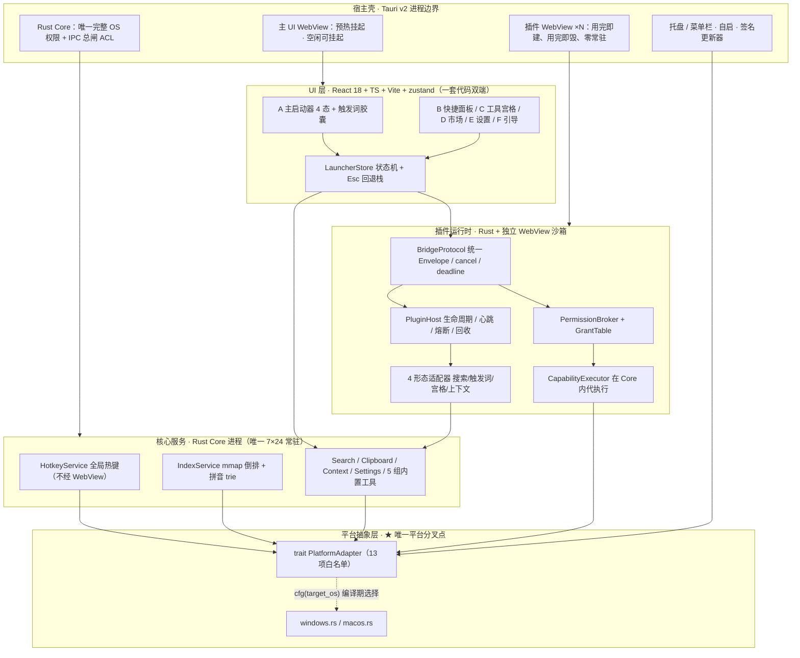

# DeskKit 架构选型复核（2026-11）

> **状态：历史文档，不要按本文实现。** 「维持 Tauri v2」已被推翻。现行架构见 [`docs/10-Current-Architecture.md`](../10-Current-Architecture.md)。

> 版本 v1.0 ｜ 撰写：高见远（架构师）｜ 团队：software-deskkit ｜ 核实日期：**2026-11-13**
> 性质：对 `docs/02-Architecture.md` §2 与 `handoff/TECH-SPEC.md` 第 1/2/8 章既有选型决策的**正式评审**，不是新功能设计。
> 边界：**本次只新建本文件**，未改动 `02-Architecture.md`、`handoff/` 四份文档、`prototype/index.html`、QA 报告与测试脚本；原型 QA 基线 md5 `1fc47e74727696c2fa21a9c7a104d293` 未触碰。即使结论为「切换」，也只给结论与影响范围，由用户决定是否落改。
> 事实标注：所有核实数据用 `[S#]` 引用，来源与核实日期见 §9；**核实不到的一律明写「未核实」**，不臆断。

---

## 0. 结论先行

| 用户四问 | 一句话结论 |
|---|---|
| **我们用的架构是什么** | Tauri v2：Rust Core + 系统 WebView（Win WebView2 / mac WKWebView）+ React 18/TS/Vite/zustand；五层结构，**`PlatformAdapter` 是唯一平台分叉点**，插件跑在独立 WebView 沙箱、经 5 道防线在运行时被强制拦截。 |
| **现在主流是什么** | **Electron 仍是市占与生态的事实标准**（npm 周下载、生产应用数、Stack Overflow 问答均显著领先）；Tauri 是增长最快的新项目选择但不是主流；启动器品类本身长期分裂为「原生单平台（轻/快）」与「Electron（Web 插件生态）」两派，2026 年 Raycast 2.0 代表第三条路「原生壳 + 系统 WebView + 共享 Web UI + Rust Core」。 |
| **为什么用这个** | 「≤80MB 空闲常驻 + 插件生态必须 Web 化 + 双端 P0/P1 对齐 100%」三个约束同时成立时，选集收敛到 **Tauri v2 或自建混合壳**；后者需专门团队（Raycast 为此投入数年、四层运行时），本项目不具备该工程量，故 Tauri 是唯一可交付解。 |
| **要不要切换** | **维持 Tauri v2，不切换。** 明确单一结论，不是「看情况」。切换只在 §5.2 的 6 条重评触发条件被满足时启动。 |

**一句话总判**：Electron 更主流、更好招人、生态更深，这一点**不回避**；但它在本项目的 **NFR-03 ≤80MB** 上是架构性不达标（复核后更保守口径仍 ~150MB，接近上限 2 倍），而「更现代」从来不是切换理由。**Raycast 2.0 在 2026 年选择与我们同构的混合架构，反向印证了方向，而不是否定它。**

---

## 1. 核实方法与数据可信度（先说清哪些数字变了）

### 1.1 原决策数据 vs 2026-11 复核

| 项 | 2026-11-06 原值 | 2026-11-13 复核 | 判定 |
|---|---|---|---|
| Electron 稳定版 | 43.4.0（Chromium 150） | **45.2.3**（Node 24.22.2 / Chromium 156）`[S1]` | 版本推进，需更新 |
| Electron 启动优化 | 未纳入 | 43 起主进程用 Node startup snapshot、framework/preload 缓存为 V8 bytecode、renderer 启动数据前置 `[S2]`；45 起 ASAR 直读、macOS 冷启预取、未开 `webviewTag` 的沙箱 renderer **跳过内置 JS bootstrap bundle（内存更可控）** `[S3]` | **实质改进，但无公开 idle 内存降幅数字（未核实）** |
| Electron idle 内存 | 250–320MB | 168MB `[S4]`；Fora Soft 以 **150MB resident 为其 Electron 产品预算**，并称实测 shipped apps「远低于常被引用的 200–300MB」`[S5]`；另有 150–400MB 区间 `[S7]` | **原值属偏高口径，应视为过时**；但 150–168MB 仍是 80MB 的 **1.9–2.1 倍**，否决结论不变 |
| Electron 包体积 | 120–187MB | 85MB（Hello World）`[S4]` / 85–150MB `[S5]` | 偏高口径，方向不变 |
| Tauri idle / 包 / 启动 | 60–134MB / 8–56MB / 142ms–1.04s | 42MB / 3.2MB / 380ms `[S4]`；20–80MB `[S6]` | 区间重叠但口径不同；**另发现固定 WebView2 Runtime 会让 Tauri 安装包增加 ~180MB** `[S7]`，包体积优势依赖打包方式 |
| Tauri 成熟度 | 「v2 稳定」未给时长 | **2.0 stable 约 2024 年末，至核实日约 2 年** `[S4]`；npm 周下载口径差异大（见下） | 需补齐生态与时间维度 |
| 竞品格局 | 仅 uTools / Rolan / Raycast 概述 | **Raycast 2.0（2026-05）重写为跨平台混合架构；Wails v3 于 2026-10-26 GA** `[S9][S17]` | 两条 11-06 未纳入的新事实，本文已补入格局表 |

### 1.2 数据可信度声明（重要）

- **广传基准缺乏方法论**：Fora Soft 明确指出「Tauri 96% 更小 / 省 5 倍内存」类基准**未披露 app 规格、OS 版本、框架版本**，hello-world 对比不能推断产品级表现 `[S5]`。本文因此**不把任何单点数字当 SLA**，只用方向性结论 + 区间，并注明测量口径未知。
- **生态代理指标口径互相矛盾**：`electron` 周下载 11,770,880 vs `@tauri-apps/api` 3,939,762（2026-10-25~31）`[S5]`；另一来源给 1.66M vs 85K `[S4]`；横评给 28M+ vs 150K+ `[S6]`；GitHub Stars ~117K vs ~106K、SO 问答 ~50K vs ~5K、生产级应用 1000+ vs 200+ `[S6]`。**数值不可直接互相比较，但方向高度一致：Electron 生态规模显著更大。** 本文只取方向。
- **「桌面框架市占率百分比」：未核实**（无可信一手统计）。本文用 npm 周下载 / GitHub Stars / SO 问答 / 生产应用数作为代理指标，并明确它们不等于市占率。

---

## 2. 问题一：我们用的架构是什么

### 2.1 五层分层图

| 层 | 职责 | 进程归属 | 是否含平台判断 |
|---|---|---|---|
| 宿主壳 | 进程边界、窗口/托盘、IPC 总闸、签名更新 | Rust Core + 系统 WebView 进程 | 否（由平台层提供） |
| 平台抽象层 | 13 项白名单（修饰键文案、默认键、热键冲突、TCC 权限、索引源、材质、关闭行为…） | Rust Core | **是，且仅此一处** |
| 核心服务 | 热键、索引、搜索、剪贴板、上下文、设置、5 组内置工具 | Rust Core | 否 |
| 插件运行时 | 沙箱、manifest、协议、授权、生命周期、崩溃隔离 | Rust Core + 插件独立 WebView | 否 |
| UI 层 | 6 界面、状态机、主题 token | 主 UI WebView | 否（文案映射由数据注入） |

### 2.2 进程模型与一次呼出的数据流

**进程模型**：Core 常驻 ≈42MB（设计预算，非实测）＝ Rust Core 12MB + mmap 索引 8MB + 剪贴板索引 4MB + 挂起 UI 0–16MB + 托盘 2MB + 预留 16MB；**插件 WebView 默认 0 常驻**，激活时瞬时峰值 ≈138MB（不受 NFR-03 约束）。热键在 Core 注册，不依赖 WebView 调度。

**一次呼出（7 步）**：① 按 `Alt/⌥+Space` → Core 的 `HotkeyService` 直接捕获 → ② 经 `PlatformAdapter` 做冲突检测与多屏定位 → ③ 唤醒预热挂起的主 UI WebView 并聚焦输入框（P95 <100ms） → ④ 输入后先 `cancel` 旧请求，`SearchService` 查 mmap 索引（<30ms）+ 算式/内置工具 + `ContextMatcher` → ⑤ 命中插件则 `PluginHost` 并行 invoke，各自 deadline、异步合流、超时丢弃该分组 → ⑥ `Enter` 分流：启动类经 opener / 工具类求值写剪贴板 / 插件类经权限防线由 Core 代执行 → ⑦ 失焦 150ms 隐藏并回收插件 WebView。

**5 道权限防线**（详见 `TECH-SPEC.md` §6.4，本文不重复展开）：① 装载期动态生成最小 capability（仅 `dk-plugin:allow-bridge-call`）→ ② Core IPC 入口 ACL default-deny，插件直调返回 `Command not allowed` 且**无弹窗** → ③ `PermissionBroker` 查 `GrantTable`（allow/deny/once）→ ④ `ScopeValidator` 验域名/路径/类型（deny 优先）→ ⑤ `CapabilityExecutor` 在 Core 内代执行、**只返回结果数据，永不返回句柄/token**。授权弹窗只写决策，不承担拦截。

---

## 3. 问题二：现在主流是什么（2026-11 格局）

> **必须区分**：「市占主流」回答的是*别人都在用什么、招人容不容易、遇到问题有没有答案*；「适合本项目」回答的是*在不可妥协判据下谁能交付*。两者不同，且**不因为 Electron 是主流就适合本项目**。

### 3.1 桌面跨平台格局表

| 方案 | 代表产品 | 市占 / 成熟度（2026-11） | 强项 | 弱项 | 适合什么场景 |
|---|---|---|---|---|---|
| **Electron**（Chromium+Node） | VS Code、Slack、Discord、Notion、Figma、uTools `[S5][S8]` | **事实标准**：npm 周下载千万级、SO 问答 ~50K、生产应用 1000+ `[S5][S6]`；稳定版 45.2.3 `[S1]` | 生态最深、渲染引擎一致（自带 Chromium）、招人最易、Node/npm 全可用、签名更新最成熟 | **idle 150–168MB（保守口径）**、包 85–150MB、冷启 ~1.4s `[S4][S5]`；43/45 有启动优化但未改变架构性开销 `[S2][S3]` | 已有 Web 前端、需要一致渲染/实时媒体/深 npm 依赖、团队无 Rust |
| **Tauri v2**（Rust Core + 系统 WebView） | Spacedrive、AppFlowy、Cody `[S6]` | 增长最快但非主流：stable 约 2 年 `[S4]`；Stars ~106K、SO ~5K、生产应用 200+ `[S6]` | 包/内存最低、default-deny capability 权限体系、Rust 内存安全、可扩移动端 `[S4][S6][S7]` | **WebView 版本碎片化**、长尾插件缺口（USB/串口/MIDI）、Rust 门槛、生态约为 Electron 的零头 `[S6][S7]` | 性能/包体积/安全敏感、需要运行时权限强制、愿承担 Rust |
| **混合自建**（原生壳 + 系统 WebView + 共享 Web UI + Rust Core） | **Raycast 2.0**（2026-05 public beta）`[S9]` | 品类内最先进实践，但需专门团队 | 完全控制每层、系统 API 完整访问、双端一套 React UI、扩展仍用 React/TS | 4 层运行时（Swift/AppKit、C#/.NET8/WPF、React、Node 长驻、Rust）工程量极大；Node backend 常驻 | 有资源「填坑」并把控制力当护城河的团队 |
| **Flutter Desktop**（Dart + Impeller 自绘） | Google Classroom、Ubuntu installer、Toyota `[S14]` | Win stable 2022、mac/Linux 随后；Impeller 2026-06 成 Win 默认；约 1/4 Flutter 开发者 targeting desktop `[S14]` | 六端一套代码、像素一致、团队若有 Flutter 基础则最省 | **无官方自动更新**；托盘/全局快捷键/通知/多窗口靠社区包；自绘不原生；**无 WebView → 插件无法 HTML/JS** `[S14]` | 已有 Flutter 移动代码库的内部工具 / 品牌一致 UI |
| **React Native Desktop**（RNW / RN macOS） | 微软自家 out-of-tree 项目 `[S15]` | **版本滞后**：上游 0.87 Active 时 RNW 0.84、RN macOS 0.81.8，落后 3–6 个 minor；每版补丁窗口约 3 个月；Linux 无维护项目 `[S15]` | React/TS 复用、原生控件观感 | 桌面端 out-of-tree、升级频繁、全局热键/托盘/截图仍需原生模块、**原生控件无 WebView 供插件** | 已有 RN 移动 App 需顺带出桌面 |
| **Avalonia / .NET MAUI**（C# + XAML） | JetBrains、Autodesk、NASA、Devolutions（Avalonia）`[S16]` | Avalonia 11.3 stable 2026-03、12.1 加 Wayland、31.3K stars `[S16]` | Avalonia 像素一致、Tray/NativeMenu/多窗口内置、WPF 技能可迁移 | **自绘无 WebView 运行时**（HTML/JS 插件不成立）；MAUI 托盘非开箱、mac 仅 Mac Catalyst、Linux 不支持 `[S16]` | .NET 团队、企业内部工具、无插件生态诉求 |
| **Wails v3**（Go Core + 系统 WebView） | Go 生态工具 `[S17]` | **v3.0.0 GA 2026-10-26**，Go 1.26+，多窗口/托盘/签名 updater+rollback `[S17]` | Go 学习曲线低于 Rust、系统 WebView、单一二进制 | 生态最小（~35K stars）；**GHSA-2p5f-2gx8-mh8m 仅部分修复、child frame 可达 bound Go methods** `[S17]`；无 Tauri 式 default-deny capability | Go 团队、不需要第三方不可信插件沙箱 |
| **纯原生双端 + 共享逻辑** | Rolan、Listary、Alfred（单平台）`[S12][S13]` | 单平台成熟度最高 | 最轻最快（Listary <40MB、Rolan 安装包 <600KB） | **两套原生 UI = 两倍工作**（Raycast 因此否决该路线 `[S9]`）；双端对齐成本最高；插件生态封闭 | 单平台极致轻量工具 |
| **原生 UI + 共享 Rust/Go Core** | Raycast 的 Rust Core 属此类变体 `[S9]` | 可行但需自建壳 | 性能关键路径共享、UI 原生 | 仍要两套 UI；插件生态需另建 | 已有原生团队 + 重计算需求 |

### 3.2 市占主流：明确不回避

**Electron 仍是 2026-11 桌面跨平台的事实标准**：npm 周下载千万级、生产应用 1000+、SO 问答约 5 万条，均显著领先 Tauri `[S5][S6]`；VS Code / Slack / Discord / Notion / Figma 仍在大规模运行，Electron「没有消亡，只是增长趋平」`[S4]`。Stack Overflow 2025 调查显示 72% 桌面开发者考虑过换框架，主因是性能与包体积 `[S4]`。**变化的是动量，不是地位。** 我们不用它是因为判据不匹配，不是因为它过时。

### 3.3 启动器品类的实际技术栈（逐一核实）

| 产品 | 技术栈 | 平台 | 插件形态 | 核实情况 |
|---|---|---|---|---|
| **uTools** | Electron（Chromium + Node.js）`[S8]` | Win/mac/Linux | **标准 Web（React/Vue）+ `plugin.json` + `index.html` + `preload.js`**；3000+ 插件、500 万用户、默认 `Alt+Space` `[S8]` | 官方文档一手核实 |
| **Raycast 2.0** | mac：Swift+AppKit；Win：C#+.NET8+WPF；共用 React+TS；Node 长驻 backend；Rust Core（直读 NTFS MFT 索引）`[S9]` | mac + Win | 扩展 React+TS+Node，UI 声明式由原生 app 渲染，API 可移植 `[S9]` | 官方技术博客 + 多篇一手转述 |
| **Alfred / LaunchBar / Quicksilver** | Objective-C 原生 macOS `[S12]` | mac only | 有插件，闭源生态 | 对比表核实；**各产品当前版本状态未核实** |
| **Rolan 5** | 官方宣传「**100% 原生、无 WebView、无 Electron**」；分组拖拽、拼音/首字母匹配、安装包 478–563KB `[S13]` | Win only | 无开放插件生态 | **官方实现语言未核实**（仅宣传口径 + 第三方 Qt/C++ 复刻 `[S13]`）；Rolan 2 需 .NET Framework 4.6.2 `[S13]` |
| **Flow Launcher** | C# / .NET 8 + WPF；v2.1.1（2026-03-09）；安装包 94.21MB `[S10]` | Win only | C#/F#/Python/JS/TS 经 JSON-RPC stdio，或原生 C# 程序集 `[S10]` | 官网 + 架构文档核实；空闲 90–150MB `[S10]` |
| **PowerToys Run** | .NET Core + WPF + MVVM；`IPlugin` / `IDelayedExecutionPlugin`（快速查询 <100ms）`[S11]` | Win only | .NET 插件程序集 `[S11]` | 微软官方架构文档一手核实 |
| **Listary** | C++ 原生后台进程、挂钩 Explorer，**<40MB**，插件架构封闭 `[S12]` | Win only | 封闭 | 第三方评测核实；官方实现细节未核实 |
| **Raycast 2.0 Windows 是否仍为邀请制** | — | — | — | **未核实**（官网已列 Win10+ x64/ARM64 下载 `[S9]`，公开 beta 2026-05-14） |

**为什么这个品类多数选原生或 Electron**（由上述核实事实归纳，非单一来源结论）：

1. **选原生**：启动器的核心是「全局热键 + 悬浮不抢焦点 + 7×24 极轻常驻 + 深 OS 集成」，原生最贴合（Listary <40MB、Rolan 无 WebView 无 Electron、Alfred Objective-C）；代价是单平台、插件生态封闭。`[S12][S13]`
2. **选 Electron**：一旦产品以「搜索框 + 大量第三方 UI 插件」为核心，用 Web 技术栈做插件是门槛最低的路径（uTools 3000+ 插件即由此而来）；代价是常驻内存。`[S8]`
3. **2026 年出现第三条路**：既要 Web 插件生态、又要双端一致与低内存 → **原生/系统 WebView 壳 + 共享 Web UI + Rust Core**。Raycast 2.0 明确否决 Electron（深层 OS 集成、不愿在 mac 打包 Chromium）、否决纯原生双 UI（两套栈=两倍工作）、否决「当时太年轻」的 Tauri 与 Flutter/Qt/RN Desktop，最终自建四层混合架构 `[S9]`。**这正是我们选型的同构方向**，差别在于我们用 Tauri 提供的壳，省掉自建壳的工程量。

### 3.4 插件生态的关键权衡（必须说透）

- **uTools 插件 ≠ 纯 HTML/JS**：官方文档明确，插件前端是标准 Web（React/Vue），但**前端无法直接访问 Node.js 与第三方 Node 模块**，需通过 `preload.js` 桥接层暴露 `window.*` 接口，桥接层可访问 `uTools API` / Node.js / 第三方 Node 模块 / **Electron renderer API** `[S8]`。
- **结论 1**：若换成**非 WebView 方案**（Flutter / Avalonia / 纯原生 / RN 原生控件），第三方插件的 UI 层失去 Web 运行时，**HTML/JS 低成本写插件这一条直接不成立**，需改为 Dart/C#/Swift/Rust 模块或自带渲染层 → 开发门槛与生态规模都会显著劣化，与「开放插件运行时」硬冲突。这是 11-06 否决原生混合的核心，2026-11 复核**依然成立**。
- **结论 2（诚实）**：即使我们**同为 WebView 方案**，**也无法直接复用 uTools 3000+ 插件** —— 它们依赖 `window.utools` 与 preload 的 Node/Electron API，而我们只暴露 `bridge.call` 且刻意不提供 Node/任意 shell。我们走的是**协议兼容**（同样 Web 技术栈、同样 manifest + 事件模型），不是**二进制兼容**。代价是插件生态从零起步；收益是权限运行时强制拦截与 ≤80MB。这是**刻意取舍，不是疏漏**，应在产品策略上用「官方内置 5 组工具开箱即用 + 本地 Beta 市场」来补，而不是靠换框架。

---

## 4. 问题三：为什么用这个

### 4.1 判据逐条对上 NFR（复核后是否仍成立）

| 判据 | 数字 | Tauri 对策 | 复核后 | 若换 Electron / RN Desktop / Flutter 的后果 |
|---|---|---|---|---|
| NFR-01 呼出 | <100ms P95，冷启 <300ms | 热键在 Rust Core 注册（不经 WebView）+ 预热挂起 WebView | ✅ 仍成立；Electron 43/45 的启动优化 `[S2][S3]` 改善的是**启动**而非热键路径调度 | Electron 冷启 ~1.4s `[S4]`；RN/Flutter 的托盘与全局热键靠社区包，P95 无保证 `[S14][S15]` |
| NFR-02 输入→结果 | <100ms（万级索引） | mmap 倒排 + 拼音 trie（本地 <30ms）；插件结果异步合流、超时丢弃分组 | ✅ 仍成立 | 与框架弱相关，主要靠 Rust 侧实现；但 Tauri IPC 若做 chatty invoke 会退化 `[S7]` → 已在契约里收敛 |
| **NFR-03 空闲** | **≤80MB** | Core/WebView 进程分离；WebView 空闲挂起；**插件零常驻**；预算 ≈42MB | ⚠️ **仍成立但最脆弱**：它是**设计预算不是实测**；且 WebView 进程空闲内存口径 20–134MB 波动 `[S4][S6][S7]` | **Electron 150–168MB 保守口径仍 ~2 倍超标** `[S4][S5]`；Flow Launcher .NET 90–150MB `[S10]` 亦超标；这是硬性淘汰线 |
| NFR-04 离线 | 内置工具 + 已装插件全离线 | 词库/汇率/索引/插件包全本地；`E_OFFLINE` 降级 | ✅ 成立 | 框架无关；Flutter 无官方更新器反而更难保证插件包分发 `[S14]` |
| NFR-06 权限运行时拦截 | 可撤销、立即生效、崩溃隔离 | default-deny capability + ACL + Broker + Scope + Core 代执行 + 独立 WebView 进程 | ✅ **Tauri 独有优势**；v2 经外部安全审计 `[S7]` | Electron 需自建 `contextBridge` + 多 BrowserWindow 隔离且内存代价大；**Wails v3 的 child-frame 可达 bound Go methods 是同类风险** `[S17]`；Flutter/Avalonia 无现成 default-deny 体系 |
| NFR-07 同期 | 同版本号/发布日，P0/P1 对齐 100% | 一套前端 + `PlatformAdapter` 唯一分叉点 + CI 双 job 全绿才 publish | ✅ 成立，但**WebView 版本碎片化是真实代价** `[S7]` | Electron 自带 Chromium 渲染最一致（真实优势），但功能分叉仍需 CI 约束；RN Desktop 版本滞后 3–6 minor 使「两端同版本」更难 `[S15]` |
| 插件生态 Web 化 | HTML/JS 低成本 | 插件即 HTML/JS + manifest，跑独立 WebView | ✅ 成立 | Flutter / Avalonia / 纯原生 / RN 原生控件**全部不成立**（§3.4） |

### 4.2 三个约束如何把选集收敛到 Tauri

| 约束 | 淘汰谁 | 幸存 |
|---|---|---|
| ① `≤80MB 空闲常驻` | Electron（150–168MB）、.NET/WPF（90–150MB）、Node backend 常驻方案（Raycast 2.0 有此层） | Tauri、Wails v3、纯原生、Flutter（自绘内存较低但无实测口径） |
| ② `插件生态必须 Web 化` | Flutter、Avalonia/MAUI、RN 原生控件、纯原生、Wails v3（无成熟不可信插件沙箱，且有 child-frame 安全边界问题 `[S17]`） | Tauri、Electron、混合自建 |
| ③ `双端 P0/P1 对齐 100%` | 纯原生双端（两套 UI=两倍工作 `[S9]`）、单平台方案（Rolan/Listary/Alfred/Flow/PowerToys）、RN Desktop（版本滞后 `[S15]`） | Tauri、Electron、混合自建 |
| ①∩②∩③ | — | **Tauri v2 与「混合自建（Raycast 式）」** |

**为什么最终是 Tauri 而不是混合自建**：两者架构同构，但 Raycast 为自建壳投入数年并维护 Swift/AppKit + C#/WPF + React + Node + Rust **四层运行时**，其官方博客也把「Electron 帮你做好的基础设施都得自己建，大多数团队没有工程资源填这个坑」写明 `[S9]`。Tauri 提供的正是这层壳 + capability 权限 + 官方插件矩阵，使本项目在 T01–T05 五个任务内可交付。**Raycast 2023 年否决 Tauri 的理由是「当时太年轻、控制力不够」；到 2026-11 Tauri 已稳定约 2 年 `[S4]`，「太年轻」时效性减弱，但「控制力差距」仍是真实劣势**（见 §4.3）。

### 4.3 原决策里最脆弱的 5 个假设（复核重点）

| # | 假设 | 2026-11 的新证据 | 若失效的后果 | 监测方式 |
|---|---|---|---|---|
| V1 | **≈42MB 常驻可达** | Fora Soft 质疑所有基准方法论 `[S5]`；Tauri 空闲口径 20–134MB 波动 `[S4][S6][S7]`；**42MB 是预算，无本项目实测** | NFR-03 直接失守，整个选型理由坍塌 | T02 完成判据已含「空闲 RSS ≤80MB 两端各测」，必须实测；未达标先收紧 WebView 挂起策略，再谈切换 |
| V2 | **WebView 版本碎片化可控** | Win WebView2 自更新、mac WKWebView 仅随 OS 更新（旧 macOS 不再获 WebKit 更新）、Linux WebKitGTK 因发行版而异 `[S7]`；Raycast 花大力「驯服 WebKit：它为浏览器设计，不是为每天显隐数百次的启动器」`[S9]` | 双端渲染不一致 → NFR-07；频繁显隐白屏/闪屏 → NFR-01 | CI 双端截图 diff 基线 + 显隐压力测试（T05）；**Tauri 侧「每天显隐数百次」的稳定性实测数据：未核实** |
| V3 | **团队能写 Rust** | Rust 高级岗美国 $180–230K `[S7]`；Electron→Tauri 是**完整重写而非重构**，Node 代码不能搬 `[S7]`；capability 常被配得过宽、IPC chatty 会退化 `[S7]` | T01–T03 阻塞；权限体系被配宽 → NFR-06 形同虚设 | 见 §6 降级路径；`cargo clippy` + capability 最小集代码审查 |
| V4 | **Tauri 生态够用** | 官方插件 30+，长尾缺口 USB/串口/MIDI `[S6]`；SO 问答 ~5K vs Electron ~50K `[S6]`；固定 WebView2 Runtime 让安装包 +~180MB `[S7]` | 个别系统能力需自研，工期不可控 | 自研 `BridgeProtocol` 屏蔽框架、插件只依赖 `deskkit` API（原 R7 缓解）；T01 阶段先验证 6 类权限对应插件全覆盖 |
| V5 | **签名/更新链路可落地** | 更新签名不能关闭、**私钥丢失即无法给既有安装发更新**；Windows 需「先 Authenticode 再重新生成 minisign」两步，顺序错 updater 拒绝 `[S7]`；mac WKWebView 无 WebDriver（e2e 自动化受限）`[S7]` | 发出去却无法升级 → 灾难性 | CI 密钥管理 + 干净机器验证签名更新链路，列入 G7 |

> 另注：11-06 的「Electron 250–320MB」与「包 120–187MB」属偏高口径（§1.1），**应视为过时表述**；但结论方向不变。这是本次复核发现的最直接文档修订点（见 §8）。

---

## 5. 问题四：要不要切换

### 5.1 明确单一结论

> **维持 Tauri v2，不切换。**

理由压缩为三条：① 六条 NFR 中 NFR-03/NFR-06 是架构性判据，2026-11 复核后 Electron 仍不满足（150–168MB vs 80MB），Flutter/Avalonia/RN/纯原生不满足 NFR-06 或插件生态；② Raycast 2.0 的同构混合架构证明方向正确，且它没有推翻 Tauri 式「系统 WebView + Rust Core + Web 插件」的组合；③ **切换成本极高且不带来判据改善** —— 迁移到 Electron 等于用 NFR-03 换生态，迁移到 Wails v3 等于用 NFR-06 换 Go 门槛，迁移到自建混合壳等于用可交付性换控制力，三者都是净亏。

**不切换的影响范围：零**（本次未改任何冻结交付物，T01–T05 与 QA 基线全部维持）。

### 5.2 重评触发条件（满足任一条才启动重新评估，不是「看情况」）

| # | 触发条件 | 阈值 / 判据 | 触发后应评估的替代方案 | 说明 |
|---|---|---|---|---|
| T1 | **NFR-03 被产品方放宽** | 空闲常驻上限放宽到 **≥150MB** | **Electron 43/45**（`[S1][S2][S3]`）+ 直接兼容 uTools 插件生态 | 这是唯一能让 Electron 通过硬判据的变更；同时需接受包体积与冷启退化 |
| T2 | **要求直接复用 uTools 现有插件** | 需支持 `window.utools` + `preload.js` 的 Node/Electron API（§3.4） | **Electron**（几乎唯一现实路径） | 与 T1 常同时发生；代价是放弃 ≤80MB 与「权限运行时强制拦截」的现成实现 |
| T3 | **新增 Linux 端为硬需求** | Q5 由「不做」改为「必做」 | 先评估 **Tauri Linux**（需 WebKitGTK 4.1 基线，Ubuntu 22.04 / Debian 12 `[S7]`）；若渲染一致性不可接受再评估 **Avalonia 11.3** 或 **Wails v3** | Avalonia/Wails 会牺牲插件生态或权限模型，须连带复核 NFR-06 |
| T4 | **团队无法引入 Rust 且 §6 缓解全部失败** | T01–T03 的 Rust 部分无人可交付、外包亦不可用 | 依次评估 **Wails v3**（Go 学习曲线低于 Rust `[S17]`，但先解决 child-frame 安全边界 `[S17]`）→ **Electron + 放宽 NFR-03** | **不是立刻推翻结论**：先走 §6 的 D1–D4 降级路径 |
| T5 | **放弃「开放插件运行时」，改做纯内置工具** | 三大约束去掉一条，第三方插件不再需要 | **纯原生双端**（Rolan 式 `[S13]`）或 **Flutter Desktop / Avalonia** | 此时 NFR-03 可更轻松达成；但产品定位已变，应重走 PRD 而非仅改架构 |
| T6 | **产品转为移动端优先，要求一套代码覆盖 iOS+Android+Desktop** | 移动端成为一等公民 | **Flutter**（六端一套、桌面最成熟的是 macOS `[S14]`）或 **Tauri Mobile**（2.x 已支持，但移动端成熟度弱于 RN/Flutter `[S4][S18]`） | 会引入「Node/插件运行时在移动端如何裁剪」的新问题，需独立评审 |
| T7 | **要求与 Raycast 同等的 WebView 显隐控制力** | V2 失效且 CI 截图/显隐压测无法收敛 | **自建混合壳**（Raycast 2.0 式 `[S9]`） | 成本最高：需专职 Swift/AppKit + C#/WPF + Rust + Node 四层团队；仅在融资/团队规模显著变化时才现实 |

### 5.3 若未来触发切换，影响范围（前置说明，本次不落改）

| 受影响对象 | 范围 |
|---|---|
| `handoff/TECH-SPEC.md` | 第 1 章选型结论、第 2 章 INV-01/03/04/06/07、第 3 章目录（`src-tauri/` 全量）、第 8 章性能预算、第 9 章依赖清单、第 10 章 T01–T05 全部需重写 |
| `docs/02-Architecture.md` | §2 选型、§3 插件运行时（沙箱模型）、§4 平台抽象层（13 项白名单映射）、§7 任务列表、§8 依赖 |
| `prototype/index.html` 与 QA 基线 | UI 与交互规格不变，**但「唯一分叉点」静态扫描基线（§4.4.1 A1–A4）需按新框架重定**；QA 140 项断言的框架相关项需复核 |
| 迁移成本性质 | Electron→Tauri 是**完整重写而非重构** `[S7]`；反向同理。T01 契约（`shared/contracts/`）与 UI 层可部分保留，Rust Core 与权限体系需整体替换 |

---

## 6. 团队能力风险与缓解（用户为移动端工程师，RN/Flutter/原生方向，1–3 年）

**先明确边界：Rust 只出现在三处，其余仍是用户熟悉的技术栈。**

| 区域 | 语言 / 技能 | 是否需 Rust | 占比估计（非核实数据，仅规划参考） |
|---|---|---|---|
| `src/` 六界面、状态机、主题 token | React 18 + TS + Vite + zustand | 否 | 约 50–60% 代码量 |
| `src/plugin-bridge/` 与第三方插件 | HTML/JS/TS + manifest | 否 | 插件开发者**完全不需要 Rust** |
| `shared/contracts/` 契约 | TS 类型 + Rust serde 镜像 | 少量（镜像，机械对应） | 约 5% |
| `src-tauri/src/core/` | Rust | 是 | 约 20–25% |
| `src-tauri/src/plugin_runtime/` | Rust | 是 | 约 10–15% |
| `src-tauri/src/platform/`（13 项白名单） | Rust + 平台 API（TCC / WebView2 / 注册表） | **是，且最难** | 约 5–10% |

**学习成本预估（非核实数据，规划参考）**：能改 `tauri.conf.json` / capabilities 配置 ≈ 数天；能写 `#[tauri::command]` 与 serde 镜像 ≈ 2–4 周；能独立交付 `platform/macos.rs` 的 TCC 权限、公证与 `PluginHost` 权限网关 ≈ 2–3 个月，且需 macOS 系统知识。Rust 的所有权/生命周期与「把 Rust 当另一个 Node 进程用」的误解是主要坑 `[S7]`。

**降级路径（不推翻结论，按序执行）**：

| # | 措施 | 效果 |
|---|---|---|
| D1 | **收窄 Rust 面**：把 Core 做成「一次性写好的骨架」，日常功能迭代全部落在 TS 侧；5 组内置工具以 `source=builtin` 走同一协议，新增工具尽量不碰 Rust | 让 80% 日常迭代与 Rust 无关 |
| D2 | **优先用官方插件**替代自研系统能力（`global-shortcut` / `clipboard-manager` / `autostart` / `updater` / `fs` / `http` / `notification`），社区补 TCC 与截图 | 减少需要自研的 Rust 量 |
| D3 | **工程护栏降门槛**：T01 契约先行 + `cargo clippy` + capability 最小集审查 + CI 双端构建闸门，把易错处变成自动断言；AI 辅助生成 Rust 骨架并由人工审查 | 缓解 V3 / V4 |
| D4 | **若仍无法引入 Rust**：以协作/外包方式交付 T01–T03 的 Rust 部分（骨架 + 平台层 + 权限网关），本人长期维护 TS 前端与插件生态；这是「补人」而非「换框架」 | 保持选型不变 |
| D5 | **D1–D4 全部失败**才进入 §5.2 的 T4：先评估 Wails v3（Go 曲线更缓），再评估 Electron + 放宽 NFR-03 | 有门槛、有顺序，不直接切换 |

> 立场：选型判据是**产品硬约束**（NFR-03 / NFR-06 / 插件生态 / 双端同期），不是团队偏好；团队能力风险应通过 D1–D4 缓解，而不是用它去推翻一个仍然满足全部硬判据的结论。

---

## 7. 与竞品的对齐检查：劣势还是差异化（不含糊）

| 对手 | 其技术栈（2026-11） | 我们 | 差异性质 | 明确判断 |
|---|---|---|---|---|
| **uTools** | Electron + Node preload 桥 + 3000+ 插件 `[S8]` | Tauri + `bridge.call` + 本地 Beta 市场 | **生态规模：明确劣势**；**内存/权限：差异化** | 「插件数量与成熟度」我们输，且短期追不上（§3.4 协议兼容 ≠ 二进制兼容）。「≤80MB + 6 类权限可撤销且运行时强制」是 uTools 架构不提供的差异化。**不要混为一谈，也不要用差异化话术掩盖生态劣势**；补法是内置 5 组工具开箱即用 + 官方插件，不是换框架 |
| **Raycast 2.0** | 自建四层混合壳（Swift/AppKit、C#/WPF、React、Node、Rust）`[S9]` | Tauri 提供的壳 + Rust Core | **架构同向（非劣势）**；**控制力与工程投入：明确劣势** | 方向被 2026 年品类最先进实践印证；但 Raycast 能细粒度驯服 WKWebView 显隐、直读 NTFS MFT，我们不能。**「Tauri 更现代」不是卖点**，卖点是「用标准壳换可交付性」 |
| **Alfred / Listary / Rolan** | Objective-C / C++ 原生单平台，`<40MB`、无 WebView `[S12][S13]` | 双端同期 + WebView | **单平台极致轻量与瞬时响应：明确劣势**；**双端同期 + 开放插件：差异化** | 我们解决的是它们结构上没解决的问题（Rolan 仅 Win、Listary 插件封闭）；但在「一台机器上最轻最快」上永远赢不了原生 |
| **Flow Launcher / PowerToys Run** | C#/.NET8/WPF，Windows-only，插件 C#/Python/JSON-RPC `[S10][S11]` | 双端 + Web 插件 + 权限网关 | **Windows 桌面组件成熟度与深度集成：劣势**；**双端 + Web 插件 + 权限：差异化** | 它们 90–150MB 亦不满足 NFR-03；其 .NET 插件生态对我们无直接复用价值 |

**一句总判**：我们的技术栈差异来自「**双端同期 + 开放插件运行时 + 权限可撤销**」这个组合，而不是单纯的框架优劣。真实劣势集中在三处 —— **插件生态规模、单平台极致轻量、WebView 显隐控制力**；这三处应由产品策略（内置工具开箱即用、官方插件、CI 截图与显隐压测）弥补，而不是通过切换框架解决，因为任何能补这三处的方案都会在 NFR-03 或 NFR-06 上失守。

---

## 8. 边界遵守与现有交付物冲突点

**未改动**（逐项确认）：`docs/02-Architecture.md`、`handoff/TECH-SPEC.md` 及其余三份 handoff 文档、`prototype/index.html`、`docs/03-QA-Report.md` 与测试脚本；QA 基线 md5 `1fc47e74727696c2fa21a9c7a104d293` 未触碰。本次**仅新建本文件**。

| # | 冲突点 / 修订建议 | 严重度 | 本次是否落改 |
|---|---|---|---|
| C1 | `02-Architecture.md` §2.2 与 `TECH-SPEC.md` §1.2 的「Electron 空闲 250–320MB」属**偏高口径**；2026-11 更保守口径 150–168MB `[S4][S5]`。**方向不变（仍 >80MB），但数字表述过时**，建议下版改注「口径依赖测量方式，区间 150–320MB」 | 文档准确性 | 否（按边界） |
| C2 | 同上的「包 120–187MB」；且复核发现**固定 WebView2 Runtime 会让 Tauri 安装包 +~180MB** `[S7]`，包体积优势依赖打包方式，建议补注 | 文档准确性 | 否 |
| C3 | 11-06 未纳入 **Wails v3 GA（2026-10-26）** `[S17]` 与 **Raycast 2.0（2026-05）** `[S9]` 两条新事实；格局判断需更新（本文 §3 已补） | 完整性 | 否（本文承载） |
| C4 | 11-06 未声明「广传基准缺乏方法论」`[S5]` 与「≈42MB 是设计预算非实测」；建议在 TECH-SPEC 第 8 章补一句「T02 必须实测，未达标先收紧策略」 | 风险披露 | 否 |
| C5 | **不构成冲突**：选型结论、13 项白名单、插件 5 道防线、双端 CI 闸门、NFR 对策、T01–T05 全部维持 | — | — |
| C6 | **QA 冻结基线 md5 与当前 `prototype/index.html` 实测「不一致」已澄清为读取口径差异，基线仍有效**：工作区文件系统对文件加了 `%TSD-Header-###%` 包装头（物理文件前 20 字节可验证）。Node `readFileSync` 读到**解码后的原始 HTML** = **208,228 bytes / `1fc47e74727696c2fa21a9c7a104d293`**，即 `03-QA-Report.md` §10.1、`fix-regression-results.json` 的 `sourceMd5`、`04-Naming.md`、`handoff/PROTOTYPE-SPEC.md` 声明的冻结基线口径；shell `md5` / `stat` 读到**带包装头的物理文件** = **212,992 bytes / `bee380603a586281c1745bb53a866c63`**。**两个指纹都对，是同一文件的两层读取口径；文件未被改动**（mtime 2026-11-06 18:11，早于本次复核）。结论：**基线仍有效，140 项断言结果有效，不发起重跑** | 已澄清（非缺陷） | 否，口径说明 |

> 以上 C1–C4、C6 仅为**修订建议与事实报告**，待用户决定是否开启变更流程；本文不落改，冻结交付物保持有效。

---

## 9. 核实来源索引（全部核实于 2026-11-13）

| # | 来源 | 类型 | 用于 |
|---|---|---|---|
| S1 | electronjs.org 官网（`electron@latest` 45.2.3 / Node 24.22.2 / Chromium 156） | 官方 | 当前稳定版 |
| S2 | electronjs.org/blog/electron-43-0 | 官方博客 | 43 启动优化（snapshot / V8 bytecode / renderer 前置） |
| S3 | mybj123.com「Electron 45 正式发布」 | 技术报道 | 45 ASAR 直读 / macOS 冷启预取 / 沙箱跳过 bootstrap |
| S4 | tech-insider.org「Tauri vs Electron 2026」（2026-09） | 横评 | 42MB vs 168MB、3.2MB vs 85MB、380ms vs 1420ms、Tauri 2.0 stable 约 2024 末、生态动量 |
| S5 | forasoft.com「Desktop App Development in 2026」 | 行业分析 | npm 周下载（10/25–31）、**基准方法论质疑**、150MB Electron 预算、AFFiNE/Teams 案例 |
| S6 | codef.cc「2026 主流 WebView 桌面框架横评」 | 横评 | Stars / 周下载 / SO 问答 / 生产应用数、Tauri 长尾插件缺口、Wails 生态 |
| S7 | technewsdaily / techloghub（Tauri v2 已知坑、迁移成本）；Tauri 官方文档转述 | 技术报道 + 文档 | WebView 碎片化、+180MB WebView2、签名私钥与两步签名、capability 配宽、IPC chatty、WKWebView 无 WebDriver、Rust 岗薪资 |
| S8 | u-tools.cn 官方「插件应用架构」+ 官网 | **官方一手** | Web 插件 + preload Node 桥、3000+ 插件、Alt+Space |
| S9 | raycast.com/blog「A Technical Deep Dive Into the New Raycast」+ designernews + 乔木博客 + jaylab | **官方一手** + 转述 | 2.0 四层混合架构、否决 Electron/Tauri/Flutter/Qt/RN 的理由、Rust Core、WebKit 显隐驯服 |
| S10 | flowlauncher.com 官网 + 架构 SKILL + open-source.store | 官网 + 社区 | C#/.NET8/WPF、JSON-RPC 插件、90–150MB、v2.1.1 |
| S11 | microsoft/PowerToys PR #7267 架构文档 | **官方一手** | .NET Core + WPF + MVVM、IPlugin |
| S12 | justapedia 启动器对比表、listary.com、open-source.store | 对比表 + 评测 | Alfred/LaunchBar Objective-C、Launchy C++(Qt)、Listary C++ <40MB |
| S13 | Rolan 官网宣传转述（ali213 / 32r / psp99）、portablefreeware、GitHub inkroom/rolan | 宣传 + 第三方 | 「100% 原生、无 WebView/无 Electron」、分组拖拽、体积；**官方实现语言未核实** |
| S14 | teamdev.com「Top 7 desktop app frameworks in 2026」、webparadox、softaims | 横评 | Flutter Desktop 现状、Impeller 2026-06、无官方更新器、社区包依赖、生产案例 |
| S15 | microsoft.github.io/react-native-windows Support Policy、Uno Platform（2026-08-21）、reactnative.dev | **官方一手** + 分析 | RNW/RN macOS 版本滞后、约 3 个月补丁窗口、Linux 无维护 |
| S16 | avaloniaui.net 官网、startdebugging（2026-05）、CSDN 问答 | 官网 + 分析 | Avalonia 11.3/12.1、Skia、MAUI 托盘/Mac Catalyst/Linux 限制 |
| S17 | Wails 官网、beyondthe.news（v3.0.0 GA 2026-10-26）、codef.cc | 官网 + 报道 | Go Core 路线、GA 时间、GHSA-2p5f-2gx8-mh8m 部分修复 |
| S18 | technewsdaily、tech-insider 生态段 | 报道 | Tauri 仓库年增 55%、Electron plateau、Rust 招聘成本 |

**明确标注为「未核实」的项**：Rolan 5 官方实现语言；桌面框架市占率百分比（仅有代理指标）；Raycast 2.0 Windows 是否仍为邀请制；Electron 43/45 启动优化对 idle 内存的具体降幅；Tauri 在「每天显隐数百次」启动器场景的长期稳定性实测；各竞品当前最新版本状态（Alfred/LaunchBar/Quicksilver）。以上均未在文档中作为事实结论使用。

---

> 评审结论：**维持 Tauri v2，不切换**；本次仅新建本文件，冻结交付物零改动。待用户决定 C1–C4 是否开启文档修订流程。

---

## 10. 后续落改记录（2026-11-13 收尾，主理人授权）

> 本节为**追加的审计轨迹**：§1–§9 与上方结论行均为「评审阶段（未获写授权时）」的快照，保持原样；其中 §8 的 C6 行按主理人明确指示**就地改为口径说明**，其余内容与 S1–S18 来源编号未删改。§8 表格「本次是否落改」列记录的是评审阶段状态，不代表本节的收尾状态。

### 10.1 授权范围

本次为**唯一授权的写操作**，范围严格限定为「澄清 C6 + 落改 C1–C4」，**只补注、不推翻任何结论**；任务 #6 保持 completed，未新建任务。

### 10.2 落改清单

| 文件 | 章节 | 改动 |
|---|---|---|
| `handoff/TECH-SPEC.md` | §1.2 选型结论表 | 「Electron 空闲 250–320MB」→ **150–320MB** 区间，注明 2026-11 更保守口径 150–168MB、11-06 的 250–320MB 属偏高口径、方向不变仍 >80MB |
| `handoff/TECH-SPEC.md` | §1.2 内存预算表后（新增补注） | ① ≈42MB 明确为**设计预算非实测**、T02 必须实测空闲 RSS、Tauri 空闲口径 20–134MB 波动、广传基准缺方法论披露不作为实测依据；② Electron 包体积 **85–187MB**；③ 固定 WebView2 Runtime 分发让 Tauri 安装包额外 **+~180MB**，发布体积按目标平台单独评估 |
| `handoff/TECH-SPEC.md` | §8 NFR-03 对策列 | 补入同一条「设计预算非实测 / T02 必须实测 / 口径波动 / 基准缺方法论」注记 |
| `handoff/TECH-SPEC.md` | §13 已知设计取舍（新增 1 条） | 补 2026-11 新事实：**Wails v3 GA（2026-10-26）** 与 **Raycast 2.0（2026-05）同构混合架构**（原生壳 + 系统 WebView + 共享 React UI + Rust Core）并明确否决 Electron 与纯原生双 UI，作为**方向印证**；如实保留「WebView 显隐控制力仍是 Tauri 相对自建混合壳的真实劣势」；明写**不因「Tauri 更现代」而维持选型** |
| `docs/02-Architecture.md` | §2.2 核实数据摘要（仅此节） | 空闲内存行 → **150–320MB** 区间补注；包体积行 → **85–187MB** 与 +~180MB 补注；表后新增 2026-11-13 复核补注（口径 / 方法论质疑 / 方向不变） |
| `docs/05-Architecture-Review.md` | §8 C6 行 | 就地改为**读取口径说明**（详见 10.3），移除原先的推测性归因与重跑建议，全文不再出现该表述 |
| `docs/05-Architecture-Review.md` | 本 §10 | 新增本节，记录授权范围、落改清单、未改清单、C6 结论与维持项 |

**未改**：`prototype/index.html`、`docs/03-QA-Report.md`、`tests/*`、`docs/04-Naming.md`、`handoff/PROTOTYPE-SPEC.md`、`handoff/CURSOR.md`、`handoff/cursor-rules.mdc`、`docs/01-PRD.md`；以及 `handoff/TECH-SPEC.md` 第 2 章 14 条硬约束、第 6 章 5 道防线、第 7 章 13 项白名单与 G0–G7、第 10 章 T01–T05、第 12 章验收表、第 14 章文档优先级；`docs/02-Architecture.md` 的 §2.1 对比表、§2.3 明确结论、§2.5 风险表结构与其余章节。handoff 四份中**仅 `TECH-SPEC.md` 被修改**，其余三份字节不变。

### 10.3 C6 口径澄清结论（基线仍有效，不重跑）

| 口径 | 读取方式 | 字节数 | MD5 |
|---|---|---|---|
| **冻结基线口径** | Node `readFileSync` → **解码后的原始 HTML** | 208,228 | `1fc47e74727696c2fa21a9c7a104d293` |
| **物理文件口径** | shell `md5` / `stat` → **带包装头的物理文件** | 212,992 | `bee380603a586281c1745bb53a866c63` |

依据：工作区文件系统对文件加了 `%TSD-Header-###%` 包装头（物理文件前 20 字节实测为 `%TSD-Header-###%`）；两个指纹**都对**，是**同一文件的两层读取口径**，不是文件被改。`prototype/index.html` mtime 为 2026-11-06 18:11，早于本次复核，全程未写入。

**结论：QA 冻结基线仍有效，140 项断言结果有效，不发起重跑**；`03-QA-Report.md` §10.1、`fix-regression-results.json` 的 `sourceMd5`、`04-Naming.md`、`handoff/PROTOTYPE-SPEC.md` 的声明无需修改。

### 10.4 维持项（零改动）

**选型结论（维持 Tauri v2、不切换）、13 项白名单、插件 5 道防线、双端 CI 闸门 G0–G7、NFR-01~10 对策、T01–T05 任务列表全部维持。** 本次仅为数字口径补注与事实补录，未推翻任何结论，未改任何硬约束。
