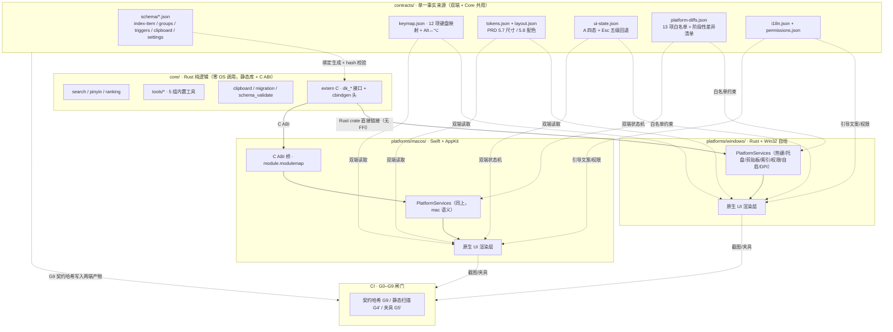
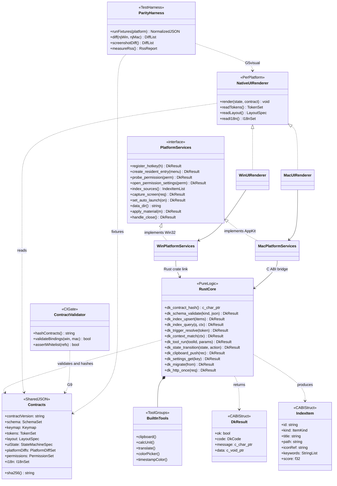
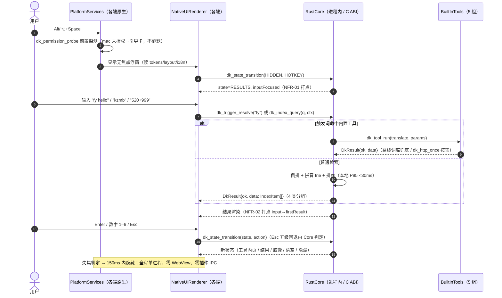
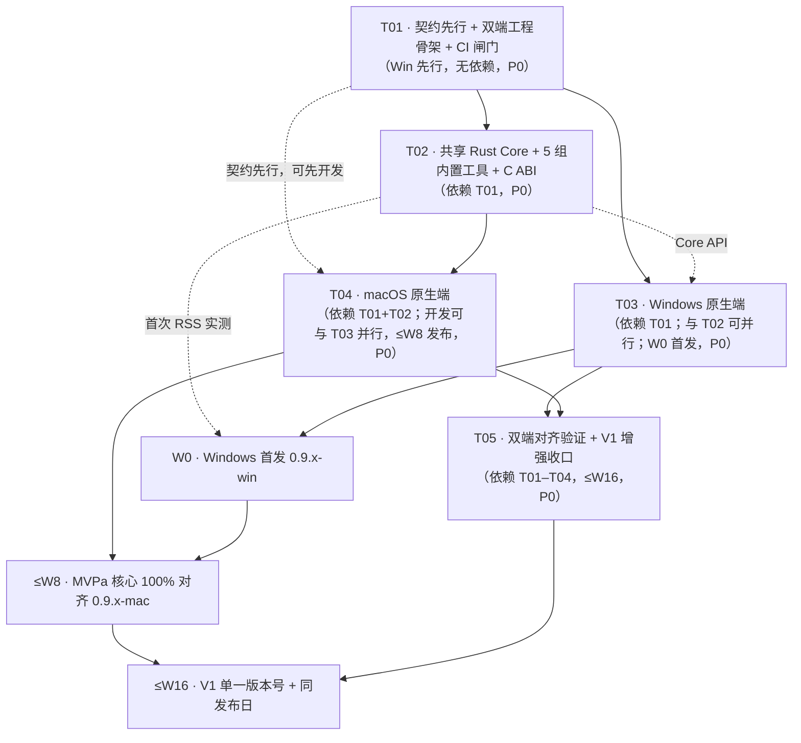

# 07 新架构设计：双端原生 + 共享 Rust Core（2026-11 方向变更）

> **状态：选型已被覆盖。** 砍插件、Windows 先行、四类结构对齐仍然有效，见 `docs/06-Incremental-PRD.md`。Windows 已改为 C# / .NET 8 + WPF，不再使用 Rust + Win32 自绘，也不再设共享 Rust Core。现行架构见 [`docs/10-Current-Architecture.md`](../10-Current-Architecture.md)。本文保留作审计。

> 文档版本：v1.0 ｜ 撰写：高见远（架构师）｜ 团队：software-deskkit ｜ 决策日期：**2026-11-16**
> 上游：`docs/06-Incremental-PRD.md`（增量 PRD + 竞品技术栈调研 + S01–S30）、`docs/01-PRD.md`、`docs/02-Architecture.md`、`docs/05-Architecture-Review.md`、`handoff/TECH-SPEC.md`
> **性质**：用户撤销三大原始约束后的**重新开题选型**，是「新方向下 Cursor 交接包怎么改」的前置架构决策；契约、目录结构、任务分解写到可实现粒度。**不复用 `docs/05-Architecture-Review.md` 的「维持 Tauri v2，不切换」结论**（该结论的三个前提已被撤销，见 §0.5）。
> **边界**：**仅新建本文件**。未修改 `docs/01~06`、`class-diagram.mermaid`、`sequence-diagram.mermaid`、`handoff/` 四份、`prototype/index.html`、`tests/*`；品牌位仍为 **DeskKit**（正式名未定），本次不动。原型 QA 冻结基线双口径见 §8.3，**未触碰、不重跑**。
> 数据口径：竞品事实**直接引用 PM 第 9/14 节已核实条目**，沿用 **S01–S30** 编号，本次不重复 WebSearch（主理人指令）；本文件新增数字一律标注 **实测 / 估算 / 引用 / 未核实** 四态，估算写明依据，详见 §5.7 与 §11。

---

## 0. 结论先行

### 0.1 单一结论（一句话）

> **改用「共享 Rust Core（纯逻辑，C ABI 边界）+ 各端原生 UI（Windows = Rust + Win32 原生自绘；macOS = Swift + AppKit 原生）、单进程常驻、零 WebView / 零浏览器内核 / 零托管运行时」的双原生极致轻量架构（Wox v2 式共享核心派，但以 `<80MB` 为硬闸门重新设计进程模型与预算）；Windows 先行 W0，macOS ≤W8 对齐核心，≤W16 进 V1 恢复单一版本号。**

允许在结论下写重评触发条件（§0.6），**不允许「视情况而定」**。

### 0.2 正面回答最尖锐的问题：`<80MB` 下还能不能选 WPF/.NET

> **不能。若坚持 NFR-03 `<80MB` 作为选型层硬判据（用户 P1 确认轻量优先、选型层不放宽；验收层预定义备案见 §0.7 R1-B），Windows 侧 C# / .NET 8 + WPF 结构性不可选。**

| # | 判据 | 证据 / 口径 |
|---|---|---|
| 1 | **运行时基线不可裁剪** | .NET 桌面应用必须宿主 CLR + `PresentationFramework` / WPF + XAML 运行时 + DirectX 合成层；**framework-dependent** 依赖系统已装 .NET Desktop Runtime（分发前置条件，RSS 不因此降低）；**self-contained** 把运行时打进包，**体积显著增大而空闲 RSS 不降**（运行时该加载的页仍要加载）。WPF 依赖运行时 XAML 解析 / 反射，**不支持 NativeAOT 全裁剪**，不存在「裁到 80MB」的编译路径。〔**工程判断 + 估算，未实测**；PM S08/S17/S01 只陈述栈，不给内存实测〕 |
| 2 | **品类唯一官方自身性能数据给出的反例** | Listary V6 用 WPF 后出现输入法闪退 / 显存异常 / 文字发虚，**V7.1 重写回自研轻量原生框架、默认软件渲染**，官方博客给出后台全部进程 **370 → 245MB（-34%）**、显存 **77MB → 0** [S10]。**注意：优化后仍是 245MB，为本门槛的 3.06 倍**；且这是唯一由官方博客给出的自身进程数据，仍非实验室实测。 |
| 3 | **同类栈的第三方实测已顶到门槛边缘** | Flow Launcher（C# / .NET 8 + WPF）个人实测「装 8 个插件稳定 **~80MB**」[S09] —— 已等于门槛，且为**非实验室个人实测**、未计入我们额外的 5 组内置工具与索引常驻；Raycast 2.0 的 Windows 原生壳（C# / .NET 8 + WPF）所在四层架构官方口径 **350–450MB** [S03]（**第三方转述，非实测**）。 |
| 4 | **判据 1/3 的直接推论** | PM 第 13 节判据 1「先问常驻时有几个运行时」、判据 3「UI 框架必须能控制渲染路径与显存，轻量派都在去托管 UI 框架」[S10][S18][S01]；WPF 恰好是 Listary 为减内存而**主动离开**的那一套。 |

**唯一能选 WPF 的前提**是用户在**选型层主动要求重选型**（§0.6 R1）。用户已在**验收层**预定义放宽备案（§0.7 R1-B），但在**选型层**明确确认轻量优先、不放宽（P1，2026-11-16 拍板），故 **WPF 仍被否决**。因此：**在本项目当前约束集内，WPF/.NET 被选型层硬判据否决，不是「权衡后略逊」，是「不可行」；验收层备案只调整发布阈值、不改技术栈。**

### 0.3 直白承认取舍（不含糊成「既主流又轻量」）

> 用户同时要「**更主流**」和「**性能更好 / `<80MB`**」。PM 的两组事实互相打架：Win 最主流的就是被 Listary 弃用的 WPF/.NET [S08][S17][S01][S10]；用「共享 React UI + 各自原生壳」解决双端对齐的 Raycast 2.0 代价是 350–450MB [S03]。**2026-11 的品类事实下，二者不可兼得。**

| 项 | 直白结论 |
|---|---|
| 「更主流」达成度 | **macOS 侧达成**：Swift + AppKit 正是 mac 主流 [S01][S02][S05]。**Windows 侧主动放弃**：不选市占最大的 C#/.NET 8 + WPF，改走 Rolan / Listary V7.1 / Wox v2 那一派 [S13][S10][S20]。 |
| 本路线属于哪一类 | **「竞品中的极致轻量派（自研 / 原生渲染 + 共享核心）」**，**不是「市占最大路线」**。同派参照：Rolan 5「100% 原生，无 Electron 无 WebView」[S13]、Listary V7.1 自研轻量原生框架 [S10]、Wox v2「Go 核心 + 全原生 GPU 渲染，not a browser shell」[S20][S23]。 |
| 放弃了什么 | 放弃了 Windows 桌面组件成熟度与生态规模、放弃一套 UI 代码跑两端、放弃 Web 插件生态复用、放弃亚克力 / vibrancy 等视觉增强（MVP）。详见 §0.5。 |
| 换来什么 | 唯一有机会触达 `<80MB` 的进程模型（单进程、零运行时、零浏览器内核、可控显存），以及两端系统能力的**原生可靠性**（全局热键 / 托盘 / 无焦点浮窗 / 索引不静默失败）。 |
| 不粉饰的一句 | **我们不是在「更主流」和「更轻量」之间找到了两全解，而是选了硬门槛、承认在 Windows 侧偏离主流。** 用户已确认轻量优先（P1，2026-11-16 拍板）；若未来**主动要求重选型**才触发 §0.6 R1，验收层的预定义放宽备案 **R1-B 不触发 R1、不改本结论**，而不是在本方案里含糊。 |

### 0.4 被否决方案及理由

| 候选 | 判定 | 一句话理由 |
|---|---|---|
| **A** Win C#/.NET 8 + WPF & mac Swift + AppKit 纯双原生主流派 | **否决** | Win 侧 WPF 与 `<80MB` 硬门槛结构性冲突（§0.2）；「最主流」只在 Win 侧成立，代价是硬门槛失守。 |
| **C** Tauri v2 瘦身版（去插件运行时） | **否决（次优）** | 对齐成本最低、团队积累最多，但常驻主 WebView + WebView2 多子进程在「全部自有进程合计」口径下内存最不确定；Win 固定分发 WebView2 Runtime 另加约 180MB 包体积（上轮 C2 补注）；系统 WebView 显隐控制力是 Raycast 专门自建壳才解决的问题 [S01]；且用户明确「技术栈我想换一下」。详见 §1.4 公平比较。 |
| **D** Flutter Desktop | **否决** | Wox v2 早期 UI 用过，**v2.4.0 主动移除独立 Flutter 进程后「内存减半到 ~150MB」仍 >80MB** [S21]，当前无在维护的本品类生产案例 [S20]；Raycast 官方「ruled them out very early… lacked the native control」[S01]；全局热键静默失效、托盘二次点击失效、隐藏窗口花屏 [S26][S27][S30]；独立引擎 + Dart VM 与「单进程」判据冲突。 |
| **E** Electron 对照基线 | **否决** | uTools 为 Electron 34.5.8 [S15]、第三方 ~150MB [S09]；捆绑 Chromium 违反判据 2；Raycast 官方列为否决理由 [S01]。与 `<80MB` 无交集。 |

### 0.5 相对上一版「放弃了什么 / 保留了什么」

| 类别 | 项 | 说明 |
|---|---|---|
| **放弃** | Tauri v2 / 系统 WebView（WebView2 / WKWebView） | 全部去除；`<80MB` 的前提是零浏览器内核 |
| **放弃** | React 18 + TypeScript + Vite + zustand + Tailwind 前端、单一 Web UI 100% 共用 | 改为两套原生 UI；「一套 UI 跑两端」不再成立 |
| **放弃** | 开放插件运行时整套（manifest / Envelope / 权限网关 / 5 道防线 / 市场 / 开发者生态） | 由 `06-Incremental-PRD.md` 用户决策触发，非架构主动取舍；删除清单见 §6 |
| **放弃** | 「同版本号 / 同发布日 / P0-P1 全量即时对齐」铁律 | 改为 W0 / W8 / W16 阶段性规则 [06 §4] |
| **放弃** | Windows 侧市占最大路线（C#/.NET 8 + WPF） | §0.3 已直白承认 |
| **放弃** | MVP 亚克力 / vibrancy 材质视觉增强 | 白名单 #11 允许差异，但为降显存 MVP 默认**关闭**（对齐 Listary 显存 77→0 [S10]）；列为 AQ5，V1 增强项可开 |
| **放弃（结论）** | `docs/05-Architecture-Review.md` 的「维持 Tauri v2，不切换」 | 其三个前提（开放插件运行时 / 双端同期铁律 / ≈42MB 设计预算）全部被撤销；该文档 §5.2 **T5「放弃开放插件运行时，改做纯内置工具」已实际触发**，重评框架本身有效 |
| **保留** | Rust 作为 Core 语言 | 从「Tauri 壳内 Rust Core」变为「独立纯逻辑 Core + C ABI」，语言不变 |
| **保留** | `<80MB`、NFR-01/02 `<100ms`、本地优先与隐私 | NFR-03 由目标**升为选型层硬判据 + 验收层默认目标（非发布阻断）**；验收层预定义备案见 §0.7 R1-B（只调归档与披露口径、不改选型） |
| **保留** | 4 类结构 100% 对齐目标、13 项平台差异白名单 | 实现机制从「同一 trait 编译期选择」换成「共享契约 + CI 契约哈希闸门」（§4.5/§4.6） |
| **保留** | 5.7 尺寸 / 5.8 配色 token、Esc 五级回退、12 项键盘映射、A 四态 / B 分组拖拽 / C 3×3 宫格 | 视觉规范与交互规格一字不改，只换渲染实现 |
| **保留** | 品牌 DeskKit | 本次不动 |

### 0.6 重评触发条件（格式参照 `05-Architecture-Review.md` §5.2，语气参照其 §7「不含糊」）

> 满足任一条才启动**重新评估或适用预定义备案**，**不是「看情况」**；**R1–R6 为重新评估触发条件，R1-B 为不重选型的发布验收与披露备案，二者严格区分**；未触发则本结论为唯一执行依据。**本次两轮用户拍板（P1/P2 第一轮、D1/D2 第二轮）均未触发 R1**，详见 §0.7（守门句）。

| # | 触发条件 | 阈值 / 判据 | 触发后应评估的替代方案 | 说明 |
|---|---|---|---|---|
| **R1** | **用户主动要求重新选型** | 用户**显式**要求：① 改回 Windows 主流派（A / WPF）② 改选 Tauri 瘦身版（C）③ 恢复第三方插件生态（与 R2 协同）。**仅阈值放宽 / 取消发布阻塞不触发 R1** | **A**（WPF/.NET 主流派）→ **C**（Tauri v2 瘦身）→ **E**（Electron） | 这是「更主流」诉求的唯一现实出口，但**必须由用户主动提出**；同时需接受包体积与冷启退化。**本次两轮用户拍板均未触发 R1**；验收层归档与披露放宽由 **R1-B** 处理，不改选型、不重评 |
| **R2** | 恢复第三方插件生态 | Q2 从「零扩展」变为「**可安装 / 可上架** 的第三方插件」 | **C**（Tauri 瘦身 + 插件运行时）或 **E**（Electron + uTools 生态兼容） | 纯原生双端没有 Web 插件宿主；一旦要求第三方可安装，本架构的「零扩展」前提失效，须整体重评。**仅「极简内置扩展点」不触发**（见 §10.2） |
| **R3** | 团队无法交付 Rust + Win32 自绘 | T03 无人可交付，且 AQ1 降级到 C++/Win32 仍失败、外包亦不可用 | 依次评估 **A**（WPF/.NET，**须同时放宽 NFR-03**）→ **C** | 不是立刻推翻结论：先走 §10.3 AQ1 与团队能力缓解；语言门槛不等于框架错误 |
| **R1-B** | **`<80MB` 实测未达标（预定义验收放宽备案，非重选型）** | 仅当 T02 首次实测 + §5.6 六档降级**全部执行**后 P95 仍 >80MB；报告绑定 `buildSha + contractHash` 并写入 `tests-v2/perf/` | **不切换 A/C/E、不重选型、不改 §0.1 结论**；只调整 G-NFR03 的实测·归档·披露断言 | `(80MB, 150MB]` 备案线自动放行 W0；**`P95 > 150MB` 仍放行 W0、升级披露**（实测值无论多高都记录归档并放行 W0，无发布阻塞出口）。**与 R1 严格区分：R1-B 生效不触发 R1**。完整规则 a–d 见下方与 §0.7 |
| **R4** | `<80MB` 实测不可达 | T02 首次实测 + §5.6 六档降级全部执行后仍 >80MB | **先进入 R1-B 备案自动判定**：`P95 <= 150MB` 备案线放行 W0；`P95 > 150MB` 记录归档并放行 W0、升级披露 | **按预定义规则自动适用披露分档、不临时找用户拍板、不自动切换框架、无发布阻塞出口**；竞品无 `<80MB` 实验室实测证据（§5.8），**诚实出口改由 T02 实测 + 六档降级 + 强制披露承担** |
| **R5** | 要求「一套 UI 代码覆盖两端」且放弃 `<80MB` | 明确以复用率优先、内存让步 | **C**（Tauri v2 瘦身版）成为首选 | 对齐成本最低、团队积累最多；其代价见 §1.4 |
| **R6** | Linux 端由 P2 评估升为硬需求 | Q4 改为「必做」 | **不触发框架重评**：Core 纯 Rust 零 OS 依赖，新增 `platforms/linux/` 渲染层即可 | 仅触发 T01 契约与 CI matrix 扩展；这正是把平台能力上移到各端的收益 |

**R1-B 细则（与 R1 严格区分，完整规则 a–d）**：

| 项 | 规则 |
|---|---|
| a) 触发判据（严格化） | 仅当「T02 首次实测 + §5.6 六档降级**全部执行**后，空闲 P95 仍 >80MB」才**自动生效**；实测报告须绑定 `buildSha + contractHash` 并写入 `tests-v2/perf/`。**不允许在未跑满六档前提前适用备案** |
| b) 备案区间与披露分档 | `P95 ≤ 80MB` 为**默认目标**（记录达标与否、不作数值发布判定）；`(80MB, 150MB]` **备案线放行 W0**；**`P95 > 150MB` 备案线亦超出 → 仍放行 W0，但必须升级披露**（实测值无论多高都记录归档并放行 W0，不设任何发布阻塞出口）。**150MB 取自原 R1 数值，改称「披露分档线」，仅作披露分档、不作数值门槛、不作选型阈值**（选型层 `<80MB` 判据不变） |
| c) 架构不变 | 备案生效**不切换 A/C/E、不重选型、不改 §0.1 结论、不改 §1 决策矩阵**；只调整 §7.2 G-NFR03 的实测·归档·披露断言（不以内存数值作发布判定） |
| d) 可见性与升级披露 | W0 发布说明与「关于」页须标注「本次采用披露分档线 150MB、实测值 X MB、已执行降级 1–6 档」；**当 `P95 > 150MB` 须额外写明「实测 X MB 已超出预定义备案线 150MB」**；CI 报告增加 `fallbackApplied: true` / `thresholdUsed: 80\|150` / `measuredP95Mb` / `degradationSteps` / **`disclosureLevel: standard\|escalated`** 字段；`measuredP95Mb` 必须如实记录、不得裁剪或省略。**仍放行 W0** |

### 0.7 用户拍板记录（2026-11-16，P1/P2 第一轮 + D1/D2 第二轮）

> **务必区分「用户原话」与「团队解释」**：下表左栏为用户选项原话 / 选择，右栏为 team-lead 的调和解释与架构落地，**右栏不得冒充用户指令**。

| 项 | **用户原话 / 选择** | **团队解释（非用户原话）** |
|---|---|---|
| **P1** | **「确认轻量优先（推荐）」** | 按 **B 方案**执行，硬门槛优先；接受 Windows 侧放弃市占最大路线。**作用于选型约束层**：`<80MB` 仍是决定选 B、否决 A/WPF 的硬判据，**不放宽、不重选型**；§0.1 结论、§0.2「WPF 不可行」、§0.3「承认偏离主流」、§0.4 否决表**全部保持不变** |
| **P2** | **「预定义放宽条件」**：现在就把「放宽到 ≥150MB」写进文档作为正式备案，避免届时阻塞 W0 发布；选项描述已明示「代价是硬门槛从一开始就不再硬」，用户接受该代价 | **作用于发布验收层**：预先写死一条**条件性放宽备案 R1-B**，使 W0 不因实测未达标而临时阻塞、不再临时找用户拍板。放宽**只作用于发布验收与披露**，**不改技术栈、不触发重选型**。为使阈值表述无歧义并落实第二轮 D2，**150MB 为披露分档线，非发布上限**；实测值无论多高都记录归档并放行 W0、只靠发布说明与「关于」页披露（守门句见下） |
| **D1**（第二轮） | **「删除」**：删掉 R1-B 细则末条（任务 #10 团队加设的治理条款）整条；**不是继续保留为「团队建议」**，而是彻底删除该条款及其所有衍生表述 | **作用于发布验收与披露层**：§0.6 R1-B 细则条目数由 5 收为 4（**a–d**），末条整行删除；§0.7 原「该条属性」说明行同步删除；V1 发布不再与内存数值复位绑定、不设任何复位要求；**不改技术栈、不触发重选型、不触发 R1** |
| **D2**（第二轮） | **「无论多高都放行」**：选项描述为「取消所有阻塞出口；实测值无论多高都记录归档并放行 W0，只靠发布说明与『关于』页披露」 | **作用于发布验收与披露层**：`P95 > 150MB` 由旧口径「按数值阻断发布」改为「备案线亦超出 → **仍放行 W0，但必须升级披露**」；150MB 改称**披露分档线**（不再作为任何数值门槛）；**G-NFR03 改称「实测·归档·披露闸门」（非阻断）**，不再以内存数值判 FAIL、不阻断 W0 发布。**不改 §0.1 结论、不切换 A/C/E、不重选型、不触发 R1**；升级披露落地细化见下方「团队解释」注 |

> 注：P2 左栏的阈值表述及「避免届时阻塞 W0 发布」均为**用户选项原文引用**（后者正是第二轮 D2 所依据的原话，属否定式动机表述、非发布阻塞规则，按「用户原话逐字保留」原则不动）；经第二轮 D2 拍板后，**150MB 为披露分档线**，实测值无论多高都记录归档并放行 W0、只靠发布说明与「关于」页披露；全文不再使用有歧义的区间写法。

> **升级披露规则（团队解释 / 落地细化，非用户原话）**：当 `P95 > 150MB`，除常规备案标注外，发布说明与「关于」页须额外写明「实测 X MB 已超出预定义备案线 150MB」；CI 报告增加 `disclosureLevel: standard\|escalated` 字段（`>150MB` 取 `escalated`，其余取 `standard`）；`measuredP95Mb` 必须如实记录、不得裁剪或省略。**仍放行 W0**。落点：§0.6 R1-B d) / §5.4 统一输出与判定 / §7.2 G-NFR03 / §10.1 Q5 可见性字段。

> **守门句（两轮拍板共同适用）**：**验收层取消所有发布阻塞，不等于选型层放宽；`<80MB` 仍是决定选 B、否决 A/WPF 的硬判据。P2 与 D2 只作用于发布验收与披露，不构成 R1 重选型触发条件。** §0.1 单一结论 / §0.2「WPF 不可行」/ §0.3「承认 Win 侧偏离主流」/ §0.4 否决表 / §1 决策矩阵 / §1.3 步骤 1「硬门槛先筛（选型层）」**逐字不动**；R1 仍为「用户主动要求重新选型」才触发，**本次两轮拍板均未触发 R1**。

**四项不矛盾的说明（两轮修订的核心）**：P1 与 P2 / D1 / D2 作用于**不同环节** —— P1 锁定「选什么」（选型约束层），P2 / D1 / D2 锁定「实测不达标时如何归档、披露与放行」（发布验收与披露层）。若把两层混成一个概念，会把 §0.6 R1（重选型触发条件）误触发，进而推翻 P1 刚确认的 B 方案。因此第一轮修订把 R1 改写为「**用户主动要求重新选型**」才触发，并拆出独立的 **R1-B**；第二轮 D1 / D2 只收紧验收与披露、**均未触发 R1**。

| 结论 | 内容 |
|---|---|
| **R1 是否触发** | **两轮均未触发**。用户 P1 明确轻量优先、D2 取消所有发布阻塞，均未要求改回主流派 / 改选 Tauri / 恢复第三方插件生态；**阈值放宽 / 取消发布阻塞本身不触发 R1** |
| **R1-B 是否生效** | **已写入文档作为预定义备案，但尚未实际生效** —— 需满足 a) 的严格触发判据（T02 实测 + 六档降级全执行后仍 >80MB）才自动适用 |
| **R1-B 生效规则** | §0.6 R1-B 细则 a–d；要点：默认目标 `P95 ≤80MB`、`(80MB, 150MB]` 备案线放行 W0、`>150MB` 仍放行 W0 + 升级披露、架构不变、CI 与发布说明/「关于」页可见；**无发布阻塞出口** |
| **落地章节（两轮合并）** | §0.2 / §0.3 / §0.6（R1、R1-B、R4）/ §0.7 / §5.1 / §5.4 / §5.6 / §5.8 / §7.2 / §7.3 / §8.2 / §9.2 / §10.1 Q5 / §10.3 AQ7 / §10.4 / §11.3 / §12；**§0.1 / §0.2 / §0.3 / §0.4 / §1 / §1.3 步骤 1 逐字不动** |

---

## 1. 决策矩阵（5 候选 × 7 判据）

### 1.1 候选定义

| 代号 | 候选 | 进程 / 运行时模型 | 双端 UI 关系 |
|---|---|---|---|
| **A** | Win C# / .NET 8 + WPF & mac Swift + AppKit 纯双原生主流派 | 各 1 主进程 + CLR（Win）/ 无额外运行时（mac） | 两套原生 UI，无共享 UI 代码 |
| **B** ✅ | **共享 Rust Core（C ABI）+ 各端原生渲染（Wox v2 式）** | **单进程**：Rust Core 静态链接进各端主进程，零引擎 / 零 CLR / 零 WebView | 两套原生 UI + **一套共享 Core + 一套共享契约** |
| **C** | Tauri v2 瘦身版（去插件运行时） | 主进程 + 系统 WebView 多子进程（WebView2 / WKWebView） | **一套 React/TS UI** + 各端系统 WebView |
| **D** | Flutter Desktop | 独立 Flutter 引擎进程 + Dart VM（或嵌入后仍带引擎） | 一套 Dart UI |
| **E** | Electron 对照基线 | 主进程 + 渲染进程 + GPU 进程 + Chromium | 一套 Web UI |

### 1.2 决策矩阵主表

> 每格给证据或明确标注「估算 / 未核实 / 工程判断」。竞品数字按 PM 第 9/14 节标注是否代理指标；**禁止把 editorial 估计当实测**。

| 判据 ↓ / 候选 → | A 纯双原生主流派 | **B 共享 Rust Core + 各端原生** ✅ | C Tauri v2 瘦身版 | D Flutter Desktop | E Electron |
|---|---|---|---|---|---|
| **① 空闲 RSS `<80MB` 可达性** | Win **否**：WPF + CLR 基线不可裁，Listary 优化后仍 245MB [S10]；Flow ~80MB 已顶边 [S09，个人实测非实验室]。mac **可达**：Alfred editorial「很少超过 ~70MB」[S05，**代理指标非实测**]。**综合：不可达** | **有条件可达（本方案最高风险假设）**：单进程 + 零运行时 + 零 WebView，预算中位 ≈65MB〔**估算**，见 §5.2〕；**无竞品实验室实测证据**，须 T02 实测（§5.8） | **不确定 / 倾向不可达**：WebView2 多子进程基线 + Core + 索引，「全部自有进程合计」口径下难压到 80MB〔**工程判断 + 估算，未实测**〕；上轮复核记「Tauri 空闲口径 20–134MB 波动，广传基准缺方法论披露」 | **否**：去独立 Flutter 进程后仍 ~150MB [S21]；Raycast 早期排除 [S01] | **否**：uTools Electron 34.5.8 [S15]、第三方 ~150MB [S09，非实验室] |
| **② 「更主流」程度** | **Win 最高**：Flow [S08]、PowerToys Run [S17 官方 dev docs]、Fluent Search [S24]、Raycast 2.0 Win 壳 [S01] 全是 C#/.NET+WPF；**mac 主流**：Swift+AppKit [S01][S02] | **mac 主流 / Win 非主流**：同派为 Rolan [S13]、Listary V7.1 [S10]、Wox v2 [S20] ——**用户量小、非市占最大路线**（§0.3 直白承认） | Tauri v2 稳定约 2 年，生态仍小于 Electron〔上轮复核结论，**未重新核实**〕；本品类无主流生产案例（Raycast 明确否决 Tauri [S01]） | **最低**：本品类唯一生产案例已弃用 [S21]，当前无在维护案例 [S20][S01] | **跨平台生态最高**：uTools [S15][S16]；但**本品类「主流」≠「轻量」** |
| **③ 双端 4 类结构对齐成本** | 高：两套 UI 无共享渲染，只能靠契约 + 夹具 + CI（同 B） | **中**：`contracts/` 单一来源 + 共享 Core + 双端夹具 + G9 契约哈希闸门（§4.6）；成本集中在契约设计，不在运行时 | **最低**：一套 React UI 天然同构 [S03 Raycast 同构思路]，对齐成本主要是 WebView 差异 | 低（一套 Dart UI），但被 ④⑤ 一票否决 | 最低（一套 Web UI），但被 ① 一票否决 |
| **④ 全局热键 / 托盘 / 无焦点浮窗 / 索引可靠性** | Win **可靠**：Win32 原生；mac **可靠**：AppKit 原生。索引两端分别实现 | **可靠**：全部平台能力原生实现（`PlatformServices`），不依赖任何跨平台抽象；对齐 PM 判据 4 [S01][S26] | **中**：Tauri 官方插件可覆盖大部分，但 **WebView 显隐 / 无焦点面板控制力**是 Raycast 自建壳才解决的问题 [S01]；Win WebView2 未预装需 Bootstrapper（上轮 R2） | **差**：Wayland 热键静默失效、托盘二次点击不弹菜单、隐藏窗口花屏 [S26][S27][S30]；文件索引 / 拖放需额外 FFI [S27] | **可靠但重**：Chromium 屏蔽了部分原生细节；Raycast 官方列为否决理由 [S01] |
| **⑤ 团队能力**（用户为 RN/Flutter/原生方向，1–3 年〔上轮 §6 口径〕） | Win C#/WPF 学习曲线**最低**、资料最多；mac Swift 需补齐；**两门语言** | Rust（旧架构已计划引入，**非全新门槛**）+ Swift；**2 门语言 + C ABI**；Rust Win32 GUI 生态弱是真实风险〔**工程判断**〕，AQ1 可降级 C++/Win32 | **最贴合现有积累**：Rust + React/TS + 旧 T01–T05 契约可复用最多 | Flutter 贴合用户背景，**但本品类证据最不利** | JS/TS 最易上手，但门槛 ① 失守 |
| **⑥ 生态维护 / 长期风险** | WPF 与插件生态强绑定 [S18]（我们无插件，绑定解除）；微软 UI 框架反复 WPF→UWP→WinUI 3 [S18][S01] | 自绘控件需自维护（**真实成本**）；Rust `windows` crate 由微软官方维护〔**未重新核实版本状态**〕；Swift/AppKit 稳定 [S01] | 依赖 Tauri 上游 + 系统 WebView 版本，可控性中等 | 桌面非 Flutter 主线投入区；本品类社区样本为零 [S20] | Electron 生态最成熟，但升级需跟 Chromium |
| **⑦ 分发 / 签名** | Win MSIX/winget + Authenticode；mac Developer ID + 公证；**与 B 相同**，无额外负担 | 同左；**无 WebView2 Runtime 分发负担**（C 需 +~180MB，上轮 C2） | Win 需处理 WebView2 Runtime 分发；mac 同上 | MSIX / DMG+公证 / AppImage 三套 + 拖放插件 [S27][S30] | 体积最大，签名流程标准 |

### 1.3 判据权重与收敛过程（不含糊）

| 步骤 | 动作 | 结果 |
|---|---|---|
| 1 | **硬门槛先筛（选型层）**：`<80MB` 为决定选型的硬判据、**不放宽**；验收层预定义备案见 §0.7 R1-B（**只调阈值、不改选型结论**） | E、D、A(Win) 出局；C 存疑；B 唯一「结构上可能」。**注：即使验收阈值备案到 150MB，WPF 优化后仍 245MB [S10]，A 依然出局** |
| 2 | **判据 4 再筛**：系统能力不得静默失败（NFR-06 新表述 + PM 判据 4） | D 二次确认出局；C 的 WebView 显隐控制力记为风险 |
| 3 | **「更主流」诉求复核** | 只有 A 满足 Win 主流，但已在步骤 1 出局 → **记录为「主动放弃」，不回头粉饰**（§0.3） |
| 4 | **对齐成本复核** | C 最低、B 中等；但 C 的门槛 ① 不确定且用户明确要换栈 → C 记为次优 |
| 5 | **唯一结论** | **B**，并附加 §5.8 最高风险假设 + §0.6 **R4 / R1-B** 诚实出口（选型层结论不变） |

### 1.4 为什么不选 C（公平比较，不因「要换栈」而贬低）

| C 的真实优势 | 为什么仍不足以翻盘 |
|---|---|
| 一套 React/TS UI 天然双端同构，4 类结构对齐成本最低 [S03 同构思路] | 对齐成本是**一次性工程成本**；`<80MB` 是**每次发布都要过的硬闸门** |
| 团队已有 Tauri / Rust / React 积累，旧 `shared/contracts/` 与 T01–T05 可复用最多 | 复用率换不来门槛达标；旧 ≈42MB 本就是「设计预算、非实测」（上轮 C4 补注） |
| Tauri v2 已稳定，官方插件覆盖热键 / 剪贴板 / 自启 / 更新 | 常驻主 WebView + WebView2 多子进程在「全部自有进程合计」口径下内存**最不确定**且我方无实测能力背书；Win 固定分发 Runtime 额外 +~180MB 包体积（上轮 C2） |
| 系统 WebView 无需捆绑 Chromium | 但 Raycast 官方以「系统 WebView 显隐控制力不足」为由否决 Tauri 并自建壳 [S01]；本产品「无焦点悬浮 + 失焦 150ms 隐藏」正是该敏感路径 |

> **C 的正确定位**：若未来触发 **R5**（要求一套 UI 覆盖两端并放弃 `<80MB`），C 是首选；当前约束集下它是**次优**，不是错误方案。

---

## 2. Windows 栈（W0 首发端）

### 2.1 语言与运行时：正面回答 framework-dependent vs self-contained

> **本端不选 .NET**。下列比较用于支撑 §0.2 的否决论证，并作为 AQ3 / R1（用户主动重选型时）的对照材料；**与 §0.7 R1-B 的「验收放宽备案」不是同一概念**。

| 维度 | .NET 8 + WPF **framework-dependent** | .NET 8 + WPF **self-contained（含 trimmed / ReadyToRun）** | **本方案 B（Rust 静态链接）** |
|---|---|---|---|
| 分发前置 | 目标机须已装 .NET 8 Desktop Runtime；未装则首启失败（需引导页 / Bootstrapper） | 无需系统运行时 | 无运行时依赖，单 exe |
| 安装包体积 | 小（仅应用本体） | **显著增大**（打包 CLR + WPF + 库）；trimming 对 WPF 反射路径受限〔**估算 / 未实测**〕 | 最小〔**估算**：Core + 资源，量级几 MB ~ 十几 MB〕 |
| **空闲 RSS** | **不因「依赖系统」而降低**：CLR / PresentationFramework 页仍须加载进本进程 | **不降低**，且常因 R2R 预编译页反而更高〔**工程判断 + 估算，未实测**〕 | 只加载本进程实际触及的页 |
| NativeAOT 裁剪 | **不支持**（WPF 依赖运行时 XAML / 反射） | 同上 | Rust 编译期单态化 + LTO，无运行时反射 |
| 对本门槛的结论 | **均不可行**（§0.2） | **均不可行** | 唯一可行路径 |

**本端运行时**：Rust（stable，`windows` / `windows-sys` crate 调 Win32），编译为单 exe，Core 以 Rust crate 直接静态链接（**Win 侧无需过 C ABI**，见 §4.5）。进程模型：**1 个常驻主进程**，索引 / 剪贴板监听 / 工具均为主进程内模块，无 helper 常驻（降级预案 §5.6 第 5 档才允许按需短命 helper）。

### 2.2 UI 渲染路径

| 项 | 方案 |
|---|---|
| 窗口 | Win32 `CreateWindowEx`，`WS_EX_LAYERED \| WS_EX_NOACTIVATE \| WS_EX_TOOLWINDOW` 实现无焦点悬浮；`SetWindowPos(HWND_TOPMOST)` 置顶 |
| 绘制 | `ID2D1HwndRenderTarget` + DirectWrite 文本（自绘控件树：搜索框 / 结果列表 / 胶囊 / 3×3 宫格 / 工具内页 / 3 Tab 设置）；**不引入 WebView2、不引入 WPF、不引入 GPU 引擎进程** |
| 视觉规范 | 尺寸 / 圆角 / 间距 / 字体层级 / 色值**全部从 `contracts/layout.json` + `contracts/tokens.json` 读取**（PRD 5.7 / 5.8 原样保留），禁止硬编码色值（沿用旧 A3「色值零散落」精神） |
| 材质 | **MVP 关闭亚克力**（降显存，呼应 Listary 显存 77→0 [S10]）；白名单 #11 保留能力，V1 增强项开启（AQ5） |
| 高亮 / 状态 | 由 `contracts/ui-state.json` 定义的状态机驱动（A 四态、Esc 五级回退），各端只做渲染，状态转移表共享 |
| 失焦隐藏 | `WM_KILLFOCUS` + `SetWinEventHook(EVENT_SYSTEM_FOREGROUND)`；**150ms 内隐藏**（沿用旧 `sequence-diagram.mermaid` 口径） |

### 2.3 系统能力逐项（全部原生，无跨平台抽象）

| 能力 | 实现 | 对应白名单项 | 备注 |
|---|---|---|---|
| 全局呼出热键 | `RegisterHotKey` + 消息循环 `WM_HOTKEY`；默认 `Alt+Space`，冲突时 `detect → 改键引导` | #2 / #3 / #9 | **默认不用** `WH_KEYBOARD_LL` 低级钩子（常驻开销 + 全局键盘监听隐私面）；仅当 `RegisterHotKey` 被占用且用户要求「抢注」时按需启用。拦截系统窗口菜单、避免 NBSP 插入 |
| 托盘常驻 | `Shell_NotifyIcon` + `NOTIFYICONDATA` + 自建右键菜单 | #4 | 菜单项结构与 mac 侧共用 `ResidentMenu` 契约 |
| 剪贴板历史 | `AddClipboardFormatListener` / `WM_CLIPBOARDUPDATE`；环形缓冲 + 原子落盘；保留时长 / 暂停 / 清空 / 排除应用 | #5 延伸 | 由 Core 管理数据，Win adapter 只负责监听与写入 |
| 截图取色 | DXGI Desktop Duplication（主）/ `BitBlt` + `GetPixel`（兜底）；HEX / RGB / HSL 由 Core 纯函数换算 | #10 | 无「屏幕录制」TCC 概念；仍走统一 `dk_permission_probe` 以防 UAC / 远程会话返回空图 |
| 拖拽添加 | `DragAcceptFiles` + `WM_DROPFILES` / `IDropTarget` | — | P0-14 核心交互（Flutter 曾在此需额外插件 [S27]，本端原生无此问题） |
| 开机自启 | 注册表 `HKCU\Software\Microsoft\Windows\CurrentVersion\Run`；便携版提供开关 | #6 | 不写 `HKLM`、不请求管理员 |
| 关闭行为 | 关闭 → 最小化到托盘；退出需二次确认 | #12 | `CloseBehavior::Resident` 由契约定义 |
| DPI / 多屏 | `SetProcessDpiAwarenessContext(PER_MONITOR_AWARE_V2)` + `GetDpiForWindow` + `EnumDisplayMonitors` | — | 高 DPI / 多屏边缘场景属「平台特有系统能力深度适配」，允许 ≤W8 收敛 [06 §4.2] |
| 数据目录 | `%APPDATA%\DeskKit` | #7 | UI 只暴露抽象「数据目录」按钮，不向普通用户暴露原始路径（沿用旧策略） |

### 2.4 应用与文件索引

| 源 | 实现 | 优先级 |
|---|---|---|
| 开始菜单 / 桌面快捷方式 | 枚举 `.lnk` + Shell `IShellLink` 解析 | MVP 必做 |
| 注册应用 | 注册表 `Uninstall` 项 + App Paths + UWP/Store 应用清单（`IApplicationActivationManager` 或包清单枚举） | MVP 必做 |
| Windows Search | OLE DB / `ISearchQueryHelper`（系统已建索引，零额外常驻） | MVP 可选，**优先**（不自建索引进程） |
| Everything | `es.exe` / IPC 桥（若用户已装）；**按需调用，不常驻** | V1 增强 [06 §4.2 平台深度适配] |
| MFT 直读 | 参考 Raycast 2.0 自研索引器绕开 NTFS 遍历 [S01][S03] | **V2 评估**，MVP 不做（自建索引常驻与 `<80MB` 冲突） |

> **统一输出**：所有索引源由各端 adapter 归一化为 `IndexItem { id, kind, title, path, iconRef, keywords, score }`，结构由 `contracts/schema/index-item.json` 定义；Core 负责倒排 + 拼音 trie + 排序，**Core 不含任何 OS 调用**（§4.5）。索引快照 mmap 落盘，构建期内存按 §5.6 第 1 档释放。

### 2.5 打包分发、签名与最低版本

| 项 | 决定 |
|---|---|
| 分发 | **winget manifest**（主）+ **便携 exe**（自解压单文件，免安装 / 免管理员）+ MSIX（可选，需签名）；scoop / choco 列为 V1 |
| 签名 | Authenticode OV（MVP）→ EV（视 SmartScreen 信誉）；**签名清单纳入 G7**；SmartScreen 新签名信誉期在发布说明中明示 |
| 最低版本 | **Windows 10 1809（build 17763）** x64（对齐 Rolan 5 基线 [S13]）；建议主推 Win10 22H2 / Win11；**ARM64 一并覆盖**（Listary 7.1 Beta 不支持 ARM [S10]，此处为差异化机会） |
| 无 WebView2 依赖 | 首启不检查 / 不引导 WebView2 Runtime（对比旧架构 R2 风险，本方案天然消除） |

### 2.6 依赖清单（Win）

| 分类 | 依赖 | 用途 |
|---|---|---|
| 系统 API | `windows`（或 `windows-sys`）crate：Win32 / Foundation / UI / Graphics / DXGI / DirectWrite / Shell / Registry | 窗口、热键、托盘、剪贴板、DPI、拖拽、自启 |
| 图形 / 图像 | `windows` Direct2D/DirectWrite 绑定；`image`（仅取色 / 编码） | 自绘与截图取色 |
| Core（共享） | `serde` / `serde_json`、`tantivy`（可选）或自研倒排、`pinyin`、`rusqlite` 或 `sled`、`semver` / `chrono`、`thiserror` / `tracing`、`sha2` | 搜索 / 拼音 / 持久化 / 迁移 / 契约哈希 / 日志 |
| 构建期 | `cbindgen`（生成 mac 侧 C 头）、`sccache`、`cargo-audit` / `cargo-deny` | 跨语言绑定与供应链 |
| **明确不引入** | `.NET Desktop Runtime` / WPF / WinUI 3 / WebView2 / Chromium / Electron / Node / Dart VM / `winit` / `wgpu` / `tauri` | `<80MB` 与单进程前提 |

---

## 3. macOS 栈（≤W8 对齐端）

### 3.1 语言与 UI

| 项 | 方案 |
|---|---|
| 语言 / 框架 | **Swift 5.9+ / AppKit**（与 mac 主流一致 [S01][S02]）；**不使用 SwiftUI**（Raycast v1 因键盘优先 / 高性能列表的控制力不足弃用 [S01]） |
| 壳 | `NSApplication.setActivationPolicy(.accessory)`（无 Dock 图标）+ `NSStatusItem` 菜单栏 + `NSPopover` / 无焦点 `NSPanel` |
| 浮窗 | `NSPanel` + `styleMask: [.nonactivatingPanel, .borderless]` + `level: .floating`；`NSWindow.didResignKeyNotification` → **150ms 内隐藏** |
| 绘制 | AppKit 控件树 + `NSVisualEffectView` 可选（**MVP 关闭 vibrancy**，AQ5）；尺寸 / 配色同样从 `contracts/layout.json` + `contracts/tokens.json` 读取 |
| 跨语言 | 链接 `libdeskkit_core.a`，通过 `include/deskkit_core.h` + `module.modulemap` 调 C ABI（§4.5） |
| 进程 | **1 个常驻主进程**（Core 静态链接在内），无独立引擎 / 无 Node / 无 WebView |

### 3.2 系统能力逐项

| 能力 | 实现 | 白名单项 |
|---|---|---|
| 全局热键 | `CGEventTap`（`kCGHIDEventTap` / `kCGEventKeyDown`）+ 辅助功能授权；默认 `⌥+Space`，**避开 `⌘+Space`（Spotlight）**；拦截事件避免插入 NBSP | #2 / #3 / #9 |
| 菜单栏常驻 | `NSStatusItem` + `NSMenu` / `NSPopover` | #4 |
| 剪贴板 | `NSPasteboard.general.changeCount` 轮询（低频，定时器仅活跃期高频）+ Core 环形缓冲 | #5 延伸 |
| 截图取色 | `SCKShareableContent` / `CGWindowListCreateImage`（**需「屏幕录制」权限**）；未授权 → 明确引导卡而非黑屏 | #10 |
| 索引 | `/Applications` + `~/Applications` 枚举、`LaunchServices`（`LSCopyApplicationURLsForURL` 等）、Spotlight 元数据 `NSMetadataQuery` / `MDQuery` | #8 |
| 拖拽添加 | `NSView.registerForDraggedTypes([.fileURL])` + `performDragOperation` | — |
| 开机自启 | `SMAppService.mainApp`（登录项，macOS 13+），旧版本 `LSSharedFileList` 兜底 | #6 |
| 关闭行为 | 红绿灯关闭 → 隐藏到菜单栏；退出二次确认 | #12 |
| DPI / 多屏 | `NSScreen.screens` + `backingScaleFactor` + `NSWindow` 屏幕切换通知 | — |
| 数据目录 | `~/Library/Application Support/DeskKit` | #7 |

### 3.3 逐项系统权限：「未授权给明确引导、不静默失败」的实现（NFR-06 新表述 / 硬性）

> PM 指出 macOS 权限「未授权会**静默失败**」[06 §11.2][S25 类比]，因此本端把权限处理做成**统一前置探测 + 统一错误渲染**，而不是逐个功能 try/catch。

| 权限 | 影响功能 | TCC 探测 | 未授权时的行为（禁止静默） |
|---|---|---|---|
| **辅助功能** Accessibility | 全局热键（`CGEventTap`）、选区上下文（V1） | `AXIsProcessTrustedWithOptions` | **不注册热键**；主界面渲染引导卡「开启辅助功能以使用全局呼出」→ 按钮 `open_settings(.accessibility)`；首次引导 Step3 列为第 1 项 |
| **输入监控** Input Monitoring | 备用键盘监听路径 | `CGPreflightListenEventAccess` / `CGRequestListenEventAccess` | 同上，独立引导卡；不回退到「假装注册成功」 |
| **屏幕录制** Screen Recording | 截图取色 | `CGPreflightScreenCaptureAccess` / `SCKShareableContent` 探测 | **不返回空图 / 不黑屏**；渲染引导卡「开启屏幕录制以使用取色」→ 深层链接；工具内页保留「返回」入口（NFR-09） |
| **完全磁盘访问** Full Disk Access | 文件索引覆盖受保护目录 | 尝试读取受保护路径的探测调用（不缓存失败态） | **只索引可访问范围并明确提示「部分目录因权限未包含」**，不伪装成「全盘已索引」 |

**统一机制（4 条，可验收）**：

1. **前置探测函数**：所有系统能力调用前先 `dk_permission_probe(perm) -> { granted, denied, notDetermined, restricted }`；`notDetermined` 触发系统授权弹窗，`denied` / `restricted` **直接短路、不调用能力**。
2. **统一返回结构**：所有能力返回 `DkResult { ok: bool, code: DkCode, message: *const c_char, data: *const c_void }`；UI 层对 `E_MAC_PERMISSION_*` 系列码有**唯一**渲染分支输出引导卡。**禁止吞异常、禁止返回空数据伪装成功**。
3. **单一文案来源**：引导卡文案、权限名、深层链接全部在 `contracts/permissions.json` + `contracts/i18n.json` 定义；两端读同一份，各端**只渲染本平台子集**（沿用旧白名单 #5「上层不感知」思路）。系统权限状态并入「关于」页 [06 §5.1 E]。
4. **CI 断言**：注入「未授权」状态跑 5 组用例 —— 4 项 mac 权限 + Win 侧对应项，断言「每个受影响功能都出现引导卡 **且** 无静默空数据 / 无未捕获异常」；该项并入 G4'（§7.1），由 `tests-v2/permission-guide/` 承载。**不重跑旧 QA 基线**（§8.3）。

### 3.4 索引与 3.5 签名 / 分发 / 最低版本

| 项 | 决定 |
|---|---|
| 索引统一输出 | 同 §2.4 的 `IndexItem`，由 `contracts/schema/index-item.json` 定义；**Core 不含 OS 调用** |
| 签名 | **Developer ID Application** 签名 + `notarytool` 公证 + `stapler staple`（离线可验）；G7 闸门 |
| 分发 | **DMG + 公证**（主）、Homebrew cask（V1）；**默认不进 Mac App Store** —— MAS 沙箱与全局热键 / 辅助功能 / 完全磁盘访问存在结构性冲突〔**工程判断，未核实当前 MAS 政策例外**〕，若用户要求 MAS 需单列 R1 之外的独立评估 |
| 最低版本 | **macOS 13 Ventura**（`SMAppService` / ScreenCaptureKit 基线）；macOS 12 兼容列为 V1 增强 |
| 注意 | Raycast 2.0 mac 侧 beta 需 macOS 26 Tahoe 开发者预览 [S04，第三方转述未核实官方]；本方案不绑定预览版系统 |

### 3.6 依赖清单（mac）

| 分类 | 依赖 |
|---|---|
| 系统框架 | AppKit / Foundation / CoreGraphics / ApplicationServices（CGEvent）/ ScreenCaptureKit / UniformTypeIdentifiers / ServiceManagement / os |
| 共享库 | `libdeskkit_core.a`（Rust staticlib）+ `include/deskkit_core.h` + `bindings/swift/module.modulemap` |
| 构建 / 测试 | Xcode / `swiftc`、`xcodebuild test`（XCTest）、`notarytool` / `stapler`、`cbindgen`（由 Core 构建产出） |
| **明确不引入** | WKWebView / React / Node / Electron / Flutter 引擎 / SwiftUI（主 UI） |

---

## 4. 共享层与平台抽象

### 4.1 分层架构图



### 4.2 「哪些共享 / 哪些各端重复」清单

| 层 | 共享 | 各端重复（必然） | 判定理由 |
|---|---|---|---|
| 业务逻辑 | ✅ 搜索 / 拼音 / 排序 / 5 组工具 / 剪贴板数据 / 迁移 / schema 校验 / 契约哈希（`core/` 一份 Rust 源码，双端各自编译链接） | ❌ 无 | 纯逻辑、零 OS 调用，可 100% 共用 |
| 契约 / 资产 | ✅ `contracts/` 全部 JSON、5 触发词、12 项键盘映射、视觉 token、设置项结构、数据 schema、状态机、平台差异清单、i18n | ❌ 无 | **4 类结构对齐的唯一事实来源** |
| UI 渲染 | ❌ 不共享 | ✅ 两套原生控件树 | 用户接受「Win/mac 各自原生」；这是与 C 方案的根本差异 |
| 平台系统能力 | ❌ 不共享（接口**语义**共享） | ✅ `PlatformServices` 两端各实现一份 | 全局热键 / 托盘 / 索引 / TCC 必须原生 [S01][S26]；接口由契约定义 |
| 跨语言边界 | ✅ `dk_*` C ABI 头 + `DkResult` / `IndexItem` / `ResidentMenu` 等结构定义 | Win 侧直接用 Rust crate（不过 FFI），mac 侧走 C ABI | 见 §4.5 |
| 测试夹具 | ✅ `contracts/fixtures/*` 一份输入、两端各跑、归一化输出逐字节 diff | 两端各一个 runner | 4 类结构可自动验证 |
| 发布元数据 | ✅ `release/version.json` / `CHANGELOG.md` / `feature-manifest.json`（V1 起单一版本号） | W0/W8 允许平台后缀 | [06 §4.4] |

### 4.3 共享契约清单（格式与位置）

| 文件 | 格式 | 内容 | 消费者 |
|---|---|---|---|
| `contracts/schema/index-item.json` | JSON Schema 2020-12 | `IndexItem { id, kind, title, path, iconRef, keywords, score }` | Core 校验 / 两端 adapter 填充 |
| `contracts/schema/{groups,triggers,clipboard,settings}.json` | JSON Schema | 分组 / 快捷项 / 剪贴板 / 设置四类数据结构（NFR-10 升级兼容对象） | Core 持久化 + 两端 UI |
| `contracts/keymap.json` | JSON | 12 项键盘映射 + `Alt↔⌥` / `Ctrl↔⌘` 语义映射 + `default_hotkey` | 两端 UI + 冲突检测 |
| `contracts/tokens.json` | JSON | PRD 5.8 配色 token（含 `--chip-group-4:#9B6CF6` 等既有值） | 两端原生绘制 |
| `contracts/layout.json` | JSON | PRD 5.7 尺寸 / 圆角 / 间距 / 字号层级 / 控件树几何 | 两端渲染 + 截图 diff 归一化几何断言 |
| `contracts/ui-state.json` | JSON | A 四态集合 + `TRANSITIONS` + **Esc 五级回退栈**（工具内页→结果→触发词胶囊→清空→隐藏） | 两端状态机（**共享状态定义，非共享实现**） |
| `contracts/triggers.json` | JSON | `fy / js / color / ts / clip` 5 触发词 → 内置工具路由 | Core 路由 + 两端胶囊渲染 |
| `contracts/settings.json` | JSON | 3 Tab 结构、条目、默认值语义 | 两端设置页 |
| `contracts/platform-diffs.json` | JSON | **13 项白名单 + 阶段性差异清单（含 `owner / dueAt / parityPlan`）** | 静态扫描 G4' + 「关于」页对齐状态 |
| `contracts/permissions.json` | JSON | 两端系统权限清单、探测行为、深层链接、引导卡语义 | 两端 `dk_permission_probe` |
| `contracts/i18n.json` | JSON | 全部 UI 文案（含权限引导、空态、双端修饰键占位符） | 两端 UI；**保证「UI 文案分支 = 0」** |
| `contracts/fixtures/*.json` | JSON | 共享测试夹具（输入 + 期望归一化输出） | `tests-v2/parity` |

> **单一来源原则**：`contracts/` 之外**不得**出现硬编码的色值、尺寸、修饰键文案、设置项键名、快捷键语义、状态名（由 G4' 静态扫描强制）。所有 JSON 带 `contractVersion` 字段；G9 对整目录取 SHA-256 写入两端产物，运行时校验不一致**拒绝启动**。

### 4.4 目录结构建议（新建 v2，不改既有 `src-tauri/` 等）

```
deskkit-v2/                              # 建议新建工作区（既有 deskkit/ 归档为历史基线）
├── contracts/                           # ★ 单一事实来源，双端 + Core 共用
│   ├── schema/{index-item,groups,triggers,clipboard,settings}.json
│   ├── {keymap,tokens,layout,ui-state,triggers,settings}.json
│   ├── {platform-diffs,permissions,i18n}.json
│   ├── fixtures/*.json
│   └── contract-version.json            # G9 契约哈希来源
├── core/                                # ★ Rust 纯逻辑 crate（零 OS 特定依赖）
│   ├── Cargo.toml / build.rs            # build.rs 调 cbindgen 产出 C 头
│   ├── include/deskkit_core.h           # extern "C" 契约（由 cbindgen 生成，勿手写）
│   └── src/
│       ├── lib.rs / dk_abi.rs           # dk_* C ABI + DkResult / DkCode
│       ├── search.rs / pinyin.rs / ranking.rs
│       ├── tools/{clipboard,calc,translate,picker,timestamp}.rs   # 5 组内置工具
│       ├── context.rs                   # 上下文匹配（只匹配内置工具）
│       ├── clipboard.rs / settings.rs / migration.rs
│       └── contracts_validate.rs        # 读 contracts/ 校验 + 计算 hash
├── bindings/swift/
│   ├── module.modulemap
│   └── DeskKitCore.swift                # C ABI 薄封装（非实现代码）
├── platforms/
│   ├── windows/                         # ★ W0 首发（Rust + Win32 自绘）
│   │   ├── Cargo.toml / src/main.rs
│   │   ├── src/platform_services/{hotkey,tray,clipboard,index,capture,autostart,permission,dpi}.rs
│   │   ├── src/ui/{window,render,widgets,state_machine}.rs
│   │   └── packaging/{winget.yaml,portable.spec,sign.ps1}
│   └── macos/                           # ★ ≤W8 对齐（Swift + AppKit）
│       ├── DeskKit.xcodeproj / Package.swift
│       ├── Sources/PlatformServices/{Hotkey,StatusItem,Clipboard,Index,Capture,AutoLaunch,Permission,Screen}.swift
│       ├── Sources/UI/{Window,Render,Widgets,StateMachine}.swift
│       └── packaging/{Info.plist, entitlements, notarize.sh, dmg.sh}
├── release/
│   ├── version.json / CHANGELOG.md / feature-manifest.json   # V1 起单一版本号
│   └── staged-diffs.json                # G8 闸门输入（由 platform-diffs.json 生成）
├── scripts/
│   ├── measure-rss.ps1 / measure-rss.sh # §5.4 可复现测量
│   └── contract-hash.py / parity-check.py
├── tests-v2/
│   ├── contracts/                       # 契约绑定生成 + hash 一致性
│   ├── parity/{fixtures,screenshots}    # 共享夹具 / 双端截图 diff
│   ├── perf/rss-{win,mac}.json          # T02 首次实测（必须落盘）
│   └── permission-guide/                # §3.3 未授权引导断言
├── docs/07-New-Architecture.md          # 本文（新方向唯一选型事实来源）
└── .github/workflows/release.yml        # G0–G9；W0 Win-only / MVPa 双 job / V1 同发布日
```

> **对齐旧结构**：旧 `shared/contracts/*` + `shared/schema/*` 的**职责**由新 `contracts/` 继承（内容大幅改写）；旧 `src-tauri/src/core/` 由新 `core/` 继承；旧 `src-tauri/src/platform/{windows,macos}.rs` 的**职责**由新 `platforms/*/PlatformServices` 继承但**位置与所有权反转**（见 §4.5）；旧 `plugin_runtime/` / `capabilities/` / `src/plugin-bridge/` / `views/market/` **整体删除**。

### 4.5 旧 Rust `PlatformAdapter` trait 的替代物（正面回答二选一）

> **不是二选一，是「共享 Rust Core + FFI/C ABI」为主、「共享契约 + 各端 adapter 层」为辅，并做一次职责重划。**

| 维度 | 旧架构（Tauri v2） | **新架构（本方案）** |
|---|---|---|
| 平台差异落点 | `trait PlatformAdapter` 定义在 **Core 内**，由 `#[cfg(target_os)]` 编译期选 `windows.rs` / `macos.rs`；**Core 持有 OS 调用** | **Core 内不再有任何平台 trait、零 OS 调用**；平台能力整体**上移**到各端 `PlatformServices` |
| Core 暴露什么 | 一堆 Tauri command + 插件 `bridge.call` | **纯逻辑 `dk_*` C ABI**（`extern "C"` + `cbindgen` 生成头）+ `DkResult` / `DkCode` / `IndexItem` 等结构 |
| 各端怎么调 | 前端 WebView 通过 IPC | **Win 侧**：Rust crate 直接静态链接 `core`（同语言，**不过 FFI**，零开销）；**mac 侧**：Swift 经 `module.modulemap` 调 C ABI |
| 各端 adapter | `platform/*.rs` 实现 trait 方法 | `PlatformServices`（两端各一份）负责：热键 / 托盘 / 剪贴板监听 / 索引源 / 截屏 / 权限探测 / 自启 / DPI；**把系统事件归一化为契约结构后喂给 Core** |
| 上层是否感知平台 | 否（trait 返回统一结构） | 否（**`contracts/` 定义统一结构**，各端填充；`i18n.json` 注入修饰键文案） |
| 双端对齐靠什么 | 「同一套代码 + 唯一分叉点 + CI 闸门」 | **「同一份 Core 逻辑 + 同一份 contracts/ + 共享测试夹具 + G9 契约哈希闸门」**（§4.6） |

**C ABI 契约（函数签名表，声明非实现）**：

| 函数 | 签名（概念，最终以 `cbindgen` 生成头为准） | 归属 |
|---|---|---|
| `dk_contract_hash` | `const char* dk_contract_hash(void)` | Core；供 G9 运行时校验 |
| `dk_schema_validate` | `DkResult dk_schema_validate(const char* kind, const char* json)` | Core；四类结构校验 |
| `dk_index_upsert` / `dk_index_query` | `DkResult dk_index_upsert(const char* items_json)` / `DkResult dk_index_query(const char* q, const char* ctx_json)` | 两端 adapter 填充索引 → Core 检索 |
| `dk_trigger_resolve` | `DkResult dk_trigger_resolve(const char* token)` | 5 触发词 → 内置工具路由 |
| `dk_context_match` | `DkResult dk_context_match(const char* ctx_json)` | 上下文匹配（只返回 `ToolHint[]`） |
| `dk_tool_run` | `DkResult dk_tool_run(const char* tool_id, const char* params_json)` | 5 组内置工具（含离线降级） |
| `dk_clipboard_{push,list,clear}` | `DkResult dk_clipboard_*(...)` | 剪贴板历史（数据由 Core 管） |
| `dk_state_transition` | `DkResult dk_state_transition(const char* state, const char* action)` | **Esc 五级回退 / A 四态由 Core 判定**，两端只渲染 |
| `dk_permission_probe` | `DkResult dk_permission_probe(const char* perm)` | §3.3 前置探测（各端实现语义，Core 定义码） |
| `dk_settings_{get,set}` / `dk_migrate` | `DkResult dk_settings_*(...)` / `DkResult dk_migrate(const char* from)` | NFR-10 升级兼容 |
| `dk_http_once` | `DkResult dk_http_once(const char* req_json)` | **唯一网络出口**，仅在线翻译增强；按需初始化、不常驻（AQ6） |

> **关键设计**：把「状态转移判定」也放进 Core（`dk_state_transition`），使 **Esc 五级回退、A 四态、结果分组 4 类**这些交互结构也变成可双端夹具验证的共享逻辑 —— 这是对 §4.6「4 类结构」的第 5 类补充（见 §6.2）。

### 4.6 两套各自原生 UI 之后，4 类结构 100% 对齐的具体机制

> 这是 team-lead 点名要回答的问题。旧架构靠「同一份 UI 代码」自动对齐；新架构**没有**这份代码，必须换成**契约 + 夹具 + 闸门**三件套，共 7 条机制。

| # | 机制 | 具体做法 | 对应 4 类结构 | 失败时的表现 |
|---|---|---|---|---|
| **M1** | **共享 schema 单一来源** | `contracts/schema/*.json` 定义分组 / 快捷项 / 剪贴板 / 设置；Core 提供 `dk_schema_validate`；两端启动时各自校验，**任何一端字段缺失/类型不符即拒绝启动** | 数据 schema | G0 构建期 + 运行时双保险失败 |
| **M2** | **共享 keymap 与修饰键注入** | `contracts/keymap.json` 定义 12 项键盘映射 + `Alt↔⌥` / `Ctrl↔⌘` 语义；两端**只读不改**，热键注册与文案渲染都从该文件取；UI 里**禁止硬编码 `Alt` / `⌥` 字面量** | 快捷键语义 | G4' 静态扫描命中即 fail |
| **M3** | **共享视觉 token + 几何契约** | `contracts/tokens.json`（PRD 5.8）+ `contracts/layout.json`（PRD 5.7）为唯一来源；两端把 token 映射为原生绘制常量；**额外产出归一化布局 JSON**（控件树几何）供 CI 逐字段比对 | 视觉规范 | G5' 截图 diff + 几何断言双判 |
| **M4** | **共享设置项结构** | `contracts/settings.json` 定义 3 Tab / 条目 / 默认值语义；两端设置页**由契约驱动生成或强校验**，禁止各端自行增删条目 | 设置项结构 | G4' 扫描 + 夹具 diff fail |
| **M5** | **共享测试夹具（一份输入、两端各跑、逐字节 diff）** | `contracts/fixtures/*.json` 覆盖：搜索/拼音样例、5 触发词、Esc 五级序列、4 类结果分组、3 类空态、设置默认值；两端 runner 输出**归一化 JSON**（去除平台材质/字体栅格差异），`scripts/parity-check.py` 逐字节比较 | 4 类全覆盖 | G5' fail，CI 直接给差异字段 |
| **M6** | **CI 契约哈希闸门（G9）** | 对 `contracts/` 全目录取 SHA-256，`release/contract-version.json` 注入两端产物 + 启动时 `dk_contract_hash()` 校验；**Win 用 v3 契约、mac 用 v2 契约 → 产物拒绝启动** | 结构性兜底 | 构建期 + 运行时双拦截 |
| **M7** | **共享状态机定义（第 5 类）** | `contracts/ui-state.json` + Core `dk_state_transition`：A 四态 / `TRANSITIONS` / Esc 五级回退栈由 Core 统一判定，两端只渲染；保证「工具专属态」命名与回退行为双端一致 | 交互结构（补充） | M5 夹具 diff fail |

**旧 G4/G5 精神的继承与改写**：旧 A1–A4 静态扫描基线（归属集合为主断言、UI 文案分支 = 0、`forced` 只由窗口导航产生）**不再针对 `prototype/index.html` 的 DOM**，而是**迁移到 `contracts/` 驱动的新静态扫描**（G4'）：① 平台相关引用点 ⊆ `platform-diffs.json` 白名单；② `i18n.json` 之外零硬编码文案 / 色值 / 修饰键；③ 设置项键名与状态名必须存在于契约。旧基线文件本身**保留不动、不重跑**（§8.3）。

### 4.7 13 项白名单 + 阶段性差异清单如何落到新结构

| 旧落点 | 新落点 | 说明 |
|---|---|---|
| `trait PlatformAdapter` 的 17 个方法 | 各端 `PlatformServices` 对应模块（§2.3 / §3.2 逐项列出） | #1/#2 修饰键与默认键 → `keymap.json`；#3/#9 → `PlatformServices/Hotkey` + `permissions.json`；#4 → Tray/StatusItem；#5/#10 → Permission；#6 → AutoLaunch；#7 → `platform-diffs.json` 数据路径项（UI 不暴露）；#8 → Index adapter；#11 → 材质开关（MVP 关闭）；#12 → `ui-state.json` 关闭行为；#13 → `release/`（**版本号/发布日/更新日志由 CI 注入，不属平台分叉**） |
| 13 项白名单 | `contracts/platform-diffs.json` 的 `whitelist[13]` | 逐项带 `id / diffKind / allowedIn / note`；G4' 断言「各端平台相关代码引用点 ⊆ 该集合」 |
| 新增「阶段性差异清单」[06 §4.2/4.3] | 同文件 `staged[]` | 每条必须含 `owner / dueAt / parityPlan / category`（平台深度适配 ≤W8 / V1 增强 ≤W16）；**这是唯一合法的临时差异来源** |
| 「关于」页双端对齐状态 | 由 CI 从 `feature-manifest.json` + `staged[]` **自动生成**，禁止手写 | G8 闸门读取 |
| 判定标准（沿用旧 §4.4 抽象标准） | **差异是否来自契约返回的数据项**：是 → 白名单内；否 → 缺陷。**不以「两端事实是否等价」为判据**，事实相同但叙述顺序随平台改写仍属 UI 层平台分支 | 旧 `docs/02-Architecture.md` §4.4 的这条抽象判据**原样继承** |

### 4.8 5 触发词 / 视觉 token / 设置项结构 / 数据 schema 的共享与校验（汇总）

| 资产 | 文件 | 共享方式 | 校验 |
|---|---|---|---|
| 5 触发词 `fy/js/color/ts/clip` | `contracts/triggers.json` | Core `dk_trigger_resolve` 路由；两端胶囊从同一文件渲染 | M5 夹具：5 词 × 两端 → 归一化输出一致；`ocr` 与「插件触发词」概念不存在 |
| 视觉 token | `contracts/tokens.json` + `layout.json` | 两端映射为原生绘制常量 | M3 + G5' 几何断言 / 截图 diff；色值零散落 |
| 设置项结构 | `contracts/settings.json` | 3 Tab、条目、默认值语义 | M4 + G4' 键名扫描 |
| 数据 schema | `contracts/schema/*.json` | Core `dk_schema_validate` + `dk_migrate` | M1 + G6 迁移测试（NFR-10 零丢失） |

### 4.9 新架构类图（替代 `class-diagram.mermaid` 的实现依据）



> 注：类图为**概念视图**，方法名仅列代表项；`dk_clipboard_*` / `dk_settings_*` 完整族、精确参数与返回结构见 §4.5 的 C ABI 契约表，**最终以 `cbindgen` 生成的 `include/deskkit_core.h` 为准**。

---

## 5. `<80MB` 性能预算与验收口径

### 5.1 采用 PM Q5 默认口径并细化

> **采用 `06-Incremental-PRD.md` Q5 建议默认值**：「**空闲常驻、全部自有进程合计、P95**」，并补充三条细化，避免口径再次漂移（上轮 C1–C4 已因口径混乱补注过一次）。

| 项 | 口径定义 |
|---|---|
| 空闲 | 启动完成后**静置 5 分钟**、无用户输入、无呼出、无索引初次构建；沿用旧 NFR-03「空闲 5 分钟后 RSS ≤80MB」 |
| 全部自有进程合计 | 主进程 + 任何 helper / 索引 / 剪贴板监听进程，**按私有工作集 / PSS 折算求和**（共享系统库按分摊计，不重复计） |
| P95 | 30 次采样（每 10s 一次，共 5 分钟窗口）取第 95 百分位；**单次尖峰不计；连续 3 次超默认目标仅记录并要求披露，不判发布失败**（默认目标 80MB / 披露分档线 150MB，见 §0.7、§7.2） |
| **默认目标与披露分档（本次修订新增）** | **默认目标 `P95 ≤80MB`**（达标与否均如实记录、不作数值发布判定）；`(80MB, 150MB]` 为**备案线放行**；**`P95 > 150MB` 仍放行 W0、升级披露**（实测值无论多高都记录归档并放行 W0）。150MB 为披露分档线，非数值门槛。**选型层 `<80MB` 判据不随之改变**（§0.7 分层） |
| 冷 / 热 | 冷启首次 <300ms 单列（NFR-01）；**索引初次构建期峰值单列、不计入空闲口径**，但必须记录峰值与回落时间 |
| 系统 WebView | **本方案无 WebView，该项恒为 0**（与 C 方案的口径差异点） |
| 两端 | Win / mac **各自独立测量并各自达标**，不取两端均值 |

### 5.2 逐进程 / 逐模块预算表（**全部为估算，须 T02 实测替换**）

> 依据：① 单进程设计，无独立引擎 / 无 CLR / 无浏览器内核；② 万级索引条目的倒排 + 拼音 trie 常驻外推；③ 原生控件树图面按 1 个 1080p 浮窗估算；④ 竞品唯一官方自身数据 Listary 245MB [S10] 与 Wox v2 ~150MB [S20] 均含其额外运行时，本表按其**结构差异**向下外推，非直接换算。**所有数字标注「估算」，无一条实测。**

| # | 模块 / 进程 | 归属 | 预算（估算） | 依据 |
|---|---|---|---|---|
| 1 | Rust Core 逻辑与常驻数据结构（倒排 + 拼音 trie + 排序缓存，万级） | 主进程 | **18–28MB** | 万级条目倒排 + trie 常驻外推〔估算〕 |
| 2 | 索引快照 mmap（应用 / 文件 / 网址） | 主进程 | **8–15MB** | mmap 触及页计入 RSS；快照落盘后释放构建期内存〔估算〕 |
| 3 | 剪贴板历史（默认保留 N 条 + 原子落盘缓冲） | 主进程 | **2–5MB** | 环形缓冲 + 文本为主〔估算〕 |
| 4 | 原生 UI 自绘（控件树 + Direct2D 图面 / AppKit 视图层） | 主进程 | **12–20MB** | 单浮窗 1080p 图面 + 控件对象〔估算〕 |
| 5 | 系统库与运行时基础页（Win32 / AppKit / CRT，按 PSS 分摊） | 主进程 | **8–14MB** | 无 CLR / 无 WebView / 无 Dart VM〔估算〕 |
| 6 | 空闲 WebView / 浏览器内核 | — | **0MB** | 本方案结构上不存在 |
| 7 | 独立引擎 / helper 常驻进程 | — | **0MB** | 单进程；降级第 5 档才引入短命 helper（不常驻） |
| 8 | 在线翻译网络栈 | 按需 | **0MB（空闲）** | `dk_http_once` 按需初始化、用完释放（AQ6） |
| — | **合计（估算）** | — | **48–82MB**，**中位 ≈65MB** | 上沿 82MB 已触碰门槛 → **必须留 ≥15MB 余量，故内部设计目标 ≤65MB** |

> **诚实标注**：中位 ≈65MB 是**工程外推，不是实测**；**当前品类没有任何竞品给出 `<80MB` 的实验室实测证据**（§5.8）。本表是 T02 的**验证靶子**，不是达标承诺。

### 5.3 测量场景定义（可复现）

| 场景 | 定义 | 是否计入 NFR-03 |
|---|---|---|
| S1 冷启 | 进程启动 → 首次可输入 | 否（计入 NFR-01 冷启 <300ms） |
| S2 索引初次构建 | 首次枚举应用 / 文件源 → 快照落盘 | **否**，但单独记录峰值 + 回落时间 |
| **S3 空闲常驻（判据场景）** | 完成 S1/S2 后**静置 5 分钟**，30 次采样 | ✅ **是** |
| S4 典型会话 | 呼出 → 搜索 → 打开工具 → 返回 → 隐藏，循环 10 次后静置 | 否（记录为参考曲线） |
| S5 权限未授权 | 撤销 1 项权限后静置 | 否（验证引导卡不额外常驻监听） |

### 5.4 可复现测量脚本思路（只给思路，不落实现）

| 端 | 采集 | 脚本产物 |
|---|---|---|
| Windows | `Get-Process` 的 `WorkingSet64` / `PrivateMemorySize64` 为主，配合 **VMMap / RAMMap** 复核私有字节与共享页分摊；多进程时按 PID 列表求和 | `scripts/measure-rss.ps1` → `tests-v2/perf/rss-win.json` |
| macOS | `footprint` / `vmmap -summary` 取**私有 + 分摊**，`ps -o rss` 交叉校验 | `scripts/measure-rss.sh` → `tests-v2/perf/rss-mac.json` |
| 统一输出 | `{ scenario, samples[30], p95, processes[], buildSha, contractHash, contractVersion, osVersion, coldStartMs, indexPeakMb, fallbackApplied, thresholdUsed, measuredP95Mb, degradationSteps, disclosureLevel }` | `scripts/parity-check.py` 汇总 + CI 归档；`fallbackApplied` / `thresholdUsed` / `measuredP95Mb` / `degradationSteps` / `disclosureLevel: standard\|escalated` 为 §0.6 R1-B d) 要求的备案可见性与披露分档字段 |
| 判定（非阻断） | **校验字段齐全与凭证绑定，数值不产生 FAIL**：T02 实测报告存在 + 六档降级记录齐全 + `buildSha/contractHash` 绑定 + `measuredP95Mb` / `thresholdUsed` / `fallbackApplied` / `degradationSteps` / `disclosureLevel` 字段齐全 + 发布说明与「关于」页披露文案已生成 + `processes` 全为自有进程；凭证缺失为「**归档无效、退回补正**」，不叫发布阻塞。`p95 > 150MB` 记录归档、升级披露（`disclosureLevel=escalated`）、仍放行 W0 | G-NFR03 **实测·归档·披露闸门**（§7.2）；>80MB 先按 §5.6 六档降级，仍不达标才进入 R1-B 自动判定 |

> 采样必须与 `contractHash` 绑定写入报告，防止「用旧契约版本跑出的低内存数据」被误当作本次产物达标证据。

### 5.5 NFR-01 / NFR-02 测量口径

| 编号 | 要求 | 打点 | 判据 |
|---|---|---|---|
| NFR-01 | 呼出响应 <100ms（P95）；冷启首次 <300ms | `hotkeyFired → inputFocused`（Win `WM_HOTKEY` / mac CGEventTap 回调起，到输入框可接收字符止） | P95 <100ms；冷启 <300ms |
| NFR-02 | 输入 → 结果 <100ms（P95），本地检索 <30ms | `inputChanged → firstResultRendered`；Core 内另打 `dk_index_query` 耗时 | 端到端 P95 <100ms；`dk_index_query` P95 <30ms；**内置工具异常不拖垮主浮层**（NFR-02 新表述 [06 §6]） |

### 5.6 未达标时的降级预案（按序执行、逐级降级、按预定义备案执行）

| 档 | 动作 | 预估释放（估算） | 代价 |
|---|---|---|---|
| 1 | **索引进程按需启停**：快照落盘后立即释放构建期内存（`madvise(DONTNEED)` / `VirtualFree` / `discard`），空闲只留 mmap 快照 | 5–12MB | 首次检索需换页，NFR-02 略升 |
| 2 | **剪贴板历史上限减半** + 纯环形缓冲、禁用预览缓存 | 1–3MB | 保留条数下降，需同步 Q3 默认值 |
| 3 | **拼音 trie 改 FST 压缩 / 懒加载** | 3–8MB | 首次拼音检索 +几 ms |
| 4 | **UI 图面降级**：关闭亚克力 / vibrancy（白名单 #11 允许）→ 纯色不透明；降低离屏缓存 | 显存 → 0，RSS 2–6MB | 视觉增强推迟（呼应 Listary 显存 77→0 [S10]）；**MVP 本就默认关闭，此档实为「不提前开启」** |
| 5 | **索引拆为按需拉起的短命 helper**：空闲时主进程只留热键 + UI 骨架；helper 用完即退，**不计入空闲常驻合计** | 8–15MB | 引入第 2 个（非驻留）进程，需复核「全部自有进程合计」口径的采集正确性 |
| 6 | **仍 >80MB** | — | **进入 §0.6 R1-B 自动判定**：`P95 <= 150MB` → 备案线放行 W0 并标注披露分档与实测值；`P95 > 150MB` → **记录归档、按实测值升级披露、仍放行 W0**。**按预定义备案执行、不临时拍板、不切换 A/C/E、不重选型、不设任何阻塞出口或复位条款** |

### 5.7 数据三态标注与代理指标禁令

| 状态 | 定义 | 本文件中的例子 |
|---|---|---|
| **实测** | 本项目在明确场景下跑出的数字 | **当前为 0 条**（T02 才产生；`tests-v2/perf/` 落盘后补齐） |
| **估算** | 有明确依据的工程外推，须写依据 | §5.2 全部预算行、§2.1 体积判断 |
| **引用** | 来自 PM 已核实竞品条目，带 `[Sxx]` | Listary 245MB [S10]、Wox ~150MB [S20]、Raycast 350–450MB [S03]、Flow ~80MB [S09] |
| **未核实** | 无来源 / 口径冲突未调和 | Rolan 具体语言 [S13]、Listary V7.1 框架语言 [S10][S12]、Fluent Search 框架与内存 [S24]、uTools 定价与插件数 [S16] |

**代理指标禁令（上轮 C1–C4 已纠正过的问题，本次不重犯）**：

- [S05] Alfred「~70MB」、Raycast「80–200MB」是 **editorial 估计**；[S03] 350–450MB 是**第三方转述官方**；[S09] Flow ~80MB / uTools ~150MB 是**个人实测非实验室**；[S11] Listary 10–20MB **与官方 [S10] 245MB 冲突**；[S07] Stars、[S16] 官方自述用户数、[S19] 套件体积 **均为代理指标**。
- **以上任何一条都不得写作「实测」或用作 SLA**。唯一由官方博客给出的自身进程数据是 [S10] Listary 370→245MB，且**仍非实验室实测**。
- 结论影响：正因为公开数字口径普遍混乱，**本项目 `<80MB` 必须由自己的 T02 实测建立证据**，不能靠引用竞品数字证明可达。

### 5.8 最高风险假设（必须显式声明）

> **本方案全部结论中，最脆弱的一条是「`<80MB` 可达」。** 品类内唯一给出自身进程数字的 [S10] 是 245MB、[S20] 是 ~150MB、[S09] 是 ~80MB（个人实测）、[S05] 是 editorial 估计；**没有任何一条实验室级实测证明本品类可达 `<80MB`**。§5.2 的 ≈65MB 是工程外推。
> 处置：**T02 首要交付物就是 `tests-v2/perf/rss-*.json` 首次实测**；未达标按 §5.6 逐级降级；六档用尽仍不达标 → 进入 **R4 / R1-B 自动判定**（`P95 <= 150MB` 备案线放行 W0，`P95 > 150MB` 仍放行 W0、升级披露），不再临时找用户拍板。**这与旧架构「≈42MB 是设计预算、非实测」的补注教训一脉相承，本次不把估算写成承诺；预定义备案与 D2 只作用于发布验收与披露，不改变「`<80MB` 可达」仍是最高风险假设这一诚实声明，也不改选型层结论（§0.7）。**
> **本轮加强声明（D2 后不弱化）**：**本方案已不存在内存数值层面的发布阻断，风险完全由 T02 实测 + 六档降级 + 强制披露承担；≈65MB 仍为工程外推、品类内无实验室实测证据。** 实测值无论是否 `>150MB` 都记录归档并放行 W0，因此「不阻断」不构成任何性能安全性提升，只把风险从「发布闸门」转移到「实测证据与披露透明度」；若 T02 实测、六档降级记录或披露文案缺失或不实，G-NFR03 判「归档无效、退回补正」（§7.2）。

---

## 6. 零插件生态后的功能边界

### 6.1 删除清单（逐项，明确作废）

| # | 删除项 | 旧位置 | 作废理由 |
|---|---|---|---|
| 1 | `Envelope` 统一消息协议（`v/id/ts/type/pluginId/sessionId/method/params/ctx/ok/data/code/message/tookMs`） | `shared/contracts/protocol.ts`、`plugin_runtime/bridge.rs` | 无跨进程插件 IPC；改为 Core 内 `DkResult` C struct 直接返回 |
| 2 | **12 个错误码全表**：`E_PERMISSION_REQUIRED`、`E_PERMISSION_DENIED`、`E_SCOPE_VIOLATION`、`E_TIMEOUT`、`E_CANCELLED`、`E_PLUGIN_CRASHED`、`E_CAPABILITY_UNKNOWN`、`E_MANIFEST_INVALID`、`E_VERSION_INCOMPATIBLE`、`E_RATE_LIMIT`、`E_OFFLINE`、`E_USER_REJECTED` | `02-Architecture.md` §6 错误码表 | 全部服务于插件调用链；新架构只保留精简 `DkCode`（`OK` / `INVALID_ARG` / `SCHEMA_VIOLATION` / `MAC_PERMISSION_*` / `WIN_PERMISSION_*` / `OFFLINE` / `TOOL_FAILED`） |
| 3 | `manifest` 及校验器（含 `manifest_version`、`permissions[].scope` 等字段） | `manifest.schema.json`、`manifest.rs` | 无插件安装 |
| 4 | **4 种插件形态** `onQuery` / `onTrigger` / `onOpenSlot` / `onContext` | `forms.rs` | 统一为 5 组内置工具 + `dk_trigger_resolve` / `dk_context_match` |
| 5 | **6 类插件权限 + 5 道防线**（装载期动态 capability / Core IPC ACL default-deny / `PermissionBroker` 查 `GrantTable` / `ScopeValidator` 验 scope / `CapabilityExecutor` 代执行） | `02-Architecture.md` §3.4、`TECH-SPEC.md` 第 6 章 | 无第三方能力调用；替换为 §3.3 的**系统权限透明**机制 |
| 6 | 组件：`PermissionBroker` / `GrantTable` / `ScopeValidator` / `CapabilityExecutor` / `PluginHost` / `LifecycleManager` / `MarketService` | `plugin_runtime/*`、`class-diagram.mermaid` | 同上 |
| 7 | 插件生命周期状态机（心跳 / 崩溃隔离 / `FAILED_SAFE` / 连续崩溃自动禁用 / 卸载 7 项清理） | `lifecycle.rs`、`host.rs` | 内置工具在主进程内，异常只需「重试 / 返回入口」（NFR-09 新表述） |
| 8 | 插件 WebView 进程、`capabilities/plugin-template.json`、动态 capability 生成 | `src-tauri/capabilities/`、`bridge` | 零 WebView |
| 9 | **D 界面**（插件市场 / 已装管理）整页 + 5 类弹层（详情 / 授权 / 更新 / 卸载 / 触发词冲突） | `views/market/*`、原型 D | [06 §5.1] 整页删除；「触发词冲突」提示移入设置-快捷键 |
| 10 | **E 设置「插件」Tab**（已装清单 / 权限总览 / 安装来源 / 自动更新） | `views/settings/*`、原型 E | 4 Tab → 3 Tab；系统权限状态并入「关于」，主程序自动更新并入「常规」 |
| 11 | 插件来源标识、「＋ 添加插件」位、搜索框敲插件名回车即安装入口、粘贴即匹配插件 | A/C 界面 | 改指内置工具 / 宫格排序 [06 §5.2] |
| 12 | `src/plugin-bridge/` 插件 SDK、`plugins/sample-translate/`、开发者文档 / 示例 / 后台 / 数据统计 | 目录 + P1-08 / P2-06 | 无第三方开发者生态 |
| 13 | **OBS-06 backlog 作废** | `docs/03-QA-Report.md` §4/§10.5 | 其现象「单项拒绝会连带拦截插件通用唤起入口」是**插件权限模型的产物**；零插件后该路径不存在。QA 报告仍保留为历史记录，**不删、不改、不重跑**，新 backlog 不承接 |
| 14 | 旧依赖：`@tauri-apps/*`、`plugin-global-shortcut` 等全部 Tauri 官方插件、`tauri-plugin-macos-permissions` / `tauri-nspanel` 等社区插件、`react` / `vite` / `zustand` / `tailwindcss` / `@playwright/test` 双端 DOM diff | `TECH-SPEC.md` §9 | 换栈后全部不适用 |

### 6.2 保留但改语义的契约

| 契约 | 旧语义 | **新语义** | 新落点 |
|---|---|---|---|
| 触发词 | `fy/js/color/ts/clip/ocr` → 插件专属模式（胶囊 + 插件调用）+ 通过触发词安装插件 | **5 个内置词**（删 `ocr`）→ **「工具专属态」**；`dk_trigger_resolve` 直接路由 Core 内置工具，**无 IPC / 无 envelope / 无授权** | `contracts/triggers.json` |
| 上下文匹配 | 剪贴板 / 选区 → 合流 6 类结果（含插件候选） | **只匹配内置工具**：文本→翻译 / 剪贴板 / 二维码（占位），图片→截图取色，文件→打开所在目录；返回 `ToolHint[]` 纯函数；剪贴板匹配保留 P0，选区上下文 / 超级面板降 P1 [06 §2.1] | `core/context.rs` + `dk_context_match` |
| **Esc 五级回退栈** | 前端 `machine.escStack + TRANSITIONS + escBack()`；「插件专属态」 | 五级不变（工具内页 → 结果 → 触发词胶囊 → 清空 → 隐藏），仅**改称「工具专属态」**；**状态判定上移到 Core**（`dk_state_transition`），两端只渲染 → 双端行为由夹具保证一致 | `contracts/ui-state.json` + `dk_state_transition` |
| 统一响应格式 `{code, data, message}` | 跨进程 `Envelope` 响应 | 保留为 **Core C ABI 的 `DkResult { ok, code, message, data }`**（进程内直返，无序列化 / 无超时 / 无心跳） | `include/deskkit_core.h` |
| 12 项键盘映射表 | 原型 `store.platform` 白名单分支 | 原样保留 12 项，改由 `keymap.json` 注入；`Ctrl/⌘+K` 操作菜单删去插件项 | `contracts/keymap.json` |
| 结果分组 | 6 类（含「插件」「计算」独立组） | **4 类**：应用 / 文件 / 网址 / 内置工具（计算并入内置工具） | `contracts/schema/index-item.json` 的 `kind` 枚举 |
| 3 类空态 | 6 类（含未安装插件 / 无可用更新 / 市场断网） | 保留：快捷启动面板无项 / 剪贴板无记录 / 搜索无结果 | `contracts/i18n.json` |
| 13 项白名单 | `PlatformAdapter` 方法映射 | 语义保留，落到 `platform-diffs.json`（§4.7） | `contracts/platform-diffs.json` |

### 6.3 新架构下一次呼出的时序（替代 `sequence-diagram.mermaid`）



---

## 7. 双端阶段性发布与 CI

### 7.1 旧 G0–G7 逐条判定（保留 / 改写 / 作废）

| 闸门 | 旧断言 | 判定 | **新断言** |
|---|---|---|---|
| **G0** | 契约 schema 一致性（Rust / TS 镜像逐字段对齐） | **改写** | 「Rust/TS 镜像」消失；改为 **`contracts/*.json` 单一来源** → 两端绑定生成（Rust `serde` / Swift `Codable`）→ **逐字段 hash 一致**；Core `dk_schema_validate` 运行时兜底 |
| **G1** | 单一版本号：`version.json` 与两端产物版本一致 | **改写（阶段性）** | W0 允许 `0.9.x-win`、W8 允许 `0.9.x-mac` 平台后缀，各 job 注入自己的版本；**V1（≤W16）起恢复严格单一版本号断言** |
| **G2** | 双端构建 matrix 两个 job 均成功 | **改写（阶段性）** | W0–W8 **仅需 Win job 成功**；mac job 以 `continue-on-error` 预构建（不阻断）；**MVPa（W8）起恢复「两个 job 全绿才 publish」** |
| **G3** | `feature-manifest.json` 中 P0/P1 两端均 `shipped` | **改写** | 拆两段：`core[]`（核心功能 + 4 类结构）**必须两端 `shipped`**；`staged[]`（平台深度适配 ≤W8 / V1 增强 ≤W16）允许一端 `deferred`，但**必须带 `owner / dueAt / parityPlan`**，由 G8 兜住 |
| **G4** | 静态扫描：`platform/` 外无 `#[cfg(target_os)]` / `process.platform`；功能开关无平台分叉 | **改写（原断言不适用）** | 各端 UI 本就是平台专属代码，不存在「共用 UI 里藏平台分支」。改为**契约驱动 G4'**：① 平台相关引用点 ⊆ `platform-diffs.json` 白名单；② `i18n.json` 之外**零硬编码文案 / 色值 / 修饰键 / 设置键名 / 状态名**（继承旧 A1–A4 精神：**归属集合为主断言、UI 文案分支 = 0**）；③ §3.3 未授权引导 5 组断言通过 |
| **G5** | 双端截图 diff：DOM 结构 / 归一化文案 / computed 尺寸三者一致 | **改写（DOM 口径不适用）** | 原生 UI 无 DOM。改为 **G5'**：① 共享夹具 → 两端**归一化布局 JSON 逐字段比对**（`layout.json` 驱动）；② 双端截图 diff，仅白名单 #11 材质允许差异、阈值沿用旧基线；③ 归一化交互输出逐字节 diff（M5） |
| **G6** | schema 一致性与升级迁移测试通过 | **保留** | 语义不变，来源改为 `contracts/schema/*.json` + `dk_migrate`；NFR-10 四类数据零丢失 |
| **G7** | 签名与公证（Win 签名 / mac notarization） | **保留（按节奏）** | W0 仅 Win Authenticode + SmartScreen；**≤W8 增加** mac Developer ID + `notarytool` 公证 + stapled；V1 起同发布日 |

### 7.2 新增闸门

| 闸门 | 断言 | 引入节点 |
|---|---|---|
| **G8 阶段性差异清单** | `staged[]` 每条必须有 `owner / dueAt / parityPlan`；`dueAt` 超期（>W8 / >W16）**自动 fail**；「关于」页对齐状态由 CI 从 `feature-manifest.json` **自动生成，禁止手写** | W0 即生效（即使 mac 未发布，也先建清单） |
| **G9 契约哈希** | `contracts/` 全目录 SHA-256 注入两端产物；运行时 `dk_contract_hash()` 与产物内值比对，**不一致拒绝启动**；CI 断言 Win/mac 使用了**同一** `contractVersion` | T01 起生效 |
| **G-NFR03 实测·归档·披露闸门（非阻断）** | 断言为**「T02 实测报告存在 + §5.6 六档降级记录齐全 + `buildSha/contractHash` 绑定 + `measuredP95Mb` / `thresholdUsed` / `fallbackApplied` / `degradationSteps` / `disclosureLevel` 字段齐全 + 发布说明与「关于」页披露文案已生成」**；**不再以内存数值判 FAIL、不阻断 W0 发布**；凭证缺失仍是「**归档无效、退回补正**」，不叫发布阻塞。`p95 > 150MB` 时 `disclosureLevel=escalated` 并按 §0.7 追加升级披露文案，`measuredP95Mb` 如实记录不得裁剪；`processes` 须全为自有进程；备案可见性字段见 §0.6 R1-B d) | **T02 首次实测即生效**（最高风险的实测·归档·披露点）；备案与披露分档规则见 §0.6 R1-B / §0.7 |

### 7.3 W0 / W8 / W16 的构建、校验、截图、签名安排

| 节点 | 构建 matrix | 契约 / schema 校验 | 截图 diff | 签名 / 公证 | 版本号 |
|---|---|---|---|---|---|
| **W0（Win 首发）** | 仅 `build-windows` 必过；mac job 预构建不阻断 | G0 + G4'（Win 单端）+ G6 + **G9** + **G-NFR03 实测·归档·披露闸门（披露分档 80/150，>150 升级披露，均放行 W0；发布说明与「关于」页须标注实测值、已执行降级档位与披露分档级别）** | 建立 **Win 基线截图**并入库；G5' 单端几何自检 | Authenticode（OV）+ SmartScreen 说明 | `0.9.x-win` |
| **≤W8（MVPa）** | **Win + mac 双 job 全绿才 publish**（恢复 G2） | G0/G4'/G6/G9 双端 + G8 首次核对「核心 100% 对齐」 | **双端截图 diff 基线建立**；白名单 #11 外差异 0 | 追加 Developer ID + 公证 stapled（G7） | `0.9.x-win` / `0.9.x-mac` 并存 |
| **≤W16（V1）** | 双 job 全绿 + 同一发布日 | 全闸门 G0–G9 + **G1 恢复严格单一版本号** | 双端截图 diff 回归基线 | 双端同批签名公证 | **单一 `v1.0` + 同 CHANGELOG** |
| **V2 起** | 恢复「双端同期铁律」 | 全部闸门 | 全部 | 全部 | 单一版本号 |

> **与旧架构的根本差异**：旧 G2 是「任一端失败 → 整批不发」以**强制同期**；新 G2 在 W0–W8 **主动允许单端发布**，同时用 G8/G9 保证「单端发布期间结构与契约不漂移」。这是 [06 §4] 阶段性放宽在 CI 上的落地，不是削弱闸门。

---

## 8. 既有交付物影响清单

### 8.1 主表（逐文件：路径 → 判定 → 理由 → 是否需重跑 QA / 更新基线）

| 路径 | 判定 | 具体理由 | 重跑 QA / 更新基线 |
|---|---|---|---|
| `docs/01-PRD.md` | **保留（标注被覆盖）** | 原 PRD 仍为需求全集与 5.7/5.8/6.6 视觉与白名单来源；但三大约束、17 条 P0 以 `06` 为准。建议后续在新文档加「被 06 覆盖」指引，**本次不动** | 否 |
| `docs/02-Architecture.md` | **作废（作为实现依据）／保留为历史决策** | Tauri v2 / 插件运行时 / `PlatformAdapter` 全部被替换；但 13 项白名单、4 类结构对齐思想、5.7/5.8、Esc 五级、12 键盘映射由本文 §4/§6 **继承改语义** | 否（其 §4.4.1 A1–A4 静态基线保留但**不再作为新方向断言**，见 §8.3） |
| `docs/03-QA-Report.md` | **保留（历史基线报告）** | 140 项断言针对旧原型 UI 交互规格，仍是「旧方向」有效基线；OBS-06 随零插件作废但不删记录 | **否，不重跑**；新方向另建 `docs/09-QA-Report-V2.md`（建议；**编号避让 QA 的 `docs/08-QA-Migration-Assessment.md`**） |
| `docs/04-Naming.md` | **保留** | 品牌位 DeskKit 未定稿但本次不动；命名方案与架构无关 | 否 |
| `docs/05-Architecture-Review.md` | **保留（历史复核）／结论作废** | 「维持 Tauri v2」三前提已撤销；其 §5.2 **T5 已实际触发**，重评框架有效；§8 C6 双口径澄清与 §10 审计轨迹仍有效 | 否 |
| `docs/06-Incremental-PRD.md` | **保留（新方向需求基线）** | 本文的上游；Q1–Q5、S01–S30、4 类结构、W0/W8/W16 全部沿用 | 否 |
| **`docs/07-New-Architecture.md`** | **✅ 新建（本文）／任务 #10 修订** | 新方向唯一选型事实来源；2026-11-16 按用户 P1/P2 拍板修订（§0.7 / R1-B） | — |
| `docs/08-QA-Migration-Assessment.md` | **新建（QA 交付）／保留** | QA 于 2026-11-16 新建的「原型与 QA 基线迁移影响评估」，**编号 08 已被占用**；本文 §8 影响清单与其口径一致（冻结基线不重跑、v2 隔离另建） | **否**，不重跑旧基线、不更新冻结指纹 |
| `docs/class-diagram.mermaid` | **作废（作为实现依据）／保留为历史资产** | 含 `PluginHost` / `PermissionBroker` / `PlatformAdapter` / `MarketService` 等已删类；新类图内嵌于本文 §4.9 | 否；建议另建 v2 资产（不动手） |
| `docs/sequence-diagram.mermaid` | **作废（作为实现依据）／保留为历史资产** | 含插件合流 / ACL / WebView 预热；新时序图内嵌于本文 §6.3 | 否 |
| `handoff/TECH-SPEC.md` | **作废（作为实现依据）** | 第 1 章选型、第 2 章 INV、第 3 章目录（`src-tauri/`）、第 6 章 5 道防线、第 8 章预算、第 9 章依赖、第 10 章 T01–T05 全部需重写 | 否（不重写，见 §8.2） |
| `handoff/PROTOTYPE-SPEC.md` | **作废（作为实现依据）** | 绑定 6 套界面 / 6 类结果分组 / 4 Tab / 6 类空态 / 插件弹层；新方向为 5 套 / 4 类 / 3 Tab / 3 类空态 | 否 |
| `handoff/CURSOR.md` | **改写（建议新建 v2）** | 写死 Tauri / Rust / React 目录与命令、旧 G0–G7 | 否 |
| `handoff/cursor-rules.mdc` | **改写（建议新建 v2）** | 同上，含旧静态扫描规则与白名单引用点 | 否 |
| `prototype/index.html` | **保留（冻结，历史参考产物）** | 演示的是旧方向（6 类分组 / D 插件市场 / 4 Tab / 6 类空态 / 插件授权态），与新方向**语义不一致**；**不修改、不删、不重跑**。新原型另建 `prototype-v2/` | **否**（详见 §8.3） |
| `tests/prototype-smoke.js` | **保留（历史基线）** | 与 `prototype/index.html` DOM id / `data-act` / 状态机强绑定 | **否**；新方向另建 `tests-v2/` |
| `tests/fix-regression.js` | **保留（历史基线）** | 验证 DEF-01/02 与 OBS-01~04 的源码修复 | **否** |
| `tests/parity-supplement.js` | **保留（历史基线）** | 双端 19 状态复核，绑定旧原型 `store.platform` | **否** |
| `tests/results.json` | **保留** | 85 条原始断言结果，基线证据 | **否** |
| `tests/fix-regression-results.json` | **保留** | 含 `sourceMd5` 冻结指纹（Node 解码口径） | **否** |
| `tests/platform-refs.json` | **保留** | 旧白名单引用点快照；新方向由 `contracts/platform-diffs.json` + G4' 取代 | **否** |
| `tests/screenshots/*.png`（10 张） | **保留（部分语义作废）** | `06-market-offline`、`07-timeout-degraded`、`10-plugin-auth` 属插件场景，新方向下语义作废但作为历史截图**不删不改**；其余为视觉基线 | **否** |
| `docs/03-QA-Report.md` 基线双口径 | **保留且有效** | 见 §8.3 | **不重跑** |

### 8.2 Cursor 交接包策略建议（**只给建议，不动手**）

> **建议采用「新建 v2 文件」策略，不重写既有四份。**

| 建议 | 说明 |
|---|---|
| 新建 `handoff/TECH-SPEC-V2.md`、`handoff/PROTOTYPE-SPEC-V2.md`、`handoff/CURSOR-V2.md`、`handoff/cursor-rules-v2.mdc` | 以 `docs/07-New-Architecture.md` 为**唯一新事实来源**，与旧包并存 |
| 旧四份标注「**历史归档 / 对应 2026-11-06 冻结基线**」 | 不删不改，保留审计链 |
| **理由 1（审计）** | 旧四份是 `03-QA-Report.md` / `04-Naming.md` / `PROTOTYPE-SPEC.md` 冻结基线的引用方；重写会破坏「双口径 md5」的可核对性（上轮 C6 已因此误判过一次） |
| **理由 2（基线）** | 旧 `tests/*.js` 与 `prototype/index.html` 强绑定；若同时重写交接包与原型规格，等于同时改动「被测对象」与「判据」，140 项断言的历史有效性无法自证 |
| **理由 3（可回滚）** | 用户已于 **2026-11-16 两轮拍板** §0.3 取舍与 §10.4 事项（P1 轻量优先 / P2 预定义放宽备案 / D1 删除 / D2 无论多高都放行，见 §0.7）；v2 并存仍保留可回滚性，可在 R1/R2 触发时低成本回退，亦可在 R1-B 备案归档与披露时复用旧基线口径 |
| **明确不做** | 本次不创建任何 v2 文件、不修改任何既有文件（§12） |

### 8.3 原型 QA 冻结基线双口径声明（避免再次误判）

| 读取口径 | 字节数 | md5 | 用途 |
|---|---|---|---|
| **Node `readFileSync` → 解码后的原始 HTML** | **208,228** | **`1fc47e74727696c2fa21a9c7a104d293`** | `03-QA-Report.md` §10.1、`fix-regression-results.json` 的 `sourceMd5`、`04-Naming.md`、`PROTOTYPE-SPEC.md` 声明的**冻结基线口径** |
| **shell `md5` / `stat` → 带 `%TSD-Header-###%` 包装头的物理文件** | **212,992** | **`bee380603a586281c1745bb53a866c63`** | 工作区文件系统物理层 |

> **两个指纹都对，是同一文件的两层读取口径；文件未被改动**（mtime 2026-11-06 18:11，早于本次方向变更）。**基线仍有效，140 项断言结果有效，本次不发起重跑、不更新基线。** 新方向的原型 / 断言 / 截图基线应另建 `prototype-v2/` + `tests-v2/` + `docs/09-QA-Report-V2.md`（避开 QA 的 08 文档，正式编号见 §8.1），与旧基线**完全隔离**。

---

## 9. 新 T01–T05 任务重排

### 9.1 依赖图（含 W0 / W8 / W16 节奏）



### 9.2 逐任务（输入 / 产出 / 验收 / 并行性）

| 任务 | 输入 | 产出文件 | 验收条件 | 并行性 / 节奏 |
|---|---|---|---|---|
| **T01 · 契约先行 + 双端工程骨架 + CI 闸门**（P0） | `06-Incremental-PRD.md`、本文 §4.3/§4.5/§5/§7 | `contracts/` **全部 12 类 JSON** + `fixtures/`；`core/Cargo.toml` + `build.rs` + `include/deskkit_core.h`（cbindgen 骨架）；`bindings/swift/module.modulemap`；`platforms/windows/Cargo.toml` 空壳；`scripts/{contract-hash.py,parity-check.py,measure-rss.*}`；`release/{version.json,CHANGELOG.md,feature-manifest.json,staged-diffs.json}`；`.github/workflows/release.yml`（**G0 / G4' / G6 / G8 / G9 先落地 + W0 Win-only**） | ① `contracts/` 双端绑定生成**逐字段 hash 一致**（G9）；② `cargo test` 契约夹具全绿；③ Win 空壳可构建、**能注册 `Alt+Space` 并弹出无焦点浮窗**；④ W0 CI 单 job 可跑通；⑤ G8 清单非空且每条带 `owner/dueAt/parityPlan` | **无依赖，最先启动**；T02/T03 全部依赖它 |
| **T02 · 共享 Rust Core + 5 组内置工具 + C ABI**（P0） | T01 的 `contracts/` 与 C 头骨架 | `core/src/{lib,dk_abi,search,pinyin,ranking,context,clipboard,settings,migration,contracts_validate}.rs`、`core/src/tools/{clipboard,calc,translate,picker,timestamp}.rs`；`bindings/swift/DeskKitCore.swift`；`tests-v2/contracts/*`；**`tests-v2/perf/rss-{win,mac}.json`（首次实测）** | ① `dk_*` 全部 C ABI 有 Rust 单测 + C/Swift 夹具；② 万级索引 `dk_index_query` P95 <30ms；③ 5 组内置工具**离线可跑**（飞行模式）；④ 四类数据 `dk_migrate` 零丢失；⑤ **`p95 ≤80MB` 实测报告落盘且绑定 `buildSha+contractHash`**（§5.8 最高风险闸门）；⑥ Core **零 OS 特定依赖**（`cargo tree` 断言无 tauri / winit / reqwest 常驻） | **依赖 T01；与 T03 可并行**（T03 先用 mock C ABI） |
| **T03 · Windows 原生端（W0 首发）**（P0） | T01 契约 + T02 Core API（可先用 mock） | `platforms/windows/` 全部（§2.3/§2.4）：`platform_services/*`、`ui/*`、`packaging/{winget.yaml,portable.spec,sign.ps1}`；`tests-v2/permission-guide/win/*`；Win 基线截图 | ① **15 条 P0 + 5 组工具 + A/B/C/E/F 5 套界面 + 3 Tab + 3 类空态 + 首次引导**；② `Alt+Space` 可注册、无 NBSP 插入、冲突给改键；③ `RegisterHotKey→inputFocused` P95 <100ms、`input→firstResult` P95 <100ms；④ **空闲 RSS ≤80MB 实测**（Win）；⑤ `platform-diffs.json` 白名单外引用点 0（G4'）；⑥ 拖拽添加 / 开机自启 / DPI 多屏 / winget + 便携 exe + Authenticode 全通；⑦ G0–G9 的 Win 子集全绿 | **依赖 T01，与 T02 并行开发**；**W0 发布** |
| **T04 · macOS 原生端（≤W8 对齐）**（P0） | T01 契约 + T02 正式 C ABI + `libdeskkit_core.a` | `platforms/macos/` 全部（§3.2/§3.3）：`PlatformServices/*`、`UI/*`、`packaging/{Info.plist,entitlements,notarize.sh,dmg.sh}`；`tests-v2/permission-guide/mac/*`；mac 基线截图 | ① **核心功能 100% 对齐 + 4 类结构 100% 对齐**（M1–M7 + G9 契约哈希一致）；② 4 项 TCC 权限**未授权给明确引导卡、无静默空数据 / 无未捕获异常**（§3.3 第 4 条）；③ `⌥+Space` 避开 Spotlight、拦截 NBSP；④ 空闲 RSS ≤80MB 实测（mac）；⑤ Developer ID + 公证 stapled + DMG；⑥ G8 清单中「平台深度适配」项全部 `shipped` 或按 `dueAt` 合规 `deferred` | **开发可与 T03 并行**（契约先行）；**发布受 ≤W8 约束**；双 job 全绿才 publish |
| **T05 · 双端对齐验证 + V1 增强收口（≤W16）**（P0） | T01–T04 全部产物 | `tests-v2/parity/{fixtures,screenshots}/*`；`scripts/parity-check.py` 补全；`release.yml` 闸门补全（G1 严格版 / G2 双 job / G3 全量 / G5' / G7 双端）；`docs/09-QA-Report-V2.md`（**若授权**）；V1 增强项（内置工具上下文匹配 / 超级面板、`⌘K` 菜单去插件项、二维码工具、可选云同步、深色主题、快捷键别名） | ① **G0–G9 全绿**；② 双端归一化布局 JSON + 截图 diff **白名单 #11 外差异 0**；③ 归一化夹具输出逐字节一致；④ **自 v1.0 起单一版本号 + 同发布日 + 同 CHANGELOG**（G1 恢复）；⑤ 两端 `<80MB` P95 均达标；⑥ 旧 `prototype/index.html` 与 140 项断言**保持冻结、未触碰**（§8.3 复核） | **依赖 T01–T04 全部完成**；≤W16 |

> **RSS 默认目标口径（任务 #10 补注 / 任务 #11 修订）**：T02–T04 的「`p95 ≤80MB` / 空闲 RSS ≤80MB」为**默认目标**（记录达标与否、不作数值发布判定）；未达标按 §0.6 R1-B 归档并披露：披露分档线 150MB，`>150MB` 升级披露、仍放行 W0。**不设任何发布阻塞，也不设 V1 前复位要求**；G-NFR03 仅校验实测凭证、归档字段与披露文案齐全（§7.2）。

### 9.3 并行性与节奏说明

| 项 | 说明 |
|---|---|
| 关键路径 | `T01 → T02 → T04 → T05`（mac 发布与 V1 收口） |
| 可并行 | `T02 ∥ T03`（T03 用 mock C ABI）；`T03 ∥ T04` **开发并行**（契约先行），但 **T04 发布必须 ≤W8 且晚于 W0** |
| Windows 先行落地 | T01 只要求 Win 空壳可构建；T03 是 W0 唯一发布任务；W0 CI 为单 job |
| macOS ≤W8 落地 | T04 与 T03 并行开发以压缩工期，但 G2 在 W8 才恢复「双 job 全绿」；核心功能在 mac 首发日**一次性补齐**（不允许分批）[06 §4.2] |
| ≤W16 落地 | T05 恢复单一版本号与同发布日；V1 增强项按 `staged[]` 的 `dueAt` 由 G8 强制 |

---

## 10. 待决问题与假设

### 10.1 对 PM Q1–Q5 逐条给出「本架构采用的默认值」

| # | PM 问题 | **本架构采用的默认值** | 对架构的影响 |
|---|---|---|---|
| **Q1** | Windows 先行 / mac 最长 8 周？ | **采用：Win 先行 W0、mac ≤W8、V1 ≤W16**；`0.9.x-win` / `0.9.x-mac` 平台后缀，v1.0 起单一版本号 [06 §4.4] | T03 为 W0 唯一发布任务；G1/G2 按 §7.1 阶段性改写 |
| **Q2** | 是否保留极简内置扩展点？ | **采用 PM 默认：零扩展、只做内置工具** | §6 删除清单成立；详见 §10.2 敏感性分析 |
| **Q3** | 内置工具是否仍开放配置？ | **采用：保留配置**（剪贴板保留时长、触发词可改、宫格增删排序），沿用 01-PRD 不新增 | `contracts/settings.json` 覆盖；降级预案第 2 档（剪贴板上限减半）需同步调整默认值 |
| **Q4** | 是否保留 Linux 端评估？ | **采用：保留为 P2 评估项，MVP / V1 不做** | Core 纯 Rust 零 OS 依赖 → 第三端只需新增 `platforms/linux/`；**不预留具体工作量**；若升为硬需求触发 R6（不重评框架） |
| **Q5** | `<80MB` 验收口径？ | **采用 PM 默认「空闲常驻、全部自有进程合计、P95」**，并按 §5.1 细化（静置 5 分钟 / 30 次采样 / PSS 折算 / 索引构建期峰值单列 / 两端各自达标）；**口径为默认目标 + 披露分档：默认目标 `P95 ≤80MB`，`(80MB, 150MB]` 备案线放行，`P95 > 150MB` 仍放行 W0 + 升级披露**（150MB 为披露分档线，非数值门槛；实测值无论多高都记录归档并放行 W0） | §5 全部预算与脚本以此为准；**G-NFR03 实测·归档·披露闸门（非阻断）**（§7.2）+ `fallbackApplied` / `thresholdUsed` / `measuredP95Mb` / `degradationSteps` / `disclosureLevel` 可见性字段；**这是发布验收与披露口径，选型层 `<80MB` 判据不变**（§0.7） |

### 10.2 Q2 若保留极简内置扩展点，对选型是否敏感

> **结论：不敏感（在「极简、仅内置、不可安装第三方」的定义下）。**

| 维度 | 分析 |
|---|---|
| 允许的形态 | 自定义命令 / 网址脚本 / 文本片段，由用户在设置里手工录入，落 `contracts/custom-commands.json`；Core 增加 `dk_run_custom(id, params)` 白名单式执行（**纯本地、无网络下载、无沙箱、无权限网关、无独立进程、无 WebView**） |
| 内存影响 | 常驻增加 <2MB〔**估算**：若干条配置 + 参数解析，无新运行时〕；§5.2 中位 ≈65MB 有 ≥15MB 余量，不触发降级 |
| 选型影响 | **不改变 B**：单进程 / 零运行时 / 零浏览器内核三条前提全部保持；C/D/E 仍被同样的判据否决 |
| 契约影响 | 需新增 1 个契约文件 + 1 个 `dk_*` 函数 + 一组夹具；`settings.json` 增加一个分组；**不影响 4 类结构对齐机制** |
| **何时变敏感** | 一旦扩展点升级为「**第三方可安装 / 可上架 / 可自动更新**」，即触发 **§0.6 R2**：纯原生双端没有 Web 插件宿主，需整体重评 C 或 E。**这条边界必须写死，不能含糊成「以后再说」** |

### 10.3 架构侧新增待决项（均给默认值，不阻塞 T01）

| # | 待决项 | **默认值** | 影响 / 备选 |
|---|---|---|---|
| **AQ1** | Windows UI 语言 | **Rust + `windows` crate 自绘**（与 Core 同语言、单进程、不过 FFI） | Rust Win32 GUI 生态弱是**真实团队风险**〔工程判断〕；若 T03 交付受阻 → 降级 **C++/Win32 自绘**（Core 改走 C ABI），代价多一门语言；再失败触发 R3 |
| **AQ2** | C ABI 生成方式 | **手写 `extern "C"` + `cbindgen` 生成头 + Swift `module.modulemap`** | 备选 `uniffi`（省力但引入运行时 glue，与 `<80MB` 谨慎）；默认手写以控内存与可读性 |
| **AQ3** | 是否保留系统 WebView 仅用于「关于页富文本」 | **否**（零 WebView 是 `<80MB` 前提） | 富文本用原生控件绘制；若未来需要，触发 R1/R5 一并重评 |
| **AQ4** | 索引是否常驻独立进程 | **主进程内按需启停 + mmap 快照** | 若 T02 实测超预算 → §5.6 第 5 档「按需短命 helper」（**不常驻**，不计入空闲合计） |
| **AQ5** | 白名单 #11 材质（亚克力 / vibrancy） | **MVP 默认关闭**（降显存，呼应 Listary 显存 77→0 [S10]）；V1 增强项开启 | 这是一处「以性能优先主动放弃视觉主流」的取舍，已在 §0.5 登记 |
| **AQ6** | 在线翻译增强的网络出口 | **单一 `dk_http_once`，按需初始化、用完释放、不常驻**；离线词库兜底，断网降级提示保留（NFR-04 新表述） | 无 `reqwest` 常驻；与 NFR-05 本地优先一致 |
| **AQ7** | `<80MB` 可达性（最高风险假设） | **T02 必须实测 → 未达标走 §5.6 六档降级 → 仍 >80MB 则适用 §0.6 R1-B 备案（`P95 <= 150MB` 备案线放行 W0，`P95 > 150MB` 仍放行 W0 + 升级披露）→ 实测值无论多高都记录归档并放行 W0；不设复位条款** | **按预定义备案执行、不临时拍板、不切换 A/C/E、不重选型、不设发布阻塞出口**；见 §5.8 / §0.7 |
| **AQ8** | mac 是否进 Mac App Store | **默认不进**（DMG + 公证 cask） | MAS 沙箱与全局热键 / 辅助功能 / 完全磁盘访问结构性冲突〔工程判断，未核实当前政策例外〕；若用户要求 MAS 需独立评估 |

### 10.4 用户拍板事项（**P1/P2 第一轮 + D1/D2 第二轮均已拍板 2026-11-16；已全部拍板，记录见 §0.7**）

| # | 需拍板事项 | 背景 / 为什么必须拍板 | **用户选择 / 落地位置** |
|---|---|---|---|
| **P1** | **确认接受「放弃 Windows 侧市占最大路线（C#/.NET 8 + WPF）」这一取舍** | 用户同时要「更主流」与「`<80MB`」，而 §0.2/§0.3 已论证二者在 2026-11 品类事实下不可兼得；若未来用户**主动要求重选型**才触发 §0.6 R1（**阈值放宽本身不触发 R1**） | ✅ **已拍板 2026-11-16：「确认轻量优先（推荐）」** —— 按 **B 方案**执行、硬门槛优先、接受 Windows 侧放弃市占最大路线。落地：§0.1 / §0.2 / §0.3 / §0.4 保持不变，§0.7 记录 |
| **P2** | **确认 `<80MB` 达标证据缺失的处置方式** | 品类内**没有任何实验室级实测**证明本品类可达 `<80MB`（§5.8），本方案 ≈65MB 是工程外推；需决定「实测不达标时是否临时阻断发布并再找用户拍板」，还是「现在就预定义放宽条件」 | ✅ **已拍板 2026-11-16：「预定义放宽条件」**（第二轮 **D2「无论多高都放行」** 进一步收紧）—— 现在就把放宽备案写入文档、使 W0 不因实测未达标而临时受阻；用户接受选项明示的代价「硬门槛从一开始就不再硬」。**最终口径：默认目标 `P95 ≤80MB`；`(80MB, 150MB]` 备案线放行；`P95 > 150MB` 仍放行 W0 + 升级披露；150MB 为披露分档线、非数值门槛；实测值无论多高都记录归档并放行 W0，只靠发布说明与「关于」页披露，不设任何发布阻塞出口**。落地：§0.6 **R1-B** / §0.7 / §5.1 / §5.4 / §5.6 / §5.8 / §7.2 / §7.3 / §10.3 AQ7 / §11.3 / §12 |

> **四项作用于两个不同环节**：P1 锁定「选什么」（**选型约束层**，不放宽、不重选型）；P2 / D1 / D2 只作用于「实测不达标时如何归档、披露与放行」（**发布验收与披露层**，只调归档与披露口径、不改技术栈）。**R1 本次两轮拍板均未触发**；R1-B 备案已写入但尚未实际生效（需满足 a) 严格判据）；**验收层取消所有发布阻塞，不等于选型层放宽**（守门句见 §0.7）。
> 次级待确认（**已给默认值，不阻塞 T01**）：Q2 是否保留极简内置扩展点（§10.2 已给「不敏感」默认值）、AQ5 材质是否 V1 开启、AQ8 是否进 MAS。**R1-B 细则末条（原团队建议）已按 D1 删除**，不再列为待确认；**P1 / P2 / D1 / D2 已全部拍板**，记录见 §0.7。

---

## 11. 来源与口径声明

### 11.1 沿用 PM S01–S30 编号（本文件实际引用子集）

| 类别 | 引用编号 | 用途 |
|---|---|---|
| **第一手官方**（功能 / 技术陈述，**均非性能实测**） | **S01** Raycast 官方技术博客（四层架构、否决 Electron/Tauri/Flutter/纯原生双 UI、v1 Swift+AppKit、弃用 SwiftUI）；**S02** Raycast 官网 / FAQ；**S06** Flow Launcher 官网；**S10** **Listary 官方博客 7.1**（370→245MB、显存 77→0，**唯一官方自身进程性能数据**）；**S13** Microsoft Store「Rolan 5」官方页（100% 原生、无 Electron 无 WebView、Win10 17763+）；**S15** uTools 官方更新日志（Electron 23→34.5.8）；**S17** Microsoft PowerToys GitHub dev docs（.NET Core + WPF + MVVM）；**S20** Wox 官方 README（全原生 GPU 渲染、not a browser shell、~150MB）；**S29** Flutter 官网能力宣称 | 竞品技术栈与格局 |
| **第三方转述 / 报道 / 实测** | **S03** 转述官方 350–450MB；**S04** macOS 26 限制（未核实官方）；**S05** editorial「~70MB / 80–200MB」（**代理指标**）；**S08** 第三方 `SKILL.md`（C#/.NET 8/WPF，未从项目官方核实）；**S09** 个人实测 Flow ~80MB / uTools ~150MB（**非实验室**）；**S11** Listary 镜像站 4.6MB / 10–20MB（**与 S10 冲突**）；**S18** 2026-11-07「Run 保留 WPF 保 22+ 插件」；**S21** 转述 Wox 官方 changelog（v2.4.0 移除 Flutter、内存减半到 ~150MB）；**S23** Go 语言占比与单文件免安装；**S24** Fluent Search 中文介绍（框架/内存/体积**未核实**）；**S26/S27/S30** Flutter 桌面踩坑（**其他品类，非启动器**） | 反面证据与风险 |
| **代理指标（禁止当实测）** | **S05** editorial 内存估计、**S07** Stars 快照、**S16** 官方自述用户数 / 插件数口径不一致、**S19** 整个 PowerToys 套件体积（非 Run 单模块）、**S23** 语言占比 / 插件数 | 仅作方向参考 |
| **未核实** | Rolan 具体语言 [S13]、Listary V7.1 框架语言 [S10][S12]、Fluent Search 框架与内存 [S24]、uTools 当前定价与插件数 [S16]、MAS 沙箱与全局热键当前政策例外（AQ8）、Rust `windows` crate 当前维护版本状态（§1.2） | 一律标注，不以常识补写 |

### 11.2 四态分类（本文件所有数字）

| 状态 | 数量 | 说明 |
|---|---|---|
| **实测** | **0 条** | 本项目尚未产生任何实测（T02 才建立 `tests-v2/perf/`）；**不把估算写成承诺** |
| **估算** | §5.2 全部 7 行 + 合计、§2.1 体积判断、§10.2 `<2MB`、§5.6 各档释放量、§2.6 包体积量级 | 每行均写明外推依据（单进程 / 万级条目 / 单浮窗 1080p / 按结构差异向下外推），**未做实验室测量** |
| **引用** | 245MB [S10]、~150MB [S20][S21]、~80MB [S09]、350–450MB [S03]、~70MB [S05]、370MB / 77MB [S10]、+~180MB（上轮 C2 补注，原源于复核文档非 PM 编号） | 带 `[Sxx]` 或明确标注来源 |
| **未核实** | 见 §11.1 末行 | 照实并列，不调和、不推断 |

### 11.3 本文件新增数字的方法论

| 项 | 方法论 |
|---|---|
| 竞品事实 | **直接引用 `docs/06-Incremental-PRD.md` 第 9/14 节已核实条目**（核实日期 2026-11-16，PM 以 WebSearch 11 组关键词交叉比对）。**本次按主理人指令不重复 WebSearch、不新增核实** |
| 性能预算 | 结构外推法：以「运行时数量 / 是否捆绑浏览器内核 / 是否托管 UI 框架 / 是否独立引擎进程」为自变量，以 [S10][S20][S09] 为**上界参照**，向下外推；**明确写出「非直接换算、无实测」** |
| 口径冲突 | **照实并列、不调和**：Listary 245MB [S10] vs 10–20MB [S11]；Raycast 350–450MB [S03] vs 80–200MB [S05]；Wox「not a browser shell」[S20] vs 第三方「Go+Tauri+Flutter」[S22]（以官方为准） |
| 代理指标禁令 | §5.7 逐条点名，**禁止把 editorial 估计 / 个人实测 / Stars / 自述用户数当实验室 SLA**（上轮 C1–C4 补注纠正过的问题，本次不重犯） |
| 上轮结论处理 | `docs/05-Architecture-Review.md` 的「维持 Tauri v2」结论**只作为历史记录引用**（§0.5 / §8.1），**不作为本次选型依据**；其 §5.2 T5 触发条件与 §7「不含糊」写法被继承为方法论 |
| **本次修订新增 150MB 分档值** | 取自原 §0.6 R1 数值，经 2026-11-16 用户 P2 拍板预定义、D2 拍板定为**披露分档线；非发布上限、不作选型阈值**（默认目标仍 `P95 ≤80MB`；`(80MB, 150MB]` 备案线放行；`P95 > 150MB` 仍放行 W0 + 升级披露）；**非实测、非引用、不产生发布阻断**，规则见 §0.6 R1-B / §0.7；与竞品数字 ~150MB [S20][S21] 无关 |

---

## 12. 交付边界复核表

| 项 | 状态 | 复核值 / 说明 |
|---|---|---|
| **新建 / 修订 `docs/07-New-Architecture.md`** | ✅ 本文 | 唯一交付物（任务 #8 新建，任务 #10 按 P1/P2 第一轮拍板修订，任务 #11 按 D1/D2 第二轮拍板修订） |
| 修改 `docs/01~06` | ❌ 全部未改动 | 01/02/03/04/05/06 均只读引用 |
| 修改 `docs/class-diagram.mermaid` / `sequence-diagram.mermaid` | ❌ 未改动 | 新类图 / 时序图**内嵌于本文 §4.9 / §6.3**，不新建 mermaid 资产 |
| 修改 `handoff/` 四份（`TECH-SPEC.md` / `PROTOTYPE-SPEC.md` / `CURSOR.md` / `cursor-rules.mdc`） | ❌ 未改动 | §8.2 只给「新建 v2」建议，**不动手** |
| 修改 `prototype/index.html` | ❌ 未改动 | §8.3 双口径复核：**Node 解码 208,228 bytes / `1fc47e74727696c2fa21a9c7a104d293`**；**物理 shell 212,992 bytes / `bee380603a586281c1745bb53a866c63`**；同一文件两层口径，**未被改动** |
| 修改 `tests/*`（6 个脚本 / JSON + 10 张截图） | ❌ 未改动 | 保留为旧方向历史基线 |
| 重跑 QA / 更新基线 | ❌ **未发起** | 140 项断言结果有效；新方向另建 `prototype-v2/` + `tests-v2/` + `docs/09-QA-Report-V2.md`（**建议，未创建**）；QA 已新建 `docs/08-QA-Migration-Assessment.md`，本次未改动 |
| 品牌位 DeskKit | ✅ 未动 | 正式名未定，本次不动 |
| **技术选型单一结论** | ✅ 已给且**保持不变** | §0.1；**未使用「视情况而定」**；重评触发条件 **R1–R6 及预定义备案 R1-B** 写在结论之下（§0.6 / §0.7）；P1 拍板确认轻量优先，**选型层不放宽、不重选型**；**两轮拍板（含 D2 取消所有发布阻塞）均未触发 R1，验收层放宽不等于选型层放宽**（守门句见 §0.7） |
| 正面回答「`<80MB` 下能否选 WPF/.NET」 | ✅ 已给 | §0.2 **不能**；§0.3 直白承认属于「极致轻量派」而非「市占最大路线」 |
| 回答「4 类结构 100% 对齐机制」+「`PlatformAdapter` 替代物」 | ✅ 已给 | §4.6 M1–M7；§4.5 「共享 Rust Core + C ABI 为主 + 共享契约 / 各端 adapter 为辅」并做职责重划 |
| 0–12 共 13 章齐备 | ✅ | §0 结论先行 / §1 决策矩阵 / §2 Win 栈 / §3 mac 栈 / §4 共享层 / §5 性能预算 / §6 零插件边界 / §7 发布与 CI / §8 影响清单 / §9 T01–T05 / §10 待决 / §11 来源口径 / §12 交付边界 |
| 新增数字标注来源与方法论 | ✅ | §5.7 / §11；实测 0 条、估算均写依据、引用带 `[Sxx]`、未核实照实并列 |
| 沿用 PM S01–S30 编号 | ✅ | §11.1；本次不重复 WebSearch（主理人指令） |
| Cursor 交接包策略 | ✅ 只给建议 | §8.2「新建 v2 文件」，未创建任何 v2 文件 |
| **用户拍板（P1 / P2 第一轮 + D1 / D2 第二轮）** | ✅ **两轮均已拍板 2026-11-16** | P1「确认轻量优先（推荐）」→ 按 B、硬门槛优先、接受 Win 侧放弃市占最大路线；P2「预定义放宽条件」→ 写入 §0.6 R1-B / §0.7 备案（150MB 为披露分档线）；**D1「删除」→ 删掉 R1-B 细则末条团队治理条款及全部衍生表述；D2「无论多高都放行」→ 取消所有发布阻塞出口，实测值无论多高都记录归档并放行 W0，只靠发布说明与「关于」页披露**。**R1 两轮均未触发、选型层不放宽**；落地见 §0.7 / §10.4 |
| 最需用户拍板的点 | ✅ **已全部拍板** | P1 / P2 / D1 / D2 四项记录、两栏区分与守门句见 §0.7；§10.4 已改为「已全部拍板」，无遗留待确认项 |
| **第二轮修订（任务 #11，2026-11-16）** | ✅ **仅改 `docs/07-New-Architecture.md`** | 按 D1/D2：删 R1-B 细则末条整条及全部衍生表述（细则收为 a–d）；`P95 > 150MB` 由发布阻断改为仍放行 W0 + 升级披露；150MB 改称披露分档线；G-NFR03 改称**实测·归档·披露闸门（非阻断）**；新增 `disclosureLevel: standard\|escalated` 字段与升级披露文案；§0.7 补 D1/D2 两行与守门句；同步 §0.5 / §0.6 / §5.1 / §5.4 / §5.6 / §5.8 / §7.2 / §7.3 / §8.2 / §9.2 / §10.1 / §10.3 / §10.4 / §11.3 / §12。**§0.1 / §0.2 / §0.3 / §0.4 / §1 / §1.3 步骤 1 逐字不动**；全文一致性检索结果见汇报 |
| 被否决方案 | ✅ 已给 | §0.4：A / C / D / E，C 另在 §1.4 公平比较 |
| **本次修订（任务 #10，2026-11-16）** | ✅ **仅改 `docs/07-New-Architecture.md`** | 按用户 P1/P2 拍板：新增 §0.7 两栏拍板记录、改写 R1 / 新增独立 R1-B / 改写 R4；统一 §1.3 / §2.1 / §5.1 / §5.4 / §5.6 / §5.8 / §7.2 / §7.3 / §8.2 / §9.2 / §10.3 / §10.4 / §11.3 / §12 的阈值与拍板口径；QA-V2 报告文件名由 08 号改为 `docs/09-QA-Report-V2.md`（4 处，避开 QA 的 `docs/08-QA-Migration-Assessment.md`）并在 §8.1 补登记；全文一致性检索结果见汇报 |
| 修改 `docs/08-QA-Migration-Assessment.md` | ❌ 未改动 | QA 于 2026-11-16 新建；本文仅在 §8.1 补登记，边界内不动 |
